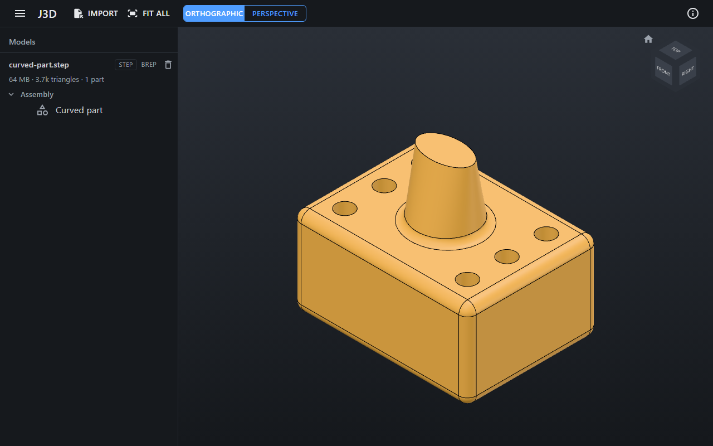

# J3D

A 3D CAD viewer that runs entirely in your browser. J3D opens STEP, IGES and BREP files with the
[Open CASCADE Technology](https://dev.opencascade.org/) (OCCT) kernel compiled to WebAssembly, and STL, OBJ and
glTF meshes with [three.js](https://threejs.org/). **Your CAD files never leave your machine:** reading, meshing and
drawing all happen in the browser tab.



## What it does

- **Import** several files at once with the **Import** button, or drop files or whole folders onto the view.
- Each file becomes a **model** in the list on the left, with its progress while importing (and a cancel button), then
  its size, triangle and part counts, any warnings, and its **assembly tree**.
- **Select** parts by clicking them in the view or in the tree (Ctrl+click adds or removes); the selected part is
  highlighted in blue, named in a panel at the bottom left, and shown in the tree. The part under the pointer is
  highlighted faintly before you click.
- **Hide, isolate and show** parts with the eye beside each model and tree node, or the toolbar buttons and keys
  below. **Undo and redo** cover hiding and showing, measurements, and deleting a model.
- **Measure** CAD models exactly from their BREP geometry: turn on **Measure** (or press `M`), click a face, edge or
  vertex to see its properties (area, length, radius, normal, axis…) and its part's volume and size, then click a
  second one for the distance between them, the angle between planes or lines, and the distance between circle
  centres. Each measurement is kept, drawn in the view and listed in the panel with copy buttons. On mesh models
  the tool measures between points, snapping to vertices, and marks the results approximate (≈).
- **Delete** a model from the list. J3D asks first, then frees all of its memory; **Undo** brings it back into its
  place, imported again from its kept copy, with its hidden parts and measurements.
- **Your models are kept** for your next visit: each imported file (with its buffers, materials and textures) is
  copied into the browser's private storage for this page, and when you come back the models are imported again in
  their order, with the parts you hid still hidden and the camera where you left it. **Clear all**, above the list,
  removes every model and everything kept. Only one tab keeps models: a second J3D tab says so and keeps nothing.
- **Export** what you see: the toolbar's **Export** saves every visible part, or only the selection when there is one,
  as **GLB** (with colours, the tree and the BREP edges) or **STL** (binary or ASCII, one uncoloured mesh). A CAD
  model's download icon in the list saves the whole model as imported, as **STEP** (with its assembly, names and
  colours) or **BREP**, showing its progress in the list with a **Cancel** button. Files are saved where your browser
  saves downloads, named after their model (or `scene` / `selection` for several).
- CAD models are drawn with **shaded faces in the file's colours** and the **true BREP edges** over them; translucent
  colours are drawn translucent.
- The view is **orthographic** by default, with a perspective toggle that keeps the framing.

### Formats

| Format | Extensions | What you get |
|---|---|---|
| STEP | `.step` `.stp` | Exact geometry through OCCT: colours (including transparency), names, the assembly tree, BREP edges |
| IGES | `.iges` `.igs` | As STEP |
| BREP | `.brep` | OCCT's own format: the shape, without colours |
| glTF | `.glb` `.gltf` | Embedded or multi-file `.gltf` (pick or drop its `.bin` and textures with it), Draco, meshopt and KTX2 compression |
| OBJ | `.obj` | With its `.mtl` and textures when you pick or drop them together |
| STL | `.stl` | Binary or ASCII |

Mesh formats are shown as **mesh** models: they have no BREP edges. glTF files are Y-up by definition and are turned
to J3D's Z-up; STL and OBJ are assumed to be Z-up already, as CAD exports are.

**Exported GLB and STL files are in millimetres and Z-up, as J3D shows them**, which suits taking them back into CAD
tools. glTF is meant to be in metres and Y-up, so other glTF viewers show J3D's GLB 1,000 times too big and lying on
its back; J3D marks its own GLB files and reads them back exactly as they were exported. A glTF model, which J3D
treats as metres, is exported 1,000 times larger, in millimetres.

## Controls

| Action | Mouse | Touch | Keys and buttons |
|---|---|---|---|
| Rotate (turntable, Z stays up) | Right-drag | One finger | Click a face, edge or corner of the **view cube** (top right) for one of 26 standard views |
| Pan | Left-drag or middle-drag | Two-finger drag | |
| Zoom | Wheel (towards the pointer) | Pinch | |
| Fit everything visible in view | | | **Fit all** in the toolbar, or `F` |
| Isometric view of everything | | | **Home**, beside the view cube |
| Select a part | Click it (a click that doesn't drag) | Tap it | Click a node in the tree selects every part under it |
| Add or remove a part | Ctrl+click | | Ctrl+click in the tree |
| Clear the selection | Click empty space | Tap empty space | `Esc` |
| Hide the selection | | | **Hide** in the toolbar, or `H`; or a node's eye in the tree |
| Show only the selection | | | **Isolate**, or `I` |
| Show everything | | | **Show all**, or `Shift+H` |
| Undo, redo (hiding, showing, measuring, deleting) | | | **Undo**, **Redo**, or `Ctrl+Z`, `Ctrl+Y` |
| Measure | Click a face, edge or vertex, then another | Tap | **Measure** in the toolbar, or `M`; `Esc` drops the first pick |
| Export the scene or the selection | | | **Export** in the toolbar: GLB, STL (binary) or STL (ASCII) |
| Export a CAD model as imported | | | The model's download icon in the list: STEP or BREP |

The view fits itself to the first model you import into an empty scene; later imports leave the camera where it is,
and so do models coming back from your last visit or an undo.

## Limits

- Each CAD model gets its **own WebAssembly heap of up to 4 GB**. Reading a STEP file can take about seven times the
  file's size, so the practical ceiling is roughly **550–600 MB of STEP**; a larger file fails with a clear "too large"
  error rather than crashing. On a laptop, a 200 MB STEP of 10,000 parts loads in about 30 seconds and orbits at 60
  frames a second on its integrated GPU.
- Translucent parts are blended without sorting, so overlapping and intersecting ones look right from every angle, but
  closely stacked layers blend a little more evenly than real glass would. A GPU without float render targets (rare)
  falls back to sorting, which can draw intersecting parts in the wrong order.
- Kept models come back by being imported again, so a large file takes as long to return (after a refresh, or when
  its delete is undone) as it took to import: about 30 seconds for a 200 MB STEP. Selections, measurements and the
  undo history aren't kept across a refresh.
- Kept files count against the browser's storage for the page. When it's full, a model stays open for the visit and
  its list item says it wasn't kept. Browsers may also clear the storage of sites you haven't used for a while unless
  they grant it persistent storage, which J3D asks for (Firefox shows a prompt; Chrome decides by itself).
- Measurements are in millimetres: STEP and IGES are converted on import, glTF (metres by its specification) is
  converted when measured, and STL and OBJ are taken to be in millimetres.
- Exports are written in the browser too, in the model's own 4 GB heap. Writing needs far less memory than reading, so
  every model that loads also exports: the 200 MB STEP saves as STEP in about 12 seconds and as BREP in 2, and one of
  600 MB, about the largest that loads, as STEP in about half a minute. **Cancel** stops an export at once, although
  the last few seconds of writing a STEP file carry on unseen, and the model's next export waits for them.
- Not in this version yet: sections, exploded views, and a phone or tablet layout.

## Browsers

J3D runs in current desktop **Chrome, Edge and Firefox**. It needs **WebGL 2** and a **cross-origin-isolated** page
(the host sends the `Cross-Origin-Opener-Policy` and `Cross-Origin-Embedder-Policy` headers for this).

| Browser | Tested |
|---|---|
| Chrome, Edge | Every change in CI (Playwright Chromium), and by hand on Windows |
| Firefox | Every change in CI (Playwright Firefox) |
| Safari | Not supported, and not tested |

Only the current version of each browser is tested.

## Privacy

Files go straight from the file picker or the drop into a Web Worker in your browser. J3D has no server-side
processing, uploads nothing, has no analytics, and loads nothing from other sites (its cross-origin isolation forbids
it). The copies it keeps for your next visit are in the browser's
[origin private file system](https://developer.mozilla.org/docs/Web/API/File_System_API/Origin_private_file_system),
on your machine, readable only by this page; **Clear all** deletes them, as does clearing the site's data in the
browser.

## Running it

J3D isn't hosted anywhere yet. To run it on your machine you need the .NET 10 SDK, Node.js 22+ and Git LFS:

```bash
git lfs install && git clone https://github.com/JRB-90/j3d.git && cd j3d
```

```bash
dotnet run --project src/J3D.Web --launch-profile https
```

Building, testing, rebuilding the OCCT WebAssembly and the CI are covered in [docs/development.md](docs/development.md).
The design, decisions and milestones are in [docs/plan.md](docs/plan.md).

## Licence

J3D is MIT-licensed ([LICENSE](LICENSE)). It makes use of the Open CASCADE Technology software (LGPL-2.1 with the Open
CASCADE exception) and other open-source components listed, with their licences, in
[THIRD-PARTY-NOTICES.md](THIRD-PARTY-NOTICES.md) and in the app's **About** dialog.
