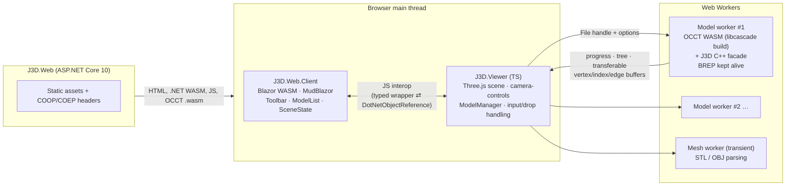

# J3D — Project Plan

> Web-based 3D CAD viewer built on BREP and the Open CASCADE Technology (OCCT) kernel, with a Blazor UI.
>
> **Branch:** `feature/iteration-1-cad-viewer` · **Status:** M0 (scaffold) complete; M1–M5 planned · **Last updated:** 2026-10-13

---

## 1. Iteration 1 goal

Let a user, entirely in the browser:

1. **Import** CAD models — STEP, IGES, BREP (exact geometry via OCCT) and STL, OBJ, glTF (meshes) — via a toolbar button or drag and drop, several files at once.
2. **Delete** an imported model.
3. **Rotate, pan and zoom** the view.

The theme is dark throughout. **CAD files never leave the user's machine**: all parsing, tessellation and rendering happen client-side.

### Acceptance criteria

- [ ] An **Import** button opens a multi-select file picker filtered to `.step .stp .iges .igs .brep .stl .obj .gltf .glb`. Dropping files onto the viewport does the same.
- [ ] Each file becomes its own model in the **model list**, showing its name, format, status, progress, and a cancel button while importing.
- [ ] BREP models render **shaded faces in the file's colours** (STEP/IGES via XCAF) with **true BREP edges** drawn over them.
- [ ] Each BREP model shows its **assembly tree** (names, nesting). The tree is read-only.
- [ ] **Delete** removes the whole model from the scene and the list, and frees its memory (worker terminated, GPU buffers disposed).
- [ ] Mouse: **left-drag pans, middle-drag pans, right-drag rotates, the wheel zooms** toward the view centre. The browser context menu is suppressed over the canvas.
- [ ] Touch: one finger rotates, two fingers pinch to zoom and drag to pan.
- [ ] Rotation is **turntable** (Z stays up, the view never rolls) about the scene centre.
- [ ] The view **auto-fits** after each import. **Fit all** is available as a button and the `F` key.
- [ ] The view is **orthographic by default**, with a perspective/orthographic toggle that keeps the framing.
- [ ] Imports scale up to what **wasm32 (4 GB per model worker)** allows. Exceeding it gives a clear "too large" error rather than a crash.
- [ ] Works in the latest two versions of desktop **Chrome/Edge, Firefox and Safari**.
- [ ] xUnit/bUnit, Vitest (including real OCCT under Node) and Playwright E2E (×3 browsers) all pass in GitHub Actions.

### Out of scope for iteration 1

Persistence (models are lost on refresh), users and auth, deployment, picking/selection, highlighting from the tree, part visibility, measurement, sectioning, exploded views, export, mobile/tablet layout, zoom-to-cursor, transparency, Draco/KTX2-compressed glTF, multi-file glTF (external `.bin`/textures).

---

## 2. Decision log

Decided with the project owner on 2026-10-13. Items marked *assumption* are my defaults and still need confirmation (§12).

| # | Topic | Decision | Notes |
|---|---|---|---|
| D1 | Language / runtime | **.NET 10 (LTS) / C# 14** | The request said "C# 10"; confirmed this meant the current .NET 10. |
| D2 | Where OCCT runs | **In the browser (WASM)** | No server compute. Most CAD code is C++ (facade) and TypeScript (worker/viewer). |
| D3 | OCCT build | **Replicad's approach**: a trimmed custom build with the `taucad/opencascade.js` toolchain (published as **libcascade 3.1, OCCT 8.0.1**) | Replicad 1.1 links via that toolchain's Docker image. The original `donalffons/opencascade.js` is unmaintained (last push Aug 2023, OCCT 7.6.2). |
| D4 | Build config format | **`@libcascade/toolchain` TypeScript config** (`defineBuild`) | Same approach as Replicad, but using the current typed format rather than legacy YAML+ytt. |
| D5 | Where WASM builds run | **GitHub Actions job builds it; output committed to `dist/` like Replicad** | Local Docker is only needed for local symbol-set changes. |
| D6 | WASM in git | **Git LFS for `*.wasm`** | |
| D7 | Blazor hosting | **Blazor Web App, Interactive WebAssembly** (global) | Switched from Interactive Server once OCCT moved to the browser: no SignalR circuit to drop. |
| D8 | Renderer | **Three.js** (r186) + **camera-controls** (3.x) | camera-controls gives orthographic support, button remapping, `fitToBox` and smooth transitions. |
| D9 | Browser language & build | **TypeScript (7.x) + Vite (8.x)**, npm workspaces | Vite output goes into the client's `wwwroot/viewer`, driven by MSBuild. |
| D10 | Formats | **STEP, IGES, BREP** (OCCT) + **STL, OBJ, glTF/GLB** (Three.js loaders) | Mesh models are labelled "mesh" and won't get BREP features later. |
| D11 | Scene | **Many models + model list** with per-model delete | |
| D12 | Persistence | **Session only** | |
| D13 | Display | Shaded faces, BREP edge overlay, STEP/IGES colours, assembly tree | Needs XCAF symbols in the build. |
| D14 | Tree interaction | **Display only**; delete is always whole-model | |
| D15 | UI library | **MudBlazor** (9.x), dark-only theme, system font stack | |
| D16 | Mouse | **Left = pan, middle = pan, right = rotate, wheel = zoom**; touch supported | Custom mapping: not a Three.js, SolidWorks or Fusion preset. |
| D17 | Rotation | **Turntable**, fixed up axis | |
| D18 | Up axis | **Z-up** | glTF (Y-up by spec) is rotated on import. |
| D19 | Camera extras | Auto-fit on import, Fit all (button + `F`), **ortho default** + toggle | No zoom-to-cursor. |
| D20 | Model size | **As large as wasm32 allows**: progress, cancellation, worker per model, threaded build available | See R3 and §12 Q1 on the threaded default. |
| D21 | Import UX | Button + drag and drop, multi-file | |
| D22 | Browsers | Evergreen Chromium + Firefox + Safari, desktop | |
| D23 | Testing | xUnit v3 + bUnit, Vitest, Playwright E2E | |
| D24 | CI | **Full GitHub Actions CI** (build + all tests on PRs) + the WASM build workflow | |
| D25 | Deployment | **Local dev only** for now | |
| D26 | Naming | **`J3D.*`**, root namespace `J3D` | |
| D27 | Deliverable this session | Plan + solution scaffold (M0) | |

---

## 3. Architecture



**Key properties**

- **Blazor owns the UI chrome and app state; TypeScript owns everything 3D.** Mesh data never crosses into .NET: the interop only carries small DTOs (ids, progress, tree, stats).
- **One Web Worker per BREP model.** Each gets its own 4 GB wasm32 heap, deleting or cancelling is just `worker.terminate()` (all memory freed instantly), and a crash or out-of-memory error in one model can't affect the others. The compiled `WebAssembly.Module` is compiled once and posted to each worker, so there's no recompilation.
- **The BREP stays alive in its worker after import.** Iteration 1 doesn't need it, but it's the foundation for picking, measurement and sectioning later.
- **Files go straight from `<input>`/drop to the worker** (`File` objects are cloneable). The main thread never holds file bytes.
- **Cross-origin isolated page** (COOP `same-origin`, COEP `require-corp`). This enables `SharedArrayBuffer` for the threaded OCCT variant and the progress channel. As a result, nothing may be loaded from third-party origins, so there are no CDNs or web fonts.

---

## 4. Repository layout

```
J3D.slnx                       .NET 10 solution (slnx format)
global.json                    SDK 10.0.301 (rollForward latestFeature), Microsoft.Testing.Platform runner
Directory.Build.props          net10.0, C# 14, nullable, warnings-as-errors, analyzers latest-recommended
Directory.Packages.props       Central Package Management
.editorconfig                  C# 14 style rules enforced at build
.gitattributes                 LFS for *.wasm
package.json                   npm workspaces root (src/J3D.Viewer, later src/J3D.Occt)
src/
  J3D.Web/                     ASP.NET Core host: COOP/COEP, MapStaticAssets, prerender shell
  J3D.Web.Client/              Blazor WASM: layout, theme, components, state, interop wrappers
  J3D.Viewer/                  TypeScript: Three.js viewer, model manager, worker host & protocol
  J3D.Occt/                    libcascade config, C++ facade, committed dist/ (M1)
tests/
  J3D.Web.Client.Tests/        xUnit v3 + bUnit
  J3D.Web.Tests/               xUnit v3 + WebApplicationFactory (host behaviour)
  J3D.E2E.Tests/               xUnit v3 + Playwright (.NET) + WebApplicationFactory.UseKestrel
  fixtures/                    CAD/mesh fixtures shared by Vitest and Playwright
docs/plan.md                   this document
.github/workflows/ci.yml       build + unit + E2E (×3 browsers)
.github/workflows/occt-wasm.yml  custom OCCT WASM build (M1)
```

Vitest specs sit next to the TypeScript sources (`src/J3D.Viewer/src/**/*.test.ts`, `src/J3D.Occt/**/*.test.ts`).

---

## 5. Technology stack

| Layer | Choice | Version (2026-10) |
|---|---|---|
| Runtime / language | .NET / C# | 10.0 (SDK 10.0.301) / 14 |
| UI | Blazor Web App, Interactive WebAssembly + MudBlazor | 10.0.x / 9.11 |
| CAD kernel | OCCT via libcascade toolchain (taucad fork of opencascade.js) | OCCT 8.0.1 / toolchain 3.1 |
| 3D | three + camera-controls | 0.186 / 3.1 |
| Browser code | TypeScript + Vite + Vitest | 7.0 / 8.3 / 5.0 |
| .NET tests | xUnit v3 (MTP v2), bUnit, Playwright for .NET | 4.0 / 2.11 / 1.63 |
| CI | GitHub Actions (ubuntu-latest; Docker for WASM builds) | |

Node ≥ 22 is required (libcascade toolchain, Vite 8).

---

## 6. Detailed design

### 6.1 OCCT WebAssembly build (`src/J3D.Occt`)

**Approach (following Replicad):** use the taucad `opencascade.js` toolchain to link a **trimmed** OCCT 8.0.1 WASM. It contains only the classes we use plus a **project-owned C++ facade**. Replicad's build lives in `packages/replicad-opencascadejs` and runs the `ghcr.io/taucad/opencascade.js` Docker image with a symbol list and C++ wrappers. We do the same with `@libcascade/toolchain`'s typed `libcascade.config.ts`.

```ts
// src/J3D.Occt/libcascade.config.ts (sketch)
export default defineBuild({
  name: 'j3d_occt',
  bindings: [ /* minimal: Standard_Failure, Message_ProgressRange, … — most work goes through the facade */ ],
  customBindings: [{ file: 'wrappers/j3d_facade.cpp', symbols: ['J3DDocument', 'J3DProgress'], scope: 'main' }],
  settings: {
    MODULARIZE: true, EXPORT_ES6: true, ENVIRONMENT: ['worker', 'node'],
    ALLOW_MEMORY_GROWTH: true, INITIAL_MEMORY: '64MB', MAXIMUM_MEMORY: '4GB',
    EXPORTED_RUNTIME_METHODS: ['FS', 'getExceptionMessage', 'incrementExceptionRefcount', 'decrementExceptionRefcount'],
  },
  compilerFlags: { optimize: 'O3', simd: true, exceptions: 'wasm', noEntry: true },
  variants: [{ name: 'single' }, { name: 'multi' /* pthreads; see toolchain multi-threading guide */ }],
});
```

**Why a C++ facade rather than calling the OCCT API from JS:** extracting triangulations face by face through embind costs millions of JS↔WASM calls on large models. The facade does import, meshing and extraction **inside C++**, writes contiguous buffers, and hands JS `typed_memory_view`s. JS copies those once into transferable `ArrayBuffer`s. Because the bound surface is small, the WASM is small too, and `libcascade check` keeps TS usage in line with the bindings.

**Facade API (C++, embind `scope: 'main'`, TS declarations hand-written):**

| Member | Purpose |
|---|---|
| `uintptr_t AllocateInput(size_t bytes)` / `ReleaseInput()` | JS streams the `File` into WASM memory in chunks; no extra JS-side copy |
| `ImportResult Import(Format, ImportOptions)` | STEP: `STEPCAFControl_Reader::ReadStream` → XCAF `TDocStd_Document`. IGES: `IGESCAFControl_Reader` (MEMFS file, since there's no stream API). BREP: `BRepTools::Read(istream)`. A custom zero-copy `std::streambuf` reads the input buffer directly. |
| `void Mesh(MeshParams)` | `BRepMesh_IncrementalMesh` once per **unique prototype shape** (XCAF referred shapes), not per instance |
| `val GetTree()` | Flat node array: `name`, `parent`, `prototype` index, 4×4 location, colour |
| `int PrototypeCount()` / `val GetFaces(i)` / `val GetEdges(i)` | Per-prototype positions/normals/indices (+ optional per-vertex colour) and edge line segments |
| `Bounds()`, `MemoryBytes()` | For fit-all and the model list's memory figure |
| `J3DProgress : Message_ProgressIndicator` | Phase and fraction reporting (§6.2) |

**Extraction rules**

- Normals come from the surface via `BRepLib_ToolTriangulatedShape::ComputeNormals`. Winding and normals are flipped for `TopAbs_REVERSED` faces.
- Edges are unique per prototype (`TopExp::MapShapes(..., TopAbs_EDGE)`), taken from `BRep_Tool::PolygonOnTriangulation` so they line up exactly with the shaded mesh. **Seam and degenerate edges are skipped**, and free edges are discretised with `GCPnts_TangentialDeflection`.
- Colour precedence: face → part (prototype) → instance → parent assembly → default `#B4B9C0`. Colours are passed in **linear RGB** (`Quantity_TOC_RGB`) because Three.js works in linear space and sRGB values would look washed out.
- Default tessellation uses a linear deflection of 0.1 % of the **model's** bounding-box diagonal (absolute, shared by all parts) and an angular deflection of 0.35 rad. Both are constants in one place, tuned in M5, with no UI in iteration 1.
- Memory views into WASM memory become invalid when memory grows, so JS must `.slice()` them **before** making any further facade call.

**Build pipeline**

- `.github/workflows/occt-wasm.yml` runs on `workflow_dispatch`, and on pushes touching `src/J3D.Occt/**` (excluding `dist/`). It uses ubuntu-latest with Docker. Steps: `npx libcascade build` → `npx libcascade assemble` → run the Vitest OCCT integration tests against the new build → commit `dist/` (LFS) back to the branch. It then invokes `ci.yml` via `workflow_call`, because pushes made with `GITHUB_TOKEN` don't trigger workflows.
- **Staleness guard in `ci.yml`:** compare the SHA-256 of the config and C++ sources against the hashes recorded in `dist/*.provenance.json`, and fail with "OCCT WASM is stale, run the OCCT WASM workflow" if they differ. Also run `npx libcascade check src` (symbol drift guard).
- The toolchain image is pinned by digest, and its provenance and build manifest are committed alongside the binaries.
- Fork PRs can't commit back. That's acceptable for a single-maintainer repo.

### 6.2 Import pipeline (worker per model)

```
user picks/drops files
  → viewer: detectFormat() (formats.ts), reject unsupported → OnImportRejected
  → ModelManager.enqueue(file): id = crypto.randomUUID(), status Queued → OnModelQueued
  → at most N concurrent imports (default 2); others wait in the queue
  → spawn model worker (BREP) or mesh worker (STL/OBJ) / main-thread GLTFLoader (glTF)
```

**Model worker lifecycle (BREP)**

1. `init`: receives the shared compiled `WebAssembly.Module` and the variant (`single` unless `crossOriginIsolated` and threading is enabled). Instantiates via Emscripten's `instantiateWasm` hook.
2. `import { file, format, options }`: `file.stream()` → chunks copied into `AllocateInput` memory (phase **Reading**, fraction = bytes/size) → `Import` (**Parsing**, indeterminate: OCCT's STEP parse has no progress hook; then **Transferring**, determinate) → `ReleaseInput` → `Mesh` (**Meshing**, determinate) → extract (**Extracting**, per prototype).
3. Posts `loaded { tree, prototypes: [{ positions, normals, indices, colors?, edges }], instances, bounds, stats, memoryBytes }` with **all typed-array buffers transferred** (zero-copy).
4. Stays alive, holding the XCAF document, until the model is deleted.

**Progress channel** (spike S3)

- `J3DProgress::Show()` is throttled to about 10 Hz.
- Single-threaded variant: `Show()` runs on the worker thread and calls `postMessage` through `EM_ASM`. The page's event loop is free, so messages arrive while the worker is busy.
- Threaded variant: `Show()` may run on a pthread, so it writes phase and fraction into a static slot in **shared** WASM memory instead. The worker posts that `SharedArrayBuffer` and its offset to the page once, and the viewer polls it every animation frame.
- Both paths sit behind a TS `ProgressChannel` interface. The viewer throttles .NET callbacks to 10 Hz or less.

**Cancellation and deletion:** `worker.terminate()` in both cases. It's instant and frees the entire WASM heap. A cancelled model's list entry is removed.

**Errors** (shown as error codes plus a message in the model list and a snackbar):

| Code | Cause |
|---|---|
| `Unsupported` | Unknown extension, or a feature we don't support (e.g. Draco glTF) |
| `ParseFailed` | The OCCT reader returned failure, or there was a C++ exception (`getExceptionMessage`) |
| `Empty` | The file parsed but contained no shapes or triangles |
| `OutOfMemory` | WASM `abort` / `RangeError` / memory growth failure: "Model too large for the browser's 4 GB WebAssembly limit" |
| `Internal` | Anything else (logged to the console with a stack trace) |

**Mesh formats** (no OCCT):

- **STL and OBJ** are parsed by `STLLoader.parse` / `OBJLoader.parse` in a transient mesh worker, with buffers transferred back. OBJ is geometry-only (no `.mtl`) and honours vertex colours.
- **glTF/GLB** uses `GLTFLoader.parse` on the main thread, since it needs the DOM for textures. It supports GLB, self-contained `.gltf` and meshopt. Draco and KTX2 return `Unsupported` in iteration 1.
- **Orientation:** glTF is Y-up by spec and is rotated +90° about X. STL and OBJ are assumed to be Z-up, which is the CAD export convention.
- Mesh models have a flat tree (glTF keeps its node hierarchy) and **no edge overlay**.

### 6.3 Viewer (`src/J3D.Viewer`)

| Concern | Design |
|---|---|
| Renderer | `WebGLRenderer({ antialias: true, alpha: true })` with a transparent clear over the viewport's CSS gradient (`#2A2F37 → #15181C`). Pixel ratio capped at 2. `ResizeObserver` on the host. |
| Up axis | `Object3D.DEFAULT_UP = (0,0,1)` before creating any camera. `camera.up = (0,0,1)` before constructing camera-controls. |
| Cameras | One `OrthographicCamera` (default) and one `PerspectiveCamera` (fov 35°). camera-controls' `.camera` is swapped on toggle. Toggling keeps framing by matching the visible height at the target: `h = 2·d·tan(fov/2)` ⇄ ortho frustum/zoom. The maths is unit-tested. |
| Controls | camera-controls with `mouseButtons = { left: TRUCK, middle: TRUCK, right: ROTATE, wheel: ZOOM (ortho) / DOLLY (persp) }`, `touches = { one: TOUCH_ROTATE, two: TOUCH_ZOOM_TRUCK (ortho) / TOUCH_DOLLY_TRUCK (persp) }` and `dollyToCursor = false`. Polar angle is unclamped apart from the small epsilon camera-controls needs at the poles. `contextmenu` is prevented on the canvas. |
| Fit all | Computes the union of model bounding boxes, then `controls.fitToBox(box, true, padding)` (smooth). Near and far planes are recomputed from the bounding sphere on every fit and model change. Runs automatically when each import completes, and via the toolbar button or the `F` key (ignored while focus is in an input). |
| Lighting & materials | `RoomEnvironment` PMREM for image-based light, plus a directional "headlight" that follows the camera. `MeshStandardMaterial` (metalness 0.05, roughness 0.55) with `polygonOffset` so edges draw cleanly on top. Materials are cached and reference-counted per colour. Single-colour parts use material colour; multi-colour parts use `Uint8` normalised vertex colours. |
| Edges | `LineSegments` with a near-black `LineBasicMaterial` (1 px; WebGL ignores line width). |
| Instancing | Each prototype's `BufferGeometry` is shared by its instances, and prototypes with many instances (≥ 16) use `InstancedMesh`. If draw calls exceed about 5,000, M5 evaluates `BatchedMesh`. |
| Render loop | On demand only: render when camera-controls reports an update or transition, when the scene changes, or on resize. Idle cost is zero. Large geometry uploads are spread across frames to avoid jank. |
| Orientation aid | A small, non-interactive axis triad in the bottom-left corner (*assumption*, §12 Q4). |
| Drag and drop | `dragenter/over/leave/drop` on the host toggles a `j3d-viewport--drop` overlay class and passes `DataTransfer.files` to the import queue. |
| Disposal | Delete removes the Object3D, disposes geometries and releases material references, then re-renders. **The camera doesn't move on delete.** |
| Test hook | `window.__j3dTest` (camera state, model count, frame counter) is exposed only in Development, for Playwright. |

### 6.4 Blazor client (`src/J3D.Web.Client`)

**Render mode:** global `InteractiveWebAssembly` on `<Routes>`. Prerendering stays on so the dark shell paints immediately. The viewer starts in `OnAfterRenderAsync(firstRender)`, so it only ever starts on the interactive (WASM) render.

**Components**

| Component | Responsibility |
|---|---|
| `MainLayout` | `MudThemeProvider` (dark-only `J3DTheme`), app bar, persistent model drawer, main content |
| `Toolbar` | **Import** (a `MudButton HtmlTag="label"` for a hidden `<input type=file multiple>`; a native label click needs no JS user-activation trickery), **Fit all**, **Projection** toggle |
| `ModelList` / `ModelListItem` | Name, format chip, kind (BREP/mesh), status, `MudProgressLinear` (determinate or indeterminate by phase), memory, **Cancel** (while importing) / **Delete** (when ready or failed), lazy `MudTreeView` for the assembly |
| `Viewport` | Owns the viewer module's lifetime; receives callbacks through `DotNetObjectReference` |

**State:** `SceneState` (singleton; per-tab in WASM) holds `ImmutableDictionary<ModelId, ModelEntry>` and raises `Changed`. Components subscribe in `OnInitialized` and unsubscribe in `Dispose`. All transitions (Queued → Importing(phase, fraction) → Ready | Failed → removed) are pure methods, unit-tested without a renderer.

**Large trees:** the assembly arrives as a flat array (`index, parent, name, childCount, prototype`). `MudTreeView` loads children on expand, so even 50k-node assemblies render instantly.

**Interop contract** (the only boundary between C# and TS; a typed `ViewerInterop : IAsyncDisposable` wraps the JS side):

| Direction | Member | Payload |
|---|---|---|
| .NET → JS | `createViewer(host, dotnetRef)` | returns the viewer handle |
| .NET → JS | `attachFileInput(input)` | the viewer sets `accept` from `formats.ts` (single source of truth) and listens for `change` |
| .NET → JS | `removeModel(id)` | cancels if still importing |
| .NET → JS | `fitAll()` / `setProjection("orthographic" \| "perspective")` / `dispose()` | |
| JS → .NET | `OnViewerReady(ViewerCapabilities)` | `webGl2`, `crossOriginIsolated` |
| JS → .NET | `OnModelQueued(ModelSummary)` | id, fileName, format, sizeBytes |
| JS → .NET | `OnModelProgress(id, ImportPhase, fraction?)` | ≤ 10 Hz |
| JS → .NET | `OnModelLoaded(id, ModelLoadedInfo)` | tree, stats (prototypes, instances, triangles, edges), bounds, memoryBytes |
| JS → .NET | `OnModelFailed(id, ImportError)` / `OnModelRemoved(id)` / `OnImportRejected(fileName, reason)` | |

**C# 14 / .NET 10 conventions** (some enforced by `.editorconfig` + analyzers at build):

- File-scoped namespaces, nullable enabled, warnings as errors, `AnalysisLevel=latest-recommended`, CPM.
- **Primary constructors** for DI, including Razor components (constructor injection, .NET 9+). Example: `Viewport(IJSRuntime js)`.
- **Extension members** (C# 14 `extension(T)` blocks) for behaviour on enums and framework types. Examples: `ModelFormat.Kind`, `IApplicationBuilder.UseCrossOriginIsolation()`.
- The **`field` keyword** for validated auto-properties, **collection expressions**, records / `readonly record struct` for DTOs and ids, switch expressions and patterns, `required` members.
- Enums cross interop as strings via `JsonStringEnumConverter<T>` + `JsonStringEnumMemberName` (trim-safe generic converter).
- Every JS object reference is `IAsyncDisposable`, and `DotNetObjectReference`s are always disposed.
- No component calls `IJSRuntime` directly except through `ViewerInterop` (`Viewport` creates it).

### 6.5 Host (`src/J3D.Web`)

- `UseCrossOriginIsolation()` sets `Cross-Origin-Opener-Policy: same-origin` and `Cross-Origin-Embedder-Policy: require-corp` on every response. Safari lacks `credentialless`, so it's `require-corp`.
- `MapStaticAssets()` handles fingerprinting, immutable caching, and brotli/gzip pre-compression at publish (`.wasm` compresses roughly 3–4×). `.wasm` is served as `application/wasm` so `compileStreaming` works.
- No server APIs in iteration 1.

### 6.6 Dark theme

- MudBlazor `PaletteDark` only, with no light mode and no toggle. Background `#121417`, surfaces `#1B1E23`, accent `#4F9DFF`, text `#E6E8EB` / `#9AA1AB`, dividers `#2A2F36`.
- **System font stack**, because Google Fonts would be blocked by COEP and adds a network dependency.
- Viewport gradient `#2A2F37 → #15181C`, near-black edges, and neutral grey `#B4B9C0` for uncoloured parts.
- `color-scheme: dark` so native controls (scrollbars, file dialogs where styled) match.

---

## 7. Licensing

OCCT and libcascade are **LGPL-2.1 with the Open CASCADE exception**. Three.js, camera-controls and MudBlazor are MIT. The OCCT WASM ships as a separate, replaceable file loaded at runtime (dynamic-linking style), and its full build recipe (config, facade source, toolchain digest, provenance) is in this repo. M5 adds `THIRD-PARTY-NOTICES.md` and an **About / licences** dialog. *This isn't legal advice. Get a review before any public deployment.*

---

## 8. Testing strategy

| Layer | Tooling | What it covers |
|---|---|---|
| TS unit | **Vitest** (Node) | Format detection, worker message protocol, camera ortho⇄persp maths, fit/near-far maths, colour conversion, tree flattening, queue and concurrency |
| OCCT integration | **Vitest** + the real `dist/` WASM under Node 22+ | Import each fixture → prototype, instance and triangle counts, names, colours, bounds, error codes, memory release |
| C# unit / component | **xUnit v3 + bUnit 2** | `SceneState` transitions, `ModelFormat` behaviour, `ModelList` / `Toolbar` / `Viewport` rendering and interop calls (bUnit JS interop in strict mode) |
| Host | **xUnit v3 + WebApplicationFactory** | COOP/COEP on pages and assets, `.wasm` MIME type and compression |
| E2E | **Playwright for .NET** + `WebApplicationFactory.UseKestrel()` (.NET 10), Chromium/Firefox/WebKit | Import via picker and via drag and drop (synthetic `DataTransfer`), list status, non-background canvas pixels, delete, cancel, `F` key, projection toggle, mouse pan/rotate/zoom changing camera state (test hook), `crossOriginIsolated`, no console errors. Runs against the **Release** build to catch trimming issues in interop DTOs. |

Notes:

- Playwright for .NET has no `toHaveScreenshot` (visual comparison is Node-only), so canvas checks use **pixel sampling** (`page.screenshot` + decode) instead of baseline images.
- Large-model tests (100 MB+ generated STEP) run on demand or nightly, not on every PR.

---

## 9. CI/CD

- **`ci.yml`** (in M0): on PRs and pushes to `main`. Steps: `npm ci` → typecheck → Vitest → `dotnet build -c Release` → client and host tests. Then an E2E matrix `[chromium, firefox, webkit]` with `playwright.ps1 install --with-deps`. Checkout uses `lfs: true`. M1 adds the OCCT staleness guard, `libcascade check`, and an LFS object cache to save bandwidth quota.
- **`occt-wasm.yml`** (M1): see §6.1.
- No deployment pipeline (D25).

---

## 10. Work breakdown

### M0 — Scaffold ✅ (this branch)

Solution and props, CPM, `.editorconfig`, LFS attributes, Blazor Web App (Interactive WASM) with the MudBlazor dark shell, COOP/COEP middleware, Vite/TS viewer workspace built by MSBuild into `wwwroot/viewer`, `Viewport` ⇄ module interop wiring with a capability report, `ModelFormat` (C#) and `formats.ts` (TS), test projects (xUnit v3 / bUnit / WAF / Playwright), and CI.
**Verified locally:** build has 0 warnings; 21 .NET tests and 17 Vitest tests pass; the app runs cross-origin isolated with the viewer module loaded. E2E is compiled but not run locally (Playwright browsers not installed).

### M1 — OCCT WASM build

- Spikes **S1** (toolchain, XCAF, facade, size, Safari WASM exceptions) and **S5** (Vite worker + WASM asset under Blazor static assets).
- `src/J3D.Occt` workspace: `libcascade.config.ts`, `j3d_facade.cpp` + `.d.ts`, `single` + `multi` variants.
- `occt-wasm.yml`, first committed `dist/` (LFS), staleness guard.
- Fixtures ([tests/fixtures](../tests/fixtures/README.md)) and Vitest OCCT integration tests in Node.
- **Exit:** CI builds the WASM, and Node tests import every BREP fixture with the expected tree, colours and triangle counts.

### M2 — Import pipeline

- Spikes **S2** (memory ceiling per browser) and **S3** (progress channel in both variants).
- `ModelManager`, import queue (concurrency 2), model worker host, shared module compilation, typed protocol, chunked file streaming, extraction to transferables, progress, cancel, error mapping including OOM detection.
- Mesh worker (STL/OBJ), main-thread glTF path, Y-up conversion.
- **Exit:** every fixture imports in all three browsers, with progress and a working cancel. A generated 200 MB STEP either loads or fails cleanly with `OutOfMemory`.

### M3 — Viewer

- Renderer, Z-up, both cameras with a framing-preserving toggle, camera-controls mapping (D16/D17), fit-all (auto, button, `F`), lighting and materials, colour handling, BREP edges, instancing, axis triad, on-demand rendering, resize, drag-and-drop overlay, disposal, test hook.
- **Exit:** manual checklist of acceptance criteria 3 and 6–10 passes. Vitest covers the camera maths.

### M4 — Blazor UI

- `SceneState`, `ViewerInterop`, `Toolbar`, `ModelList`/`ModelListItem` with lazy tree, snackbar errors, unsupported-browser notices (no WebGL2; not cross-origin isolated → single-threaded notice in the console only).
- **Exit:** bUnit coverage of all components and state transitions. The full user flow works by hand.

### M5 — Hardening

- Spike **S4** (threaded vs single benchmark) → decide the default variant (§12 Q1).
- Large-model runs and tuning (tessellation constants, chunked uploads, `BatchedMesh` if needed, dropping CPU copies of GPU-resident buffers if memory-bound).
- Full Playwright suite ×3 browsers in CI, Safari-specific fixes, `THIRD-PARTY-NOTICES.md` and About dialog, README/dev docs.
- **Exit:** every acceptance criterion in §1 is ticked.

---

## 11. Risks and spikes

| # | Risk | Mitigation |
|---|---|---|
| R1 | The libcascade toolchain is young (v3.x) | Replicad depends on it too. Pin the image digest. Keep the facade small and toolchain-agnostic so a plain Emscripten OCCT build is a fallback. |
| R2 | The 4 GB wasm32 ceiling. OCCT's STEP parse can peak at many times the file size, so the practical limit may be roughly 200–400 MB of STEP. | Stream input into WASM, free it before meshing, one heap per model, explicit `OutOfMemory` error. S2 measures the real limit per browser. |
| R3 | The **threaded build barely helps our workload**: libcascade reports 1.33× for STEP import + mesh and **1.06× for meshing alone**. Each worker's pthread pool also costs `PTHREAD_POOL_SIZE × 8 MB` of stack, multiplied by one worker per model. | Ship both variants (as Replicad does) and keep COOP/COEP, but **recommend single-threaded as the default** unless S4 shows ≥ 1.3× on our fixtures (§12 Q1). |
| R4 | Safari quirks (WASM exception handling flavour, SAB, WebGL) | S1 checks the `exceptions: 'wasm'` output on Safari early. WebKit is in the E2E matrix from M0. |
| R5 | Blazor WASM trimming breaks interop DTO deserialisation in Release | E2E runs Release. DTOs are simple records with string enums. |
| R6 | Main-thread jank when uploading huge geometry | Spread uploads across frames, render on demand, instancing. |
| R7 | IGES has no stream reader, so it needs a MEMFS copy (2× input memory) | Acceptable, since IGES files are typically smaller. Documented. |
| R8 | Git LFS quota and bandwidth | Cache LFS objects in CI; WASM changes are infrequent. |
| R9 | Changing the symbol set locally needs Docker (not installed; WSL2 is) | Rely on the CI workflow. Docker Desktop with the WSL2 backend is optional. |

---

## 12. Open questions

1. **Threaded default.** Given R3, I recommend **single-threaded by default**, with the threaded variant kept available and decided by benchmark S4. OK?
2. **Delete without confirmation** (*assumption*). Models are session-only and easy to re-import, so delete is immediate, with a snackbar. Do you want a confirm dialog?
3. **Auto-fit on every import completion** (*assumption*), even if you've moved the camera in the meantime. Alternative: auto-fit only if the camera hasn't moved since the import started.
4. **Axis triad** (*assumption*). Included as a small orientation aid for turntable Z-up navigation. Keep it?
5. **glTF scope** (*assumption*). GLB, self-contained `.gltf` and meshopt only. Draco/KTX2 and multi-file `.gltf` are deferred.
6. **Transparency** (*assumption*). STEP colour alpha is ignored (opaque) in iteration 1.
7. **Repository visibility.** Is `JRB-90/j3d` public? This affects how LGPL source availability is satisfied and the Actions/LFS quotas.
8. **Pushing.** M1's WASM build runs in GitHub Actions, so this branch has to be pushed. May I push it and open a draft PR when M1 starts?
