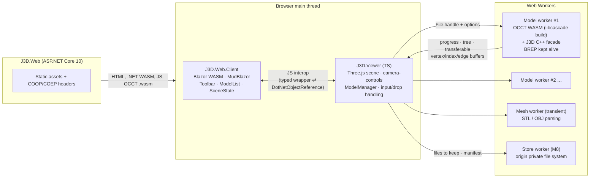

# J3D — Project Plan

> Web-based 3D CAD viewer built on BREP and the Open CASCADE Technology (OCCT) kernel, with a Blazor UI.
>
> **Branches:** one per milestone, squash-merged · **Status:** iteration 1 complete: M0 (scaffold), M1 (OCCT WASM build), M2 (import pipeline), M3 (viewer), M4 (Blazor UI) and M5 (hardening) merged. Iteration 2 complete (§1, D73–D92): **M6 (selection and visibility) merged** (D93–D100), **M7 (measurement) merged** (D101–D108), **M8 (persistence) merged** (D109–D117), **M9 (export) merged** (D118–D128), **M10 (hardening) merged** (D129–D136). **M11 (loose ends) merged** (D137–D141). **Iteration 3 in progress** (§1, D142–D159): **M12 (selection modes, context menu and measurement) merged** (D160–D164); **M13 (origin frames and moving) merged** (D165–D171), then a **clarity pass merged** (D172–D179); **M14 (assembly editing) built, in review** (D180–D187); M15 and M16 planned · **Last updated:** 2026-10-25

---

## 1. Goals

### Iteration 1 (complete)

Let a user, entirely in the browser:

1. **Import** CAD models — STEP, IGES, BREP (exact geometry via OCCT) and STL, OBJ, glTF (meshes) — via a toolbar button or drag and drop, several files at once.
2. **Delete** an imported model.
3. **Rotate, pan and zoom** the view.

The theme is dark throughout. **CAD files never leave the user's machine**: all parsing, tessellation and rendering happen client-side.

#### Acceptance criteria

- [x] An **Import** button opens a multi-select file picker filtered to `.step .stp .iges .igs .brep .stl .obj .gltf .glb`. Dropping files onto the viewport does the same.
- [x] Each file becomes its own model in the **model list**, showing its name, format, status, progress, and a cancel button while importing.
- [x] BREP models render **shaded faces in the file's colours** (STEP/IGES via XCAF) with **true BREP edges** drawn over them.
- [x] Each BREP model shows its **assembly tree** (names, nesting). The tree is read-only.
- [x] glTF loads as GLB, embedded `.gltf`, multi-file `.gltf` (with its `.bin`/textures selected or dropped together), meshopt, Draco and KTX2. OBJ loads with its `.mtl` and textures when they're supplied alongside it.
- [x] Semi-transparent colours (STEP/IGES alpha, glTF/MTL opacity) render translucent.
- [x] **Delete** asks for confirmation ("Delete *name*?"), then removes the whole model from the scene and the list, and frees its memory (worker terminated, GPU buffers disposed).
- [x] Mouse: **left-drag pans, middle-drag pans, right-drag rotates, the wheel zooms** toward the view centre. The browser context menu is suppressed over the canvas.
- [x] Touch: one finger rotates, two fingers pinch to zoom and drag to pan. Verified with synthetic touch pointer events, plus a real touch device when one is available (D64).
- [x] Rotation is **turntable** (Z stays up, the view never rolls) about the scene centre.
- [x] The view **auto-fits when the scene goes from empty to its first model**. Later imports don't move the camera. **Fit all** is available as a button and the `F` key.
- [x] A clickable **view cube** (top-right) snaps to 26 standard views (6 faces, 12 edges, 8 corners) with an animated transition, keeping the current zoom. A **Home** button goes to isometric and fits all.
- [x] The view is **orthographic by default**, with a perspective/orthographic toggle that keeps the framing.
- [x] Imports scale up to what **wasm32 (4 GB per model worker)** allows. Exceeding it gives a clear "too large" error rather than a crash.
- [x] Works in current desktop **Chrome/Edge and Firefox**: verified by CI's Playwright Chromium and Firefox, and by hand in Chrome and Edge on Windows. Earlier browser versions are a known gap (D64). Safari was dropped in M11 (D137); until then CI also ran Playwright's WebKit as its stand-in (D42, D138).
- [x] xUnit/bUnit, Vitest (including real OCCT under Node) and Playwright E2E (×3 browsers until M11, then Chromium and Firefox, D138) all pass in GitHub Actions.

Reviewed in M5 (D64). Each criterion is covered by the E2E suite (in Chromium, Firefox and WebKit in CI, since M5 against the published app), the manual checklists of M3 and M4, and the owner's own testing in Chrome and Edge before M5 merged; touch only through synthetic pointer events, as no touch device was available. The last two were ticked once [JRB-90/j3d#6](https://github.com/JRB-90/j3d/pull/6)'s CI had passed in all three browsers and the owner had tested by hand.

#### Out of scope for iteration 1

Persistence (models are lost on refresh), users and auth, deployment, picking/selection, highlighting from the tree, part visibility, measurement, sectioning, exploded views, export, mobile/tablet layout, zoom-to-cursor, undo.

### Iteration 2 (complete)

Let a user **inspect** what they've imported, still entirely in the browser:

1. **Select** parts in the viewport or the tree, and **hide, show and isolate** them (D77, D78).
2. **Measure** the exact BREP geometry: faces, edges, vertices and parts, alone or in pairs; approximately on mesh models (D80, D81).
3. **Keep** the session across a refresh: files in the browser's private storage, with visibility and the camera (D82).
4. **Export** what's visible as GLB or STL, and a BREP model as STEP or BREP (D83, D86).
5. **Undo** visibility changes, measurements and deleting a model (D84).

Also: zoom toward the cursor (D74). Deployment stays local-only (D75). **CAD files still never leave the user's machine**: OPFS is the browser's own storage on that machine.

#### Acceptance criteria

**M6: selection and visibility**

- [x] Clicking a part in the viewport selects that placed part (a tree leaf) and highlights it in the accent colour (tint and edges). Ctrl+click adds or removes a part; Esc or a click on empty space clears the selection; a click that drags doesn't select (D77).
- [x] The part under the pointer is faintly highlighted before it's clicked (D89).
- [x] Selecting a tree node selects every part under it, and a part selected in 3D expands and scrolls the tree to it (through paged levels, D60): the viewport and the tree always agree. This works for BREP assemblies and for mesh models' hierarchies (D81).
- [x] Every model and tree node has an eye toggle, and hiding an assembly hides its subtree. Hide, Isolate and Show all act on the selection, from the toolbar and the keys H, I and Shift+H. Hidden parts can't be picked, and Fit all frames only what's visible (D78).
- [x] A floating panel at the viewport's bottom-left shows the selected part's name and path, and is hidden when nothing is selected (D87).
- [x] The wheel and pinch zoom toward the pointer, in both projections (D74, amends D19). The wheel is tested (E2E, orthographic); pinch uses the same camera-controls setting and wasn't tested separately.
- [x] Ctrl+Z and Ctrl+Y, and Undo and Redo buttons, undo and redo visibility changes (D84; measurements join in M7, delete in M8).
- [x] Iteration 1's leftovers are done: M5's manual checklist in the built-in browser with screenshots, the orbit frame rate with real animation frames, and a CI dispatch with `large_fixtures=200,curved-100` (D88).

**M7: measurement**

- [x] A **Measure** tool (toolbar button and the key M) pre-highlights the face, edge or vertex under the pointer on a BREP model and picks it on click; with the tool off, clicks select parts (D79). A highlighted edge is drawn 1 px wide (WebGL ignores line width), so it's harder to see than a face or a vertex dot.
- [x] One picked entity shows its properties: an edge's length; a circle's radius, diameter and centre; a face's area; a plane's normal; a cylinder's radius and axis; a part's volume and bounding box. Two picked entities show the minimum distance with its closest points, the angle between planes or lines, and the distance between circle centres (D80).
- [x] Results are in millimetres, drawn as dimensions in 3D and listed in the floating panel with copy buttons (D80, D87). Adding and clearing measurements can be undone (D84).
- [x] On a mesh model the Measure tool gives approximate point-to-point distances (snapping to vertices) and bounding boxes, marked as approximate (D81).

**M8: persistence**

- [x] Imported files, with their sidecars, are kept in the browser's private storage (OPFS) automatically. After a refresh the models are imported again in their list order, and their visibility and the camera are restored. **Clear all** removes everything stored (D82).
- [x] Deleting a model can be undone: it's imported again from its kept file into the same place in the list. Delete still asks first (D29) and still frees the model's memory at once (D84). Playwright's WebKit has no private file system, so the reload tests run in Chromium and Firefox only (D116). Safari, which was to be checked by hand in M10, was dropped in M11 (D137).

**M9: export**

- [x] An **Export** menu in the toolbar saves the visible scene, or the selection when there is one, as GLB (colours and hierarchy) or STL (one merged mesh) (D83, D86).
- [x] A BREP model's item saves the whole model as imported, as STEP (assembly, names, colours) or BREP (D83, D86).

**M10: hardening**

- [x] Overlapping and intersecting translucent parts draw without sorting artefacts: weighted blended order-independent transparency (D90, R10).
- [x] Hover and click picking stay below D63's ~200 ms line on the 10,437-part file (D89).
- [x] CI runs on `ubuntu-26.04`, all three browsers included (D88).
- [x] Every criterion above is covered by tests that pass in CI (unit, bUnit, Vitest with real OCCT, Playwright ×3), as in iteration 1, and by the owner's manual pass in Chrome and Edge (D64).

#### Out of scope for iteration 2

Users and auth, deployment (D75), sectioning, exploded views, mobile/tablet layout, exact (BREP) measurement of mesh models, exporting part of a BREP model as STEP or BREP, undoing selection or camera moves, persisting selection or measurements, editing geometry.

### Iteration 3 (planned)

Let a user **arrange** what they've imported, still entirely in the browser:

1. **Select** at three levels: whole models, placed parts, and BREP faces, edges and vertices (D146).
2. **Measure** from one reference: the first pick's own value drawn on it, then the reference against each later click, one result at a time (D147).
3. **Move** objects by numbers (X, Y, Z, Rx, Ry, Rz in their local, parent or world frame) and with a triad in the scene, and show their origin frames (D148–D150).
4. **Restructure** assemblies: move objects around the hierarchy; copy, paste, delete, group and rename them from a context menu or the keyboard; and expand compound parts into one part per solid (D151, D152, D154).
5. **Export** the edited assembly, or just the selection, as STEP or BREP (D145, D155).

Edits change placements and structure, never shapes (D144). Each one can be undone, is kept across a refresh and is written into exports (D145). Planned from the owner's list after testing iteration 2 by hand (D142). **CAD files still never leave the user's machine.**

#### Acceptance criteria

**M12: selection modes, context menu and measurement**

- [x] A toolbar switch sets what a click selects: **Model** (the whole model), **Object** (a placed part, as in M6, with sub-assemblies from the tree) or **Feature** (a BREP face, edge or vertex, picked as Measure picks them, D107). Ctrl+click adds or removes in every mode; models and objects stay in step between the viewport and the tree; the panel lists a selected feature's values (D146). Mesh models have Model and Object (D153).
- [x] In the Measure tool the first click, or a feature already selected when the tool turns on, is the **reference**: its own value is drawn on it in 3D (an edge's length, a circle's diameter, a face's area) and listed in the panel. Each later click shows the reference against what it picked, replacing the previous result. Esc clears the measurement and turns the tool off (D147).
- [x] A right click that doesn't drag opens a **context menu** on a part in the viewport or a node in the tree, holding the commands that exist (Hide, Isolate, Show all, Fit all, Measure, Export); a right drag still rotates (D152).
- [x] A generator writes a licence-free **hierarchical assembly**, small and committed for the tests and large on demand, and a script fetches the real assembly chosen at M12's start (D156).

**M13: origin frames and moving**

- [x] An **Origin frames** toggle draws the X, Y and Z axes (red, green, blue, a constant size on screen) at the origin of each selected part, sub-assembly or model (D150).
- [x] A **Move** tool shows a triad at the selected object's origin: its arrows and planes translate the object and its rings rotate it, with a key switching between the two (D149).
- [x] **Fields** for X, Y, Z (mm) and Rx, Ry, Rz (degrees, fixed angles) in a Local, Parent or World frame: Parent and World show and set the object's pose in that frame, and Local moves or rotates it by the values about its own axes. The fields follow the triad while it's dragged (D148).
- [x] Parts, sub-assemblies and whole models move, in BREP and mesh models alike (D153). Picking, measuring, Fit all and the GLB and STL exports all see the new placements. Each move can be undone, and moves are kept across a refresh (D145).

**M14: assembly editing**

- [x] Dragging tree nodes onto an assembly node or the model's name, or **Cut** then **Paste** onto an assembly, moves them there within their model without moving them in 3D; Ctrl+drag copies instead (D151, D182, D183).
- [x] **New assembly** (Ctrl+G) groups the selection under a new node at its parent's origin, named for editing at once; **Ungroup** (Ctrl+Shift+G) moves an assembly's children up to its parent; **Rename** (F2) renames any node (D183–D186).
- [x] **Copy** and **Paste** add the copied objects as new instances in the same place, inside a selected assembly or beside the originals, and select them; **Delete** removes objects from their model, and an assembly left empty goes with them. All of these are in the context menu, in the viewport and the tree, and on Ctrl+C, Ctrl+X, Ctrl+V and Delete; in Model mode Delete removes the selected models, after the confirmation (D152, D180, D181, D187).
- [x] Every edit can be undone and is kept across a refresh, in BREP and mesh models (D145, D153).

**M15: exporting edits, and Expand**

- [ ] A BREP model's STEP and BREP exports write its **edited assembly**: placements, structure, copies and deletions, with names and colours (D145).
- [ ] When the selection lies in one BREP model, the Export menu also saves it as **STEP or BREP**: the selected objects with their subtrees, under their assembly path from the root (D155).
- [ ] **Expand** on a compound part, and **Expand all** on a model, turn each such part into a sub-assembly with one part per solid, keeping names and colours. Expanding can be undone, is kept and is exported like any other edit (D154).

**M16: hardening**

- [ ] On the large generated assembly and the real one (D156), selecting, moving and editing respond within D63's ~200 ms line, and restoring and exporting show their progress.
- [ ] Every criterion above is covered by tests that pass in CI (unit, bUnit, Vitest with real OCCT, Playwright in Chromium and Firefox), and by the owner's manual pass in Chrome and Edge (D64).

#### Out of scope for iteration 3

Deployment (D75), exploded views, phone and tablet layouts, exact (BREP) measurement of mesh models, moving or copying objects between models, undoing selection or camera moves. **Dropped** (D143): users and auth, sectioning, keeping measurements or selections (a selection is kept by exporting it, D155), and editing geometry.

---

## 2. Decision log

Decided with the project owner on 2026-10-13 (D1–D27 in the first Q&A, D28–D36 in the follow-up round) and 2026-10-14 (D39–D45 at the start of M2, D46–D50 at the start of M3, D51 after M3 merged, D52–D59 at the start of M4, D60 during M4, D61–D72 at the start of M5) and 2026-10-15 (D73–D92 when planning iteration 2, D93–D100 at the start of M6, D101–D108 at the start of M7) and 2026-10-16 (D109–D117 at the start of M8, D118–D128 at the start of M9) and 2026-10-18 (D129–D136 at the start of M10, D137–D141 at the start of M11, D142–D159 when planning iteration 3, D160–D164 at the start of M12). Remaining assumptions are listed in §12.

| # | Topic | Decision | Notes |
|---|---|---|---|
| D1 | Language / runtime | **.NET 10 (LTS) / C# 14** | The request said "C# 10"; confirmed this meant the current .NET 10. |
| D2 | Where OCCT runs | **In the browser (WASM)** | No server compute. Most CAD code is C++ (facade) and TypeScript (worker/viewer). |
| D3 | OCCT build | **Replicad's approach**: a trimmed custom build with the `taucad/opencascade.js` toolchain (published as **libcascade 3.1, OCCT 8.0.1**) | Replicad 1.1 links via that toolchain's Docker image. The original `donalffons/opencascade.js` is unmaintained (last push Aug 2023, OCCT 7.6.2). |
| D4 | Build config format | **`@libcascade/toolchain` TypeScript config** (`defineBuild`) | Same approach as Replicad, but using the current typed format rather than legacy YAML+ytt. |
| D5 | Where WASM builds run | **GitHub Actions job builds it; output committed to `dist/` like Replicad** | Local Docker is only needed for local symbol-set changes. |
| D6 | WASM in git | **Git LFS for `*.wasm`** | |
| D7 | Blazor hosting | **Blazor Web App, Interactive WebAssembly** (global) | Switched from Interactive Server once OCCT moved to the browser: no SignalR circuit to drop. |
| D8 | Renderer | **Three.js** (r186) + **camera-controls** (3.x) | camera-controls gives orthographic support, button remapping, `fitToBox` and smooth transitions. |
| D9 | Browser language & build | **TypeScript (7.x) + Vite (8.x)**, npm workspaces | Vite output goes into the client's `wwwroot/viewer`, driven by MSBuild. |
| D10 | Formats | **STEP, IGES, BREP** (OCCT) + **STL, OBJ, glTF/GLB** (Three.js loaders) | Mesh models are labelled "mesh" and won't get BREP features later. **Amended by D81:** they get selection, visibility and approximate measurement. |
| D11 | Scene | **Many models + model list** with per-model delete | |
| D12 | Persistence | **Session only** | **Amended by D82** for iteration 2: files and scene state kept in OPFS. |
| D13 | Display | Shaded faces, BREP edge overlay, STEP/IGES colours, assembly tree | Needs XCAF symbols in the build. |
| D14 | Tree interaction | **Display only**; delete is always whole-model | **Superseded by D144** (iteration 3): placements and structure become editable. |
| D15 | UI library | **MudBlazor** (9.x), dark-only theme, system font stack | |
| D16 | Mouse | **Left = pan, middle = pan, right = rotate, wheel = zoom**; touch supported | Custom mapping: not a Three.js, SolidWorks or Fusion preset. **Amended by D152:** a right click that doesn't drag opens a context menu. |
| D17 | Rotation | **Turntable**, fixed up axis | |
| D18 | Up axis | **Z-up** | glTF (Y-up by spec) is rotated on import. |
| D19 | Camera extras | Auto-fit on import, Fit all (button + `F`), **ortho default** + toggle | No zoom-to-cursor. **Amended by D74:** zoom-to-cursor in iteration 2. |
| D20 | Model size | **As large as wasm32 allows**: progress, cancellation, worker per model, threaded build available | Threaded default: see D28. |
| D21 | Import UX | Button + drag and drop, multi-file | |
| D22 | Browsers | Evergreen Chromium + Firefox + Safari, desktop | **Amended by D137:** Safari dropped. |
| D23 | Testing | xUnit v3 + bUnit, Vitest, Playwright E2E | |
| D24 | CI | **Full GitHub Actions CI** (build + all tests on PRs) + the WASM build workflow | |
| D25 | Deployment | **Local dev only** for now | Confirmed for iteration 2 (D75). |
| D26 | Naming | **`J3D.*`**, root namespace `J3D` | |
| D27 | Deliverable this session | Plan + solution scaffold (M0) | |
| D28 | OCCT threading | **Single-threaded by default.** Both variants are built; multi-threaded becomes the default only if the M5 benchmark (S4) shows ≥ 1.3× on our fixtures | COOP/COEP stay on regardless. See R3. |
| D29 | Delete | **Confirmation dialog** before deleting a loaded model | Cancelling an in-progress import and dismissing a failed entry are immediate. |
| D30 | Auto-fit | **Only when the scene goes from empty to its first model** | Applies again after every model has been deleted. |
| D31 | Orientation aid | **Clickable view cube**, top-right: 6 faces + 12 edges + 8 corners = 26 views, plus Home | Animated, keeps zoom. Home = isometric + fit all. New scope beyond rotate/pan/zoom. |
| D32 | glTF scope | **Everything**: GLB, embedded and multi-file `.gltf`, meshopt, Draco, KTX2 | Draco/Basis decoders are self-hosted (COEP forbids CDNs). |
| D33 | OBJ materials | **`.mtl` + textures** via the same sidecar mechanism as multi-file glTF | |
| D34 | Transparency | **Honour alpha** from STEP/IGES colours, glTF and MTL | Translucent faces split into their own sub-meshes. See R10. |
| D35 | Repo visibility | **Public** (`JRB-90/j3d`) | The repo itself satisfies LGPL source availability for the OCCT build. |
| D36 | Pushing | Pushed and **draft PR opened** after M0 | |
| D37 | Delivery | **One PR per milestone**, squash-merged into `main` | M0 merged as #1. |
| D38 | Local OCCT builds | **Docker Desktop** (WSL2 backend) for fast facade iteration | CI still builds and commits `dist/`. |
| D39 | M2 scope | **Headless import pipeline plus a dev-only test hook.** M2 delivers the TypeScript pipeline; Playwright drives it through `window.__j3dTest` | Rendering stays in M3, the Blazor UI and .NET interop in M4. The app looks unchanged after M2. |
| D40 | Multi-threaded OCCT in the browser | **Deferred to M5.** M2 wires only the single-threaded variant and the `postMessage` progress path | Both variants are still built and committed (D28). Nested pthread workers and shared-memory progress arrive with S4, only if S4 shows ≥ 1.3×. Amends S3. |
| D41 | Spike checkpoint | Spikes first, findings recorded here, then **continue without pausing** unless a finding contradicts a decision | |
| D42 | Browsers for M2 checks | **Playwright browsers installed locally**; Safari coverage is **Playwright WebKit only** | No Mac available. Real Safari stays a known gap until M5. **Superseded by D137** (M11): Safari isn't supported. |
| D43 | Folder drops | **Dropped folders are expanded recursively** into the batch | A multi-file glTF folder groups automatically. Sidecars match by relative path first, then by file name. The picker stays files-only. |
| D44 | Mesh fixtures | **Generated by script** (gltf-transform, draco3dgltf, meshoptimizer, procedural textures, KTX2 encoder) | Licence-free and reproducible, like the OCCT fixtures. |
| D45 | Housekeeping with M2 | LFS object cache in CI; **SDK 10.0.402 / ASP.NET 10.0.13**; merged milestone branches deleted | 10.0.13's SDK is only in the 10.0.4xx feature band. |
| D46 | Mesh materials | **Normalised to `MeshStandardMaterial`**: MTL's Phong materials are converted (colour, textures, opacity and vertex colours kept); STL, and OBJ without an MTL, use the BREP neutral grey; glTF keeps its own PBR or unlit materials | Only Standard/Physical materials respond to the `RoomEnvironment` lighting, so Phong would look flat beside BREP parts. |
| D47 | WebGL in Firefox CI (R13) | **Try the `webgl.force-enabled` prefs first, then headed Firefox under Xvfb; only if both fail, skip Firefox's pixel checks** and record it here | The viewer also degrades gracefully without WebGL: imports still work and nothing is drawn. **Outcome (M3):** the prefs alone weren't enough (headless Firefox still had no WebGL2); headed Firefox under `xvfb-run` gets it from Mesa's software renderer, so Firefox runs the full suite. The prefs stay set. |
| D48 | Toolbar | **Moved from M4 into M3**: the final `Toolbar` (Import, Fit all, Projection) in the app bar, right of the title, with the `ViewerInterop` wrapper it needs | The model list, delete dialog and snackbars stay in M4. After M3 the app is usable apart from delete. |
| D49 | Pixel sampling in E2E | **Focused**: the model draws non-background pixels, the STEP fixture's face colour appears, a translucent part blends with what's behind it, and the view cube is drawn and highlights on hover | Navigation (pan, rotate, zoom, view cube, fit) is asserted through camera state from the test hook, not pixels. |
| D50 | M3 process | **Work straight through** (as D41). Claude runs the manual checklist in the built-in browser with screenshots, then opens a draft PR; the owner checks by hand before saying merge | |
| D51 | Firefox E2E flake (R14) | **Firefox's E2E test classes run one at a time** (`--parallel none`); Chromium and WebKit stay parallel. Landed at the start of the M4 branch, which `main`'s red Firefox run waits for | Measured over 10 dispatched Firefox runs each: 3/10 passed in parallel, 10/10 serially, and the job takes about as long (3–4 min, since software rendering is CPU-bound anyway). **Tried first and dropped:** `preserveDrawingBuffer: true` on the renderer, on the theory that Firefox snapshotted a discarded buffer. The new diagnostics showed the frames were drawn correctly while the screenshots stayed stale, so the renderer keeps three's default. |
| D52 | Model list item | **Compact**: name, format chip and kind, the item's action button, and once loaded one line of memory · triangles · parts, with a warning icon whose tooltip lists any load warnings | "Parts" counts placed instances. A failed item shows its error code and message. |
| D53 | Model tree | **A collapsed expander on every model**, BREP and mesh. Opening it shows the roots; deeper levels load as they're expanded (lazy `MudTreeView`) | Mesh models show the file's object hierarchy (e.g. a glTF's nodes). |
| D54 | Snackbars | **An error snackbar for each failed import and a warning snackbar for each rejected file**; load warnings stay in the item | A failed item stays in the list until dismissed. Rejected files get no item, so the snackbar is their only report. |
| D55 | Import progress | **Phase label plus a bar per phase**: determinate when the phase reports a fraction, indeterminate when it can't (OCCT's Parsing) | No guessed weights across phases. |
| D56 | `SceneState` lifetime | **Scoped**, not a singleton (amends §6.4) | Under WebAssembly that's one per tab, as a singleton would be, and the host's prerender never shares it between requests. Same reasoning as `ViewerSession`. |
| D57 | List order | **Import order**: new models go at the bottom, in the order they were picked or dropped | |
| D58 | M4 process | **As M3 (D50)**: work straight through, Claude runs the manual checklist in the built-in browser, then a draft PR; the owner checks by hand before saying merge | |
| D59 | Test hook after M4 | **Kept alongside the UI** (Development only). The M2/M3 tests keep using it for what the UI doesn't show; M4's E2E tests drive the list, the dialog and the real Import input | |
| D60 | Wide tree levels | **Paged**: each level shows 100 nodes, then a "Show 100 more (*n* left)" row that appends the next page | Found in M4: `MudTreeView` renders every node it's given, and opening a level of about 1,400 blocked the page for 0.6 s (a 10,000-part flat file would take several seconds). A page takes about 0.1 s. |
| D61 | S4 method | **Node first, the browser only if threading wins**: both OCCT builds import the same fixtures under Node, 3 runs each, timed per phase. The threaded build is wired into the browser (nested pthread workers, probably a rebuild with a pool started ahead of time) only if it reaches the bar (D69) on the whole import | Found at the start of M5: the `multi` build had never been run, so S4 first proves it works. Amends S3 and D40 only if threading wins. |
| D62 | S4 and tuning fixtures | **A meshing-heavy generator beside the block copies**: a generated, licence-free STEP of curved, filleted parts (cylinders, tori, B-spline faces) written by OCCT, never committed | The S2 files repeat a 12-triangle block, so they're heavy to parse and almost free to mesh. |
| D63 | Large-model tuning | **Measure, then fix only what crosses a line**: `BatchedMesh` if orbiting the 200 MB file runs below 30 fps; uploads spread across frames if adding a model stalls the page for more than about 200 ms; CPU copies of GPU buffers dropped if memory is the limit; tessellation constants retuned for triangle count against looks. Anything that changes a decision is asked first | Estimated from the code before measuring: the 200 MB file's 10,437 parts are about 21k draw calls (a mesh and an edge line each), 4× the 5k line in §6.3. |
| D64 | Criteria that can't be fully checked | **Amended to what can be verified**: browsers are ticked on CI's Playwright Chromium, Firefox and WebKit plus the owner's manual pass in current Chrome and Edge on Windows, with real Safari and previous browser versions recorded as known gaps (D42). Touch is ticked on the synthetic tests, plus a manual check if a touch device is available | §1 amended to match. **Amended by D137:** Safari and WebKit are no longer among the browsers. |
| D65 | Trimming (R5) | **E2E runs against the published, trimmed app in CI**, chosen by an environment variable and still in Development so the test hook works, and the **trim analyzer** fails the build on trim warnings. Locally, the in-process host stays the default | Found at the start of M5: E2E ran a build, and Blazor WebAssembly only trims at publish, so R5's mitigation never exercised trimmed code. |
| D66 | About and notices | **An info button at the right end of the app bar** opens an About dialog: version, MIT licence, repo link, "CAD files never leave your machine", and each shipped component with its licence (OCCT/libcascade LGPL-2.1 with the exception, linking the build recipe in the repo). **`THIRD-PARTY-NOTICES.md` is hand-curated** with the full licence texts of what ships to the browser, including the runtime libraries linked into the WASM, and a test fails if a runtime dependency is missing from it | Generated notices would need dev-only packages filtered out and would miss what's linked inside the WASM. |
| D67 | Docs | **A user-facing README** (what J3D is, a screenshot, formats, controls, limits, browser support and known gaps, privacy) **and `docs/development.md`** for building, testing, the OCCT rebuild, CI dispatches and fixtures | |
| D68 | CI runner | **Pinned to `ubuntu-24.04`** in both workflows, first thing in M5 | `ubuntu-latest` moves to Ubuntu 26.04 from 2026-10-19. Headed Firefox under Xvfb (D47, D51) is known to work on 24.04; moving on is a later, deliberate change. |
| D69 | S4 bar | **The 4-core CI runner decides** whether threading reaches ≥ 1.3× (D28); the 20-thread development machine's numbers are recorded beside it | Threading has to pay off on ordinary hardware, and its thread cost is paid per model (R3). |
| D70 | If S4 loses | **The threaded build stays, unused**: both variants stay in the config and `dist/`, and the benchmark stays in the repo to re-run when OCCT or libcascade improve threading | It costs a second 6–7 min link and about 15 MB of LFS, only when the OCCT build changes. |
| D71 | List and tree scale | **Virtualised only if measured**: the tree on the 10k-part file and a list of about 50 models are timed, and virtualised only past D63's ~200 ms line | Wide levels are already paged (D60). |
| D72 | M5 process | **As M3/M4 (D50, D58)**: work straight through, Claude runs the manual checklist in the built-in browser, then a draft PR; the owner checks by hand, including the Chrome and Edge pass (D64), before saying merge | |
| D73 | Iteration 2 goal | **Selection, visibility and measurement**: parts selected in 3D or the tree, hidden, shown and isolated; faces, edges and vertices picked and measured exactly from the BREP each worker keeps alive (§3) | Chosen over selection and visibility alone (part-level, no OCCT change). Measuring needs topology ids from the C++ facade (a WASM rebuild) and a query channel to the model worker, which today only answers `import`. |
| D74 | Iteration 2 extras | **All four: zoom-to-cursor, persistence, export and undo** | Zoom-to-cursor amends D19 (camera-controls' `dollyToCursor`, off since M3). |
| D75 | Deployment | **Stays local-only** (D25) | Deployment becomes its own iteration, after a legal review of the LGPL/Open CASCADE obligations (§7). The host prerenders on ASP.NET, so a static host would mean converting to standalone Blazor WebAssembly. |
| D76 | Plan document | **This document is extended**: §1 gains iteration 2's goal and criteria, decisions continue at D73, milestones M6–M10 join §10, and §3–§9 are updated as things land | |
| D77 | Selection | **Parts, multi-select**: a click selects one placed part (a tree leaf); Ctrl+click adds or removes; selecting a tree node selects every part under it; Esc or a click on empty space clears. Viewport and tree stay in sync, the tree expanding and scrolling to a part selected in 3D. Highlight: an accent tint plus accent edges | `BatchedMesh` and `InstancedMesh` raycasts already return the instance (`batchId`, `instanceId`), and each instance maps to its tree node through the scene's `instances`. **Amended by D146:** Model and Feature selection beside parts (iteration 3). |
| D78 | Visibility | **Eye toggles in the tree and the list, plus commands**: hiding an assembly hides its subtree; Hide, Isolate and Show all act on the selection from the toolbar and the keys H, I and Shift+H. Fit all frames visible parts only | `BatchedMesh.setVisibleAt` does the drawing side (§6.3, M5). |
| D79 | Picking entities | **A Measure tool** (toolbar toggle, key M): while it's on, the face, edge or vertex under the pointer is pre-highlighted and clicks pick entities for measuring; while it's off, clicks select parts | |
| D80 | Measurements | **One entity or a pair**. One: edge length; circle radius, diameter and centre; face area; plane normal; cylinder radius and axis; part volume and bounding box. Two: minimum distance with its closest points (OCCT's `BRepExtrema_DistShapeShape`), the angle between planes or lines, centre to centre of circles. Drawn as dimensions in 3D and listed in the results panel (D87), in millimetres | OCCT converts STEP and IGES lengths to millimetres on import. Free points picked on surfaces (point-to-point with snapping) weren't chosen for BREP models. **Amended by D147:** a single entity's value is drawn on it in 3D too. |
| D81 | Mesh models | **Selection and visibility per node, plus approximate measurement**: glTF nodes, OBJ objects and an STL as one part select and hide like BREP parts; the Measure tool gives point-to-point distances snapping to vertices, and bounding boxes, marked as approximate | **Amends D10** ("won't get BREP features later"): they still get no exact measurement. |
| D82 | Persistence | **Files and scene state in OPFS**, automatically: each imported file and its sidecars are copied into the origin private file system; after a reload the models are imported again in list order, and their visibility and the camera are restored. **Clear all** removes everything stored | **Amends D12** (session only). Selection and measurements aren't kept. A 200 MB STEP takes as long to come back as its first import (about 30 s). Caching the extracted meshes too wasn't chosen. **Amended by D145:** assembly edits are kept too (iteration 3). |
| D83 | Export formats | **GLB, STL, STEP and BREP** | STEP through OCCT's `STEPCAFControl_Writer` (assembly, names, colours), BREP through `BRepTools::Write`: both add writer code to the WASM (a rebuild). GLB and STL use three's exporters. |
| D84 | Undo | **Visibility, measurements and deleting a model**: Ctrl+Z / Ctrl+Y and toolbar buttons. Deleting still frees the model's memory at once; undoing it imports the model again from its kept file into the same place in the list. The confirmation (D29) stays. Selection and camera moves aren't undoable | **Amended by D145 and D147** (iteration 3): edits join the history, and measurements leave it. |
| D85 | Iteration 2 milestones | **Five, foundation first**: M6 selection and visibility, zoom-to-cursor, and the undo history (visibility first); M7 picking and measurement; M8 persistence and undoing a delete; M9 export; M10 hardening | Selection comes first because measurement builds on its picking. |
| D86 | Export scope | **Meshes of what's visible, BREP models whole**: GLB and STL export the visible scene, or the selection when there is one (STL as one merged, uncoloured mesh); STEP and BREP export one whole BREP model as imported, from its list item. An Export menu in the toolbar, plus the item's menu | Exporting part of a BREP model would need the facade to build a new XCAF document from the chosen placements. **Amended by D145 and D155** (iteration 3): STEP and BREP write the edited assembly, and a selection in one BREP model exports as STEP or BREP too. |
| D87 | Results panel | **A floating panel at the viewport's bottom-left**: the selected part's name and path, or the measurement results with copy buttons; hidden when empty. Dimensions and their labels are drawn in 3D | The view cube is top-right and snackbars bottom-right. |
| D88 | Iteration 1 carry-overs | **All four**: M5's not-done items early in M6 (the manual checklist in the built-in browser, the orbit frame rate with real animation frames, a CI dispatch with large fixtures); the move to `ubuntu-26.04` in M10 (D68); order-independent transparency (D90); three-mesh-bvh only if picking is measured over the ~200 ms line (D89) | |
| D89 | Hover | **Parts pre-highlight on hover** with a faint accent tint, one raycast per animation frame at most. Measured on the 10,437-part file in M6; three-mesh-bvh if it crosses D63's ~200 ms line | `BatchedMesh.raycast` tests every instance's bounding sphere, then its triangles. |
| D90 | Order-independent transparency | **In M10**: weighted blended OIT (two render targets and a composite pass), checked against the nested-translucency fixture | Materials will have settled by then (selection tint, measurement overlays). Resolves R10's accepted artefacts. |
| D91 | Starting M6 | **#7 merged first** ([JRB-90/j3d#7](https://github.com/JRB-90/j3d/pull/7), the iteration 1 close-out); M6 then branches from `main` as `feature/m6-selection-visibility`, with this plan as its first commit | |
| D92 | Iteration 2 process | **As M3–M5**: each milestone starts with its own short question round, then Claude works straight through, stopping only for contradictions; the manual checklist in the built-in browser with screenshots; a draft PR; the owner tests by hand and says merge | |
| D93 | Highlight (M6) | **An overlay layer**: selected and hovered placements are drawn again on top with an accent material and accent edges, batched, so a large selection is still a few draw calls | Works the same for batched, instanced and mesh models, and leaves the cached materials (§6.3) and the batching alone. Per-instance colour (`setColorAt`) multiplies the cached part colour, and an outline pass costs full-screen passes every frame. |
| D94 | Hiding merged edges (M6) | **A per-vertex visibility attribute** on each model's merged `LineSegments`, with a small shader patch that drops hidden segments; each placement's segment range is remembered, so hiding updates only its range | Keeps D63's draw-call win. Rebuilding the index on every change, or going back to edges per part, weren't chosen. |
| D95 | Where state lives (M6) | **.NET owns it, the viewer applies it**: `SceneState` holds each model's selected and hidden tree nodes and the undo history; commands go to the viewer through `ViewerInterop`, and picks come back as (model id, node). Hover stays in the viewer | Matches §3's split: Blazor owns app state, TypeScript owns everything 3D. |
| D96 | Tree (M6) | **Tri-state eyes and auto-reveal**: an eye is open, closed or half (some descendants hidden); hidden nodes are dimmed and selected ones highlighted; Ctrl+click multi-selects in the tree too. A part picked in 3D opens its model's tree, expands its ancestors, loads pages (D60) up to it and scrolls it into view | |
| D97 | Toolbar (M6) | **Grouped icon buttons** after Import, Fit all and Projection: Hide, Isolate and Show all (disabled when they'd do nothing), then Undo and Redo, each tooltip naming its key | |
| D98 | Hidden and selected (M6) | **Hidden parts leave the selection**, however they were hidden, so the selection is always what's visible; undoing the hide doesn't select them again | |
| D99 | Keys (M6) | **As `F`**: H, I, Shift+H, Esc, Ctrl+Z and Ctrl+Y work anywhere on the page except while focus is in a text input, where Ctrl+Z and Ctrl+Y stay the input's own | |
| D100 | M5 leftovers (M6) | **First, before any M6 code** (D88): the built-in browser checklist and the orbit frame rate with real animation frames while the owner brings the Claude window forward, and a CI dispatch with `large_fixtures=200,curved-100` | |
| D101 | Measure workflow (M7) | **Click A, click B, keep**: the first click picks an entity and shows its properties; the second picks another and shows the pair's results. The measurement is then kept, drawn in 3D and listed in the panel, and the next click starts a new one. Esc drops a half-done pick, Clear removes them all; adding and clearing are undoable (D84) | **Superseded by D147** (iteration 3): one reference is measured against each later click, and nothing is kept. |
| D102 | Pairs across models (M7) | **Exact, with the shape sent**: the second entity's face, edge or vertex is written as BREP text in its own worker and read into the first entity's worker with its world transform, measured there, then freed | Each model has its own worker and heap (§3), so the two shapes are never in one heap otherwise. |
| D103 | Dimension labels (M7) | **HTML over the canvas**: dimension lines and points drawn in WebGL, the values as small HTML labels positioned over the canvas each frame | Crisp at any zoom, styled with the theme, readable by E2E and screen readers. |
| D104 | Part properties (M7) | **With every pick**: a picked face, edge or vertex also lists its part's volume and bounding box in the panel, under the part's name | |
| D105 | glTF units (M7) | **Converted to millimetres**: glTF measurements are its metres × 1000; the scene itself isn't rescaled | Settles assumption 13's open point. |
| D106 | M7's WASM rebuild | **Measurement code only**; the STEP and BREP writers get their own rebuild in M9 (R19) | Each milestone's WASM change and size stay reviewable on their own. |
| D107 | Pick priority (M7) | **Vertex, then edge, then face**: a vertex within 8 px wins, then an edge within 6 px, else the face under the pointer; the pre-highlight shows which before the click | |
| D108 | Measurement lifetime (M7) | **Measurements follow their parts**: one on a hidden part is hidden with it (still listed, greyed); deleting a model removes its measurements, and M8's undo of the delete brings them back | **Superseded by D147** (iteration 3): measurements aren't kept. |
| D109 | Several tabs (M8) | **The first tab owns the store**: it holds a Web Lock while it's open; another tab starts empty and session-only, with a snackbar saying its models won't be kept | Tabs writing one manifest would silently overwrite each other's models. |
| D110 | Clear all (M8) | **In the Models list header, confirmed**: removes every model, stored file and measurement, and the undo history, at once; it can't be undone | D82's "removes everything stored", so nothing is kept for an undo. |
| D111 | Camera on restore (M8) | **Restored at once**: the stored camera and projection are applied as the page opens, and D30's first-model auto-fit is skipped for a restored scene, so the models appear where the view was left | |
| D112 | OPFS writes (M8) | **A storage worker**: one worker streams each file in chunks into synchronous access handles, so no file is ever whole in memory and the page never waits on a write | Synchronous access handles work in every engine (Safari 15.2+); `createWritable` needs Safari 26 (R18). |
| D113 | When files are stored (M8) | **Once the model has loaded**: failed and cancelled imports are never stored, and the manifest lists a model only after all its files are written, so a refresh during the copy just leaves it out | |
| D114 | Restoring (M8) | **Ordinary list items**: each restored model imports with its progress and cancel; cancelling it, or dismissing a failure (a file missing or evicted), deletes its stored files; Clear all stops everything | |
| D115 | Persistent storage and quota (M8) | **Asked quietly, full storage reported**: `navigator.storage.persist()` on the first import, with no dialog of J3D's own (Chrome decides silently, Firefox asks). A file that doesn't fit stays loaded for the visit; its item says "Not kept: storage full" and a snackbar says so | |
| D116 | WebKit coverage (M8) | **CI decides**: the reload E2E tests run locally in Chromium and in all three browsers in CI. If CI's Linux WebKit can't write OPFS either, they skip WebKit with the reason recorded (R18), and Safari gets a manual check in M10 | Playwright's Windows WebKit can't write OPFS (R18). **Superseded by D137 and D138** (M11): WebKit left the tests, and Safari got no manual check. |
| D117 | Model identity (M8) | **A model keeps its id for life**: its files are stored under it, and a reload or an undone delete imports it again under the same id, so hidden parts, measurements and history steps need no remapping. .NET still owns which models exist, their order, hidden parts and the history (D95); the viewer owns the files, the manifest and the camera, and stores what .NET has applied | Proposed with the M8 questions; no objection. |
| D118 | Export units (M9) | **Millimetres everywhere**: GLB and STL are written in millimetres; CAD, STL and OBJ parts as they are, glTF parts × 1000 (D105) | Proposed: each format at real size (GLB in metres). GLB in millimetres departs from glTF's metres, so other glTF viewers show J3D's exports 1000× too big; it suits taking them back into CAD tools. |
| D119 | Export commands (M9) | **A toolbar menu and an item icon**: an Export button after Import opens GLB, STL (binary) and STL (ASCII), labelled for the scene or the selection; a BREP model's list item gets a download icon that opens STEP and BREP | |
| D120 | Saving exports (M9) | **A browser download**: the file goes through a `blob:` URL and `<a download>`, in every browser | `showSaveFilePicker` exists only in Chrome and Edge. |
| D121 | M9's WASM rebuild | **Local Docker**, started minimized, as in M7; CI's OCCT workflow then reproduces `dist/` | Compile errors show in about a minute instead of a CI round trip. |
| D122 | GLB axis (M9) | **Z-up, as J3D shows it**: GLB isn't rotated to glTF's Y-up | Proposed: Y-up as glTF requires. Other glTF viewers show the exports lying on their backs; the numbers match the CAD coordinates. |
| D123 | J3D's own GLB (M9) | **Marked, and read back as marked**: J3D's GLB carries `asset.extras` `{ "unit": "mm", "up": "z" }`, and J3D's glTF import honours it: no × 1000 when measuring (D105) and no Y-up rotation, so its exports round-trip exactly | Other tools ignore the extras. |
| D124 | GLB edges (M9) | **Faces and edges**: each BREP part's edges are written as line primitives beside its faces | Proposed: faces only. Many glTF viewers draw lines thin or not at all. |
| D125 | Export progress (M9) | **In place, with Cancel**: a STEP or BREP export shows "Exporting STEP · 40%" and a bar in its model's item, with Cancel (OCCT's progress indicator breaks the transfer; the model stays loaded); GLB and STL show a busy Export button; failures go to a snackbar | Proposed: without Cancel. |
| D126 | STEP schema (M9) | **AP214**, OCCT's default | The most widely read; assembly, names and colours carry over. |
| D127 | STL encoding (M9) | **Both**: STL (binary) and STL (ASCII) are separate menu items | Proposed: binary only. |
| D128 | Export file names (M9) | **After the source**: STEP and BREP take the model's name with the new extension (`bracket.step`); GLB and STL take the model's name when everything exported comes from one model, else `scene` or `selection` | |
| D129 | OIT scope (M10) | **The models' translucent surfaces**: BREP translucent ranges (batched and instanced) and mesh models' translucent materials (glTF `BLEND`, MTL opacity). The selection and hover tints and the measurement marks stay as they are, drawn on top | Proposed as recommended. The overlays are meant to sit over the parts, not blend among them. |
| D130 | When OIT is on (M10) | **Always, with a fallback**: whenever the GPU has blendable float render targets (`EXT_color_buffer_float`, `EXT_float_blend`); otherwise today's sorted blending, without a message (R21) | Found at M10's start: Playwright's Chromium and WebKit on Windows both have them, with 8 draw buffers. |
| D131 | CI on `ubuntu-26.04` (M10, D88) | **Pinned after a trial**: Firefox E2E runs dispatched on 26.04 beside 24.04 first (headed under Xvfb is the risk, R22), then both workflows pinned to `ubuntu-26.04` | Found at M10's start: the image is published and Playwright 1.63 has Ubuntu 26.04 builds; `ubuntu-latest` becomes 26.04 on 2026-10-19. |
| D132 | Real Safari (M10, D116) | **A known gap**, as D42: no Mac. Playwright's WebKit results stand in, and the README says real Safari is untested | Replaces D116's manual Safari check. **Superseded by D137** (M11): Safari isn't supported. |
| D133 | Picking criterion (M10, D89) | **Measured again once** on the large files with today's code: part picks and the Measure tool's entity picks | M6 measured 1.3 ms per pick; M7 and M9 have touched picking since. |
| D134 | Intersecting translucency fixture (M10, D90) | **A new generated STEP** of translucent boxes crossing each other in different colours, for E2E pixel checks from angles where sorting fails | `translucent.step` only nests a core in a cover. |
| D135 | Narrow app bar (M10) | **Icons below about 1,100 px**: Import, Export and Fit all drop their labels (keeping tooltips), so the bar stays on one line | Found in M9's checklist: "Fit all" wraps at about 970 px. |
| D136 | README screenshot (M10) | **Refreshed** from the built-in browser: a selection, a measurement and the Export menu | The current one predates M6. |
| D137 | Safari (M11, D22) | **Not supported**: J3D targets current desktop Chrome, Edge and Firefox, and the README says Safari isn't supported | The owner's decision: no Mac, and no intent to support it. Supersedes D22's Safari, D42, D116 and D132, and amends D64. |
| D138 | WebKit in testing (M11) | **Removed**: CI's E2E matrix is Chromium and Firefox, and local runs use Chromium (and Firefox in Docker, D139). The WebKit fallbacks already in the code stay | Proposed as recommended. It was only Safari's stand-in. Saves a 6-minute E2E job a run; the wall time is set by Chromium's job. |
| D139 | Firefox locally (M11, §8) | **Documented commands in Docker**: build and publish on Windows, then run the built E2E tests in Playwright's `mcr.microsoft.com/playwright/dotnet:v1.63.0-resolute` image (Ubuntu 26.04, as CI), headed under `xvfb-run` with test classes one at a time (D47, D51) | Proposed as recommended. The image's SDK (10.0.401) is below `global.json`'s 10.0.402, so it runs the Windows build rather than building. |
| D140 | M8's Delete-dialog bug (M11) | **An opt-in stress test and a code read**: an E2E test gated by `J3D_STRESS` takes a measurement, then opens Delete and cancels, about 50 times, run locally in Chromium and Firefox. Fixed with a test if it reproduces, otherwise recorded as not reproduced | Proposed as recommended. Off in CI, so a rare race can't flake every PR. |
| D141 | Large exports (M11) | **Measured on three files**: `large-200mb.step`, `curved-100mb.step` and a generated STEP of about 550 MB, close to the 4 GB ceiling, exported as STEP and BREP in Node (opt-in, `J3D_LARGE_FIXTURES`) and in the browser: time, peak heap, file size, Cancel, and a clean `OutOfMemory` | Proposed as recommended. Code changes only if something fails. |
| D142 | Iteration 3 goal | **Arrange assemblies**: select at three levels, measure from one reference, move objects by numbers and with a triad, restructure assemblies, expand compound parts, and export the result or the selection | From the owner's list of 14 items after testing iteration 2 by hand (2026-10-18), settled in four question rounds. Every recommended option was taken except the fixtures' (D156: both). |
| D143 | Dropped | **Users and auth, sectioning, keeping measurements, and editing geometry are dropped**, not deferred; keeping a selection is folded into exporting it (D155) | The owner's list. All were out of scope in iterations 1 and 2 (§1). |
| D144 | What edits change | **Placements and structure, never shapes**: objects are moved, re-parented, copied, pasted, deleted, grouped and expanded; their faces, edges and solids stay as imported | **Supersedes D14** (a display-only tree, whole-model delete). Dropping geometry editing (D143) is read as the shapes staying read-only. |
| D145 | Edits' lifecycle | **Undoable, kept and exported**: each edit is a step in the undo history (D84); edits are kept across a refresh with their model (D82); a BREP model's STEP and BREP exports write the edited assembly, and GLB and STL export the scene as shown | **Amends D82 and D86** ("as imported"). The facade has to edit or rebuild its XCAF document (a WASM rebuild, M15). Chosen over edits lost on a refresh, or kept on screen only. |
| D146 | Selection modes | **A three-way switch: Model, Object, Feature.** Model selects whole models; Object selects a placed part as M6 does, with sub-assemblies from the tree; Feature selects BREP faces, edges and vertices (vertex, then edge, then face, D107), Ctrl adding and removing, with a selected feature's values in the panel. Measure always picks features | **Amends D77.** Chosen over Feature mode with face, edge and vertex filters, and over Object mode selecting the topmost component, with a double-click to go down a level. |
| D147 | Measuring (iteration 3) | **One reference, one live result**: the first click, or a feature selected when Measure turns on, is the reference, its own value drawn on it in 3D (a length along an edge, Ø on a circle, an area on a face) and listed in the panel; each later click measures the reference against what it picked, replacing the previous result; Esc clears it and turns Measure off. Nothing is kept: no list, no Clear, and measurements leave the undo history | **Supersedes D101 and D108; amends D80 (a single entity is drawn too), D84 and assumption 12.** A single pick's values were already listed in the panel (D80) but not drawn, and every pair was kept, so measurements stacked. |
| D148 | Placement fields | **X, Y, Z in millimetres and Rx, Ry, Rz in degrees, as fixed angles** (about the frame's fixed X, then Y, then Z: R = Rz · Ry · Rx), in a **Local, Parent or World** frame. Parent and World show the pose of the object's origin in that frame, and typing sets it; a pose in Local is always zero, so there the fields move or rotate the object by the values about its own axes. Applied on Enter, each an undoable step | Chosen over relative moves in every frame, and over a Local pose measured from the placement as imported. |
| D149 | Triad | **A Move tool** (a toolbar toggle and key, like Measure) shows three's `TransformControls` at the selected object's origin: arrows and planes translate, rings rotate, a key switches, and it's oriented by the frame chosen for the fields, which follow the drag. One object (a part, sub-assembly or model) at a time; each drop is one undo step | `TransformControls` ships with three r186 (MIT), so there's no new dependency; it has local and world space, and snapping. Chosen over a triad on every selection, and over a custom one with arrows and rings together. |
| D150 | Origin frames | **A toggle, off by default**, draws XYZ axes (red, green, blue, a constant size on screen) at the origin of each selected part, sub-assembly or model | The scene carries only each part's world matrix (`getSceneJson`, §6.1), so the facade has to report every node's placement (a WASM rebuild, M13). |
| D151 | Moving in the hierarchy | **Tree drag, or Cut then Paste, keeping the world position**: a node dropped on an assembly node becomes its child, with its local placement worked out again so it doesn't move in 3D. Within one model. **New assembly** groups the selection under a new node | Chosen over keeping the local placement, and over moves between models (BREP shapes sent between workers, as D102 does for measuring). |
| D152 | Copy, paste, delete and the context menu | **Instances in place**: Paste adds the copied objects as new instances sharing their geometry, under the target assembly or else their original's parent, in the same place, and selects them. Delete removes objects from their model without asking, since it can be undone; deleting a whole model still asks (D29). A right click that doesn't drag (4 px, as D77) opens a context menu in the viewport and the tree; Ctrl+C, Ctrl+X, Ctrl+V and Delete do the same, where D99's keys work | **Amends D16**: a right click opens the menu, and a right drag still rotates. Chosen over pasting with an offset, and over a menu in the viewport only. |
| D153 | Mesh models (iteration 3) | **Edited too, apart from BREP-only features**: Model and Object selection, moving, the triad, origin frames, hierarchy moves, copy, paste and delete work on mesh models' nodes, GLB and STL export them, and they're kept. Feature selection and Expand are BREP only, and measuring a mesh stays approximate (D81) | Three's objects already carry their transforms. |
| D154 | Expand | **OCCT's `XCAFDoc_Editor::Expand`** (DRAW's `XExpand`), as a command: **Expand** in a compound part's context menu, and **Expand all** in a model's item menu, turn each part whose shape is a compound (several solids, say) into a sub-assembly with one part per solid, keeping the names and colours the file gives them. An edit like any other (D145), offered only where there's something to split | The owner asked whether an Expand operation is possible: `XCAFDoc_Editor` is in OCCT 8.0.1, as the libcascade toolchain's symbol catalogue lists it. Chosen over an exploded view, expanding the whole tree, and expanding every compound part on import. |
| D155 | Exporting part of a model | **The selection, with its structure**: when it lies in one BREP model, the Export menu also offers STEP and BREP of the selected objects with their subtrees, under their assembly path from the root (unselected siblings left out), named, coloured and placed as in the model | **Amends D86**, and replaces keeping a selection (D143). Selections across models stay GLB and STL. Chosen over top-level parts at their world placements, and over one STEP from several models. |
| D156 | Iteration 3 fixtures | **A generator and a real assembly**: a licence-free generated STEP of a deep assembly (several levels, sub-assemblies both reused and unique, names, colours, compound parts for Expand), small and committed for the tests and large on demand (as D44, D62); and one real, publicly available assembly whose licence allows it, downloaded on demand into the git-ignored `large/` folder and never committed, proposed at M12's start for the owner's approval | The owner chose both over either alone. |
| D157 | Iteration 3 milestones | **Five, foundation first**: M12 selection modes, the context menu, the new Measure and the fixtures; M13 origin frames and moving (a WASM rebuild); M14 assembly editing; M15 exporting edits and the selection, and Expand (a WASM rebuild); M16 hardening | Chosen over writing each milestone's edits into STEP as it goes, and over the editing milestones first. |
| D158 | Iteration 3 process | **As iteration 2 (D92)**: each milestone starts with its own short question round, recorded here and committed first on its branch; then work straight through, stopping only for contradictions; the manual checklist in the built-in browser; a draft PR; the owner tests by hand and merges. This plan is M12's first commit (as D91) | |
| D159 | Plan document | **Extended again** (as D76): §1 gains iteration 3's goal and criteria, decisions continue at D142, milestones M12–M16 join §10, and §3–§9 are updated as things land | |
| D160 | Real assembly (M12, D156) | **The SO-101 robot arm**: `STEP/SO101/SO101 Assembly.step` (20 MB) from TheRobotStudio/SO-ARM100, Apache-2.0, pinned to commit `d04fa97`, downloaded on demand into `tests/fixtures/large/` and never committed; its tree is checked once it's downloaded | Proposed as recommended. Bigger published machines were either not one full-assembly STEP (Voron's repos hold single parts) or GPL; the generator covers size (D161). |
| D161 | Generated assembly (M12, D156) | **A "plant", written by OCCT in Node** as `generate-fixtures.mjs` writes its fixtures (the full prebuilt libcascade): lines › stations › robots › arms › links, with fasteners reused hundreds of times as instances, unique and shared sub-assemblies, names, colours and a few compound parts for Expand; a small one committed, larger ones by size on demand, as `fixtures:large` | Proposed with the M12 questions; no objection. |
| D162 | Mode switching (M12, D146) | **Keys 1, 2 and 3** (Model, Object, Feature), beside the toolbar switch, where D99's keys work. The selection is converted: Object to Model selects the models holding the selected parts, Model to Object selects all their parts, and switching to or from Feature clears it | Proposed as recommended. Chosen over clearing on every switch and over one key cycling the modes. |
| D163 | Several features (M12, D146) | **Each one, plus totals**: a collapsible block per selected feature, as a single pick shows today, the newest open, plus totals where they add up (the selected edges' summed length, the selected faces' summed area) | Proposed as recommended. |
| D164 | Context menu (M12, D152) | **Target-aware**: on a part or a tree node it selects the target if it isn't already selected, then offers its commands (Hide, Isolate, Measure from here, Export the selection); on empty space, Show all, Fit all and Export the scene. Desktop only: touch gets no menu | Proposed as recommended. Chosen over one menu everywhere with commands disabled, and over a long press on touch. |
| D165 | Shared objects (M13) | **An edit applies to the occurrence picked**: moving one of the plant's six robots, or one of 400 identical bolts, moves only that one, since J3D's tree is per occurrence. When M15 writes STEP, an edited shared sub-assembly or part is made unique where it has to be | Proposed as recommended. Chosen over editing the definition (every instance moving) and over asking each time. |
| D166 | Move keys (M13, D149) | **W shows the arrows and planes, E the rings**, as three's editor and Unity do; pressing the active key again, or Esc, turns Move off. Where D99's keys work | Proposed as recommended. Chosen over G to toggle with R to switch, and T with Space. |
| D167 | Placement fields' place (M13, D148) | **In the selection panel while Move is on**, in place of its summary: the frame switch (Local, Parent, World) and X, Y, Z, Rx, Ry, Rz. They act on one object: a part picked in the view, the node picked in the tree, or a model in Model mode; with anything else selected the triad hides and the panel says why. Millimetres for every model, glTF converted as its measurements are (D105) | Proposed as recommended. Chosen over showing them for any single selected object, and over a separate panel. |
| D168 | Snapping (M13, D149) | **While Ctrl is held**: the triad snaps to 1 mm steps and 15° angles; free otherwise | Proposed as recommended. Chosen over no snapping and over settable steps. |
| D169 | A model's origin (M13, assumption 15) | **The file's origin**: a model's frame is the file's own, so it coincides with World until the model is moved. A top-level node's parent frame is its model's; a model's parent is World | Proposed as recommended. Chosen over the bounding box's centre, which isn't a real frame and changes as parts move or hide. |
| D170 | Clicking while moving (M13) | **Clicks select as usual and the triad follows**; a click on empty space clears the selection and hides it | Proposed as recommended. Chosen over ignoring clicks off the triad. |
| D171 | Origin frames' toggle (M13, D150) | **A toolbar button and the O key** | Proposed as recommended. Chosen over a button alone, and over showing the frame only while Move is on. |
| D172 | Clarity pass (between M13 and M14) | **Refine the look within DESIGN.md's "Inspection Bench", replacing MudBlazor's inherited Material defaults**, in its own PR before M14 | From an Impeccable critique of the whole app (27/40, 2026-10-25; `.impeccable/critique/`): the owner asked for the app to be "as clean and understandable as possible". PRODUCT.md and DESIGN.md record the product and the look. |
| D173 | Toolbar (clarity pass) | **Five groups set off by hairlines (Files and view, Select, Tools, Visibility, History); Measure, Move, Origin frames and the Model, Object and Feature modes carry text labels** from 1,280 px, Import, Export and Fit all from 1,280 px only, every tool an icon below 1,100 px; 32 px square buttons; a tool that's on is a blue tint, not an outline | Amends D135. 11 of 14 toolbar controls were bare icons; the active outline grew a button by 2 px. Origin frames gets an axes icon (Material's "3D rotation" read as rotating). |
| D174 | Projection (clarity pass) | **An Orthographic \| Perspective switch under the view cube**, out of the app bar | It's a setting of the view, and the bar's widest control. |
| D175 | Settings and Material defaults (clarity pass) | **Sentence case everywhere (theme), square-cornered controls, segmented switches with a quietly raised choice and no blue, neutral snackbars with only the icon coloured, quieter Clear all and About links** | DESIGN.md's One Blue Rule: blue is for what's being acted on. White on the accent read at 2.8:1. |
| D176 | Measurement panel (clarity pass) | **A part's rows grouped under its name** (`MeasureRow.group`), **feature cards numbered** in pick order, **copy buttons on hover or focus** and only on rows with numbers, **values right-aligned with long whole numbers grouped in thousands** for display (copies keep the plain value) | Repeated "Part: volume" prefixes, identical card titles and seven copy icons crowded the values. |
| D177 | Move fields (clarity pass) | **A heading names what the fields hold ("Move by" in Local, "Position in its parent" or "in the world")**, and an **Apply** button beside Enter | The same six fields meant a move in one frame and a place in the others. |
| D178 | First run (clarity pass) | **The empty view says what to drop, the formats, and how the mouse moves the view**; the empty list reads "No models yet. Import files, or drop them on the view." in Text Muted; the model's figure reads "64 MB in memory" | "No models imported." was 2.9:1, and the memory figure read as the file's size. |
| D179 | Behaviour fixes (clarity pass) | **Confirmations focus Cancel** (a J3D `ConfirmDialog`: MudBlazor's message box focuses its confirming button) and Delete says Undo brings the model back; **Escape closes an open menu** before anything else; **Isolate fits the view** to what's left; **context menu items show their keys** | Found by the critique. Amends D29's dialog and assumption 9 (Isolate now also fits). |
| D180 | Paste's target (M14, D152) | **Into a selected assembly, else beside**: with an assembly selected the copies go inside it; with a part selected, beside it under its parent; with nothing selected, or with the copied objects (or something inside them) still selected, beside the originals. Cut, Copy and Paste stay within one model: they're offered when the selection, and Paste's target, lie in the copied objects' model | Proposed as recommended. Right after Copy the copied assembly is still selected, so pasting into the selection would have nested a copy in its own original. Chosen over Paste beside the selection with a separate "Paste into" (Unity's way), and over always pasting beside the originals. |
| D181 | Emptied assemblies (M14) | **Removed in the same step**: an assembly left with nothing in it by Delete, a Cut and Paste, or a drag goes with that step, and Undo brings it back. Empty assemblies in the imported file stay | Proposed as recommended. The selection holds parts (D95), so an empty assembly couldn't be selected, moved or deleted. Chosen over keeping it with tree clicks selecting nodes, and over keeping it unselectable. |
| D182 | Tree drag (M14, D151) | **Onto assemblies and the model**: a node dropped on an assembly node goes inside it as its last child, and on the model's name to its top level. Dragging a selected node drags the selection's objects; an unselected one drags itself. No reordering among siblings; drops into another model, onto a part, or into the dragged objects' own subtrees are refused. MudBlazor 9.11's tree view has no drag and drop (checked at M14's start), so J3D uses the browser's drag events | Proposed as recommended. Chosen over reordering with drop lines between rows (across paged levels), and over assembly nodes only, which left no way to the top level. |
| D183 | Editing extras (M14) | **Rename, Ctrl+G, Ungroup and Ctrl+drag**: Rename (F2, and in the menu) renames any node in the tree in place; New assembly is also Ctrl+G; Ungroup (Ctrl+Shift+G) removes a selected assembly and moves its children up to its parent without moving them in 3D; a drag with Ctrl held copies instead of moving. Each an edit like the others (D145), and M15 writes names into STEP | The owner took all four offered. D152 gave New assembly no key. |
| D184 | A new assembly's frame (M14) | **Its parent's origin**: a new assembly's placement is the identity, so its frame is its parent's (as D169 for models) and nothing moves; its children's placements are worked out again in it | The owner's choice, over the centre of the selection's bounds (recommended: the triad in the group's middle, rotating it about its middle) and over the first object's origin. |
| D185 | A new assembly's place (M14) | **Under the selection's shared parent**, or their nearest common ancestor when the parents differ, in the first object's place among its siblings. Offered only when the selection lies in one model | Proposed as recommended. Chosen over always the model's top level. |
| D186 | Names (M14) | **Copies keep their names**, as STEP's instances of one part share theirs; a new assembly is "Assembly 1", "Assembly 2" and so on (the next number free in its model), and its name opens for editing at once, as Explorer's New folder: Enter keeps what's typed, Esc keeps the default | Proposed as recommended. Chosen over numbered copies ("Bolt (2)"), and over renaming new assemblies only with F2. |
| D187 | Edits by mode (M14) | **Object mode edits; Model mode only deletes**: in Model mode Delete removes the selected models after the confirmation (D29), and Cut, Copy, Paste, New assembly, Ungroup and Rename aren't offered; Feature mode offers no edits | Proposed as recommended. There's no copying between models (§1), and Model mode selects no tree nodes. Chosen over duplicating models on Copy and Paste (an import again, R20), and over no edits in Model mode. |

---

## 3. Architecture



**Key properties**

- **Blazor owns the UI chrome and app state; TypeScript owns everything 3D.** Mesh data never crosses into .NET: the interop only carries small DTOs (ids, progress, tree, stats).
- **One Web Worker per BREP model.** Each gets its own 4 GB wasm32 heap, deleting or cancelling is just `worker.terminate()` (all memory freed instantly), and a crash or out-of-memory error in one model can't affect the others. The compiled `WebAssembly.Module` is compiled once and posted to each worker, so there's no recompilation.
- **The BREP stays alive in its worker after import.** Iteration 1 doesn't need it, but it's the foundation for picking, measurement and sectioning later.
- **Files go straight from `<input>`/drop to the worker** (`File` objects are cloneable), so the main thread never holds the bytes of a BREP, STL or OBJ file. glTF is the exception: three's GLTFLoader needs the DOM for textures, so it reads and parses on the main thread.
- **Models are kept on the user's machine (M8, D82):** each loaded model's files are copied into the origin private file system by one store worker, and imported again from there after a reload or an undone delete. Nothing leaves the browser.
- **Cross-origin isolated page** (COOP `same-origin`, COEP `require-corp`). This enables `SharedArrayBuffer` for the threaded OCCT variant and the progress channel. As a result, nothing may be loaded from third-party origins, so there are no CDNs or web fonts.

---

## 4. Repository layout

```
J3D.slnx                       .NET 10 solution (slnx format)
global.json                    SDK 10.0.402 (rollForward latestFeature), Microsoft.Testing.Platform runner
Directory.Build.props          net10.0, C# 14, nullable, warnings-as-errors, analyzers latest-recommended
Directory.Packages.props       Central Package Management
.editorconfig                  C# 14 style rules enforced at build
.gitattributes                 LFS for *.wasm
package.json                   npm workspaces root (src/J3D.Viewer, later src/J3D.Occt)
src/
  J3D.Web/                     ASP.NET Core host: COOP/COEP, MapStaticAssets, prerender shell
  J3D.Web.Client/              Blazor WASM: layout, theme, components, state, interop wrappers
  J3D.Viewer/                  TypeScript: Three.js viewer, model manager, worker host & protocol
  J3D.Occt/                    libcascade config, C++ facade, committed dist/ (M1)
tests/
  J3D.Web.Client.Tests/        xUnit v3 + bUnit
  J3D.Web.Tests/               xUnit v3 + WebApplicationFactory (host behaviour)
  J3D.E2E.Tests/               xUnit v3 + Playwright (.NET) + WebApplicationFactory.UseKestrel
  fixtures/                    CAD/mesh fixtures shared by Vitest and Playwright
docs/plan.md                   this document
docs/development.md            building, testing, the OCCT rebuild and CI in practice (M5)
THIRD-PARTY-NOTICES.md         what ships to the browser, with licence texts (M5, D66)
.github/workflows/ci.yml       build + unit + E2E (×3 browsers)
.github/workflows/occt-wasm.yml  custom OCCT WASM build (M1)
```

Vitest specs sit next to the TypeScript sources (`src/J3D.Viewer/src/**/*.test.ts`, `src/J3D.Occt/**/*.test.ts`).

---

## 5. Technology stack

| Layer | Choice | Version (2026-10) |
|---|---|---|
| Runtime / language | .NET / C# | 10.0 (SDK 10.0.402, runtime 10.0.13) / 14 |
| UI | Blazor Web App, Interactive WebAssembly + MudBlazor | 10.0.x / 9.11 |
| CAD kernel | OCCT via libcascade toolchain (taucad fork of opencascade.js) | OCCT 8.0.1 / toolchain 3.1 |
| 3D | three + camera-controls | 0.186 / 3.1 |
| Browser code | TypeScript + Vite + Vitest | 7.0 / 8.3 / 5.0 |
| .NET tests | xUnit v3 (MTP v2), bUnit, Playwright for .NET | 4.0 / 2.11 / 1.63 |
| CI | GitHub Actions (`ubuntu-24.04`, pinned by D68; Docker for WASM builds) | |

Node ≥ 22 is required (libcascade toolchain, Vite 8).

---

## 6. Detailed design

### 6.1 OCCT WebAssembly build (`src/J3D.Occt`)

**Approach (following Replicad):** use the taucad `opencascade.js` toolchain (`@libcascade/toolchain` 3.1, OCCT 8.0.1, image pinned by digest) to link a **trimmed** OCCT WASM. It contains only a **project-owned C++ facade**, written the way Replicad writes its wrappers: plain C++ classes that the toolchain's bindgen exposes to JS (`scope: 'all'`, so bindings *and* TypeScript declarations are generated). Bulk data is returned as malloc'd arrays whose addresses and lengths JS reads directly out of WASM memory. See [`libcascade.config.ts`](../src/J3D.Occt/libcascade.config.ts) and [`wrappers/j3d_facade.cpp`](../src/J3D.Occt/wrappers/j3d_facade.cpp).

**Why a C++ facade rather than calling the OCCT API from JS:** extracting triangulations face by face through embind costs millions of JS↔WASM calls on large models. The facade does import, meshing and extraction **inside C++** and hands JS contiguous buffers to copy once into transferable `ArrayBuffer`s. Binding only two classes also lets the linker drop unused OCCT code: the trimmed build is **15.4 MB** (single) / **15.0 MB** (multi) raw, against 42.7 MB for the full prebuilt libcascade.

**Facade API** (generated TS: `dist/j3d_occt_<variant>.d.ts`; typed wrapper: [`src/facade.ts`](../src/J3D.Occt/src/facade.ts) → `OcctModel.load(module, source, format, fileName, options)`):

| Member | Purpose |
|---|---|
| `J3DModel.allocateInput(bytes)` / `releaseInput()` | JS streams the `File` into WASM memory in chunks (no extra JS-side copy). Addresses are `unsigned int` because they can exceed 2 GB. |
| `J3DModel.importFile(format, fileName)` | STEP: `STEPCAFControl_Reader::ReadStream` over a zero-copy `std::streambuf` → XCAF document. IGES: `IGESCAFControl_Reader` via an in-memory file (no stream API). BREP: `BRepTools::Read(istream)`, then added to an XCAF document so every format takes the same path. Returns a status code; `getLastError()` explains failures. |
| `J3DModel.mesh(linearDeflectionRatio, angularDeflection)` | Walks the document with `XCAFPrs_DocumentExplorer` (styles inherited through the assembly), collects unique **prototypes** (referred part + effective style) and meshes each unique shape once with `BRepMesh_IncrementalMesh` |
| `J3DModel.getSceneJson()` | `{ nodes: [{ name, parent, prototype, matrix }], instances: [{ node, prototype, matrix }] }`, column-major; an instance's matrix is its world transform, and **since M13** a node's is its placement in its parent's frame (`XCAFPrs_DocumentNode::LocalTrsf`; a root's is its world placement), so every node, assemblies included, has a frame (D150) |
| `J3DModel.getPrototypeCount()` / `extractPrototype(i)` → `J3DMeshData` | Positions, normals, opaque-then-translucent indices, per-vertex RGBA (only when a part has several colours, otherwise one uniform colour) and BREP edge segments |
| `J3DMeshData.getFaceRanges…` / `getEdgeRanges…` / `getVertices…` (M7) | Topology ids: (first index, count) per BREP face, in face order, within the opaque or translucent range; (first edge point, count) per BREP edge; xyz per BREP vertex. Faces, edges and vertices are numbered as `RWMesh_FaceIterator`, the edge map and `TopExp::MapShapes` meet them, and `J3DModel` keeps them per prototype |
| `J3DModel.measureEntity(kind, prototype, index, matrix)` (M7) | JSON of one face (area, centroid, and plane normal, cylinder/cone/sphere/torus parameters), edge (length, ends, midpoint, and line direction, circle radius/centre/normal, ellipse radii) or vertex, placed by the instance's matrix, plus its whole part's volume, area, centroid and optimal bounds (D104; `BRepGProp`, `BRepAdaptor_*`, `BRepBndLib::AddOptimal`) |
| `J3DModel.measurePair(…, shapeB)` / `exportEntity(…)` (M7) | Two entities: `BRepExtrema_DistShapeShape`'s minimum distance and closest points, the acute angle between planes, lines, or a line and a plane, and the distance between circle centres. `exportEntity` writes an entity as BREP text, which `measurePair` reads in another model's worker as entity B (D102). Failures come back as `{"error": …}` |
| `Module.j3dProgress(phase, fraction)` | Set by JS; called from C++ (`EM_ASM`) for Parsing/Transferring/Meshing/Extracting. Phase changes are always reported, repeats are throttled to 10 Hz. |
| `J3DModel.exportFile(format)` (M9) | The whole model as imported (D83): STEP through `STEPCAFControl_Writer` (AP214, OCCT's default, with the assembly, names and colours, D126; layers and validation properties off), or BREP through `BRepTools::Write` (the free shapes at their locations, one shape or a compound, without J3D's triangulation). Reports **Transferring** (STEP, with a fraction) and **Writing** (`PhaseWriting` 5: BREP with a fraction; STEP's writer has no progress hook). Returns a status code, `StatusCancelled` (5) when stopped |
| `getOutputLength()` / `getOutputChunkCount()` / `getOutputChunkPtr(i)` / `getOutputChunkLength(i)` / `releaseOutput()` (M9) | The export's bytes, written through a private `std::streambuf` into 16 MB malloc'd chunks, so growing it never copies what's written and the file is never whole twice in the heap; running out of memory there is `OutOfMemory`. `facade.ts` copies the chunks into one `Uint8Array` outside the heap, then releases them |
| `Module.j3dCancelled()` (M9) | Set by JS for an export. The cancellable progress indicator's `UserBreak()` polls it (latched once true), so OCCT's transfer or write stops between items (D125) |

**As built (M13):** the node placements added 57 bytes to the single-threaded build (15,764,942 → 15,764,999) and 50 to the multi-threaded one (15,272,889 → 15,272,939), rebuilt locally in Docker. An OCCT test checks that on `plant.step` every part's world matrix is the product of its nodes' placements from the root down.

**As built (M7):** measuring added 101 KB to the single-threaded build (15,427,687 → 15,529,066 bytes, +0.7 %; D106).

**As built (M9):** the STEP writer added 236 KB to the single-threaded build (15,529,066 → 15,764,942 bytes, +1.5 %; 5,063,343 gzipped) and 221 KB to the multi-threaded one (15,051,647 → 15,272,889; R19). Built locally in Docker (D121); CI's OCCT workflow rebuilt both from the same sources and found nothing to commit, so the build reproduces byte for byte.

**Large exports (M11, D141):** the opt-in `large.test.ts` in Node and `LargeModelTests` in headless Chromium (through the item's menu, the file saved by the browser) on the single-threaded build, each file first cancelled two seconds into a STEP export:

| File | Heap once loaded | STEP: size, Node / Chromium | BREP: size, Node / Chromium | Heap after (Node) |
|---|---|---|---|---|
| `curved-100mb.step` (718 parts) | 679 MB | 98 MB, 6.1 / 4.6 s | 29 MB, 1.3 / 1.5 s | 815 MB |
| `large-200mb.step` (10,437 parts) | 1,457 MB | 204 MB, 15.1 / 11.3 s | 26 MB, 1.8 / 2.0 s | 1,585 MB |
| `large-550mb.step` (28,404 parts) | 3,534 MB | 562 MB, 49.6 / 30.2 s | 73 MB, 5.7 / 4.1 s | 4,046 MB |
| `large-580mb.step` (29,887 parts, Node only) | 3,830 MB | 592 MB, 43.4 s | 77 MB, 5.1 s | 4,086 MB |
| `large-600mb.step` (30,876 parts) | 4,096 MB | 613 MB, 90.4 / 32.3 s | 80 MB, 8.6 / 4.1 s | 4,096 MB |

- **Every file that loads also exports.** Writing needs far less than reading's peak, and the heap the import grew (and freed) holds it: even the 600 MB file, whose import filled the heap to its 4 GB ceiling, exported both ways. So an export's `OutOfMemory` (mapped as an import's is, above 90 % of the heap) wasn't reached. The block copies share their shapes, so BREP is much smaller than STEP.
- **Cancel** took 0.1–0.3 s in every run (24–104 ms in the built-in browser): OCCT's progress indicator polls throughout the transfer. STEP's last phase (`WriteStream`) doesn't poll; see §6.2.
- Chromium loaded the two largest files faster than Node did (84 s against 120 and 146 s) and wrote them faster too. In the built-in browser on the GPU machine, the 200 MB file's STEP took 11.6 s and BREP 1.5 s.

**Extraction rules**

- Faces come from OCCT's own `RWMesh_FaceIterator` (as in its glTF exporter): oriented triangles, transformed nodes, and normals computed from the surface when the triangulation has none.
- Edges are unique per prototype, taken from `BRep_Tool::PolygonOnTriangulation` so they line up exactly with the shaded mesh. **Seam and degenerate edges are skipped**, and free edges are discretised with `GCPnts_TangentialDeflection`.
- Colour precedence: face → part → instance → parent assembly → default `#B4B9C0`, as resolved by the face iterator and document explorer. Colours are passed as **linear RGBA**, because Three.js works in linear space and sRGB values would look washed out. STEP transparency (`SURFACE_STYLE_TRANSPARENT`) arrives as the colour's alpha.
- Faces with alpha < 1 are written to a separate **translucent** index range per prototype, so the viewer can draw opaque and translucent geometry with different materials (D34).
- Default tessellation uses a linear deflection of 0.1 % of the **model's** bounding-box diagonal (absolute, shared by all parts) and an angular deflection of 0.35 rad. Both are constants in one place, tuned in M5, with no UI in iteration 1.
- Memory views into WASM memory become invalid when memory grows, so `facade.ts` copies each one (`.slice()`) before making any further call.

**Toolchain constraints found in M1** (worth knowing before touching the facade):

- The bindgen binds **every top-level and single-namespace class** in a custom file. Helpers must be **private nested classes** (which it skips), and free functions must be `inline`, because the file is compiled into several translation units.
- The bindgen parses the file without Emscripten's headers, so `emscripten.h` is included only under `__has_include`.
- XCAF pulls in OCCT's visualisation toolkit, whose font code references FreeType. As in Replicad's build, `ERROR_ON_UNDEFINED_SYMBOLS` is off; nothing calls it.
- OCCT 8 API differences from 7.x: `Quantity_ColorRGBA::Alpha()`, `Standard_Failure::what()` (no `DynamicType()`), and `Standard_True/False` and the `TopTools_*` collection typedefs are deprecated.
- `libcascade check` (symbol drift guard) isn't used: the TypeScript never references OCCT symbols directly, only the two facade classes.

**Build pipeline**

- **Locally** (Docker Desktop): `npm run build:wasm --workspace @j3d/occt`. A compile error comes back in about 30 seconds; a full link plus `wasm-opt` takes about 6–7 minutes per variant.
- **CI:** `.github/workflows/occt-wasm.yml` runs on `workflow_dispatch` and on pushes touching the config, wrappers or package. It builds both variants and assembles them, runs the Vitest OCCT tests against the new build, commits `dist/` (`*.wasm` via LFS) back to the branch, then dispatches `ci.yml`, because pushes made with `GITHUB_TOKEN` don't trigger workflows.
- **Staleness guard in `ci.yml`:** `npm run check:dist` renders the config and compares it and the C++ sources with the hashes recorded in `dist/*.provenance.json`. `src/J3D.Occt/**` is checked out with LF line endings on every platform so the hashes are stable.
- Fork PRs can't commit back. That's acceptable for a single-maintainer repo.

### 6.2 Import pipeline (worker per model)

```
user picks/drops files (dropped folders expanded recursively, D43)
  → planBatch(): models, sidecars held back for matching, unsupported files → rejected
  → ModelManager.importFiles(batch): id = crypto.randomUUID(), status queued → queued event
  → at most N concurrent imports (default 2); others wait in the queue
  → runner per format: model worker (BREP) · mesh worker + main-thread rebuild (STL/OBJ) · main-thread GLTFLoader (glTF)
  → loaded | failed event; once every model of the batch has finished, its unused sidecars → rejected
```

**As built (M2).** The pipeline lives in `src/J3D.Viewer/src/import/`. Each format has an `ImportRunner` (`request → { result, dispose() }`); `dispose()` both cancels a running import and frees a loaded model, so the `ModelManager` treats cancel and delete the same way. The OCCT runner is in the entry chunk; the mesh runners (and Three.js) are in a chunk loaded on the first mesh import. Until the Blazor UI arrives in M4, the `ModelManager`'s events go to a Development-only test hook (`window.__j3dTest`, enabled by a `<meta name="j3d-test-hook">` that the host renders only in Development), which the Playwright tests drive (D39).

**Model worker lifecycle (BREP)**

1. The main thread compiles the OCCT module once per page (`WebAssembly.compileStreaming`, falling back to `compile` if the MIME type is wrong) and posts the compiled `WebAssembly.Module` with each import. The worker instantiates it through Emscripten's `instantiateWasm` hook, so no worker fetches or compiles the 15 MB binary. Only the `single` variant is wired in (D40).
2. `import { file, format, module }`: `file.stream()` → chunks copied into `AllocateInput` memory (phase **Reading**, fraction = bytes/size) → `Import` (**Parsing**, indeterminate: OCCT's STEP parse has no progress hook; then **Transferring**, determinate) → `ReleaseInput` → `Mesh` (**Meshing**, determinate) → extract (**Extracting**, per prototype).
3. Posts `loaded { scene: { nodes, instances, prototypes }, bounds, stats, memoryBytes }` with **all typed-array buffers transferred** (zero-copy). Bounds and counts are computed in the worker, before the transfer.
4. Stays alive, holding the XCAF document, until the model is deleted.
5. OCCT's own console output (`print`/`printErr`) goes to `console.debug`/`console.warn` with an `[OCCT]` prefix: it explains parse failures but isn't an app error.

**Progress channel** (spike S3)

- `J3DProgress::Show()` is throttled to about 10 Hz.
- Single-threaded variant (the only one wired in, D40): `Show()` runs on the worker thread and calls `Module.j3dProgress` through `EM_ASM`, which `postMessage`s to the page. The page's event loop is free, so messages arrive while the worker is busy in WASM. **Verified in M2** in Chromium and WebKit: every phase arrives, in order.
- `throttleProgress` (in the workers and again per model in the `ModelManager`) always passes a phase change and a phase's end, drops exact repeats, and otherwise limits updates to one per 100 ms, so .NET will see at most 10 Hz per model.
- Threaded variant (not built: S4 didn't reach the bar in M5, D69): `Show()` may run on a pthread, so it would write phase and fraction into a static slot in **shared** WASM memory; the worker posts that `SharedArrayBuffer` and its offset to the page once, and the viewer polls it every animation frame.

**Measurement queries (M7):** after loading, the model worker also answers `measureEntity`, `measurePair` and `exportEntity` requests, each with an id its `measured` or `measureFailed` answer echoes, one at a time in order (R16). The OCCT runner hands the viewer a `BrepMeasurer` with the loaded model (`content.measure`) that wraps the channel in promises.

**Exports (M9, D83, D125):** a loaded model's worker also answers `export { id, format, cancel? }` in turn with the queries: `OcctModel.exportFile` writes the file, `exportProgress` reports a fraction (or null while OCCT writes a STEP file), and `exported` transfers the bytes, or `exportFailed` says why (`cancelled` when stopped). The worker can't take a message while OCCT runs, so to cancel, the page sends a 4-byte `SharedArrayBuffer` (the page is cross-origin isolated) with the request and sets it to 1; `Module.j3dCancelled` reads it with `Atomics.load`. The page doesn't wait for the worker: an aborted export rejects at once with `ExportCancelledError`, and its late answer is dropped. The OCCT runner hands the viewer a `BrepExporter` (`content.exporter`); removing the model rejects its exports, which .NET is waiting on, though its measurements still never settle. A Cancel during a STEP export's last phase (`WriteStream`, which neither reports progress nor polls the flag) clears the item at once, but the worker writes to the end and drops the bytes, so the model's next request waits for it (2 s on the 200 MB file in the built-in browser). **Since M11** the worker mutes OCCT's standard output while it exports (`occt-output.ts`): the STEP writer prints transfer statistics for every shape, about 100,000 lines for the 10,437-part file, and with something listening to the console (DevTools, Playwright) that export took 2.4 times as long and its Cancel 15 s in headless Chromium. An import's messages still go to `console.debug`.

**Cancellation and deletion:** `worker.terminate()` in both cases. It's instant and frees the entire WASM heap. A cancelled model's list entry is removed.

**Keeping models (M8, D82, D109–D117).** `src/J3D.Viewer/src/store/`:

- **Where:** the origin private file system, under `j3d/`: `models/<id>/` holds a model's files, named `0`, `1`, … (its own file first, then the sidecars its import used), and a `meta.json` (its summary, and each file's imported path, type and date) written last, which marks the copy complete; `manifest-0.json` and `manifest-1.json` hold the scene: the kept models in list order with their hidden part nodes, and the camera (projection, position, target, focal offset, zoom). The manifest is written to the two files in turn with a rising `seq`, and the newest readable one wins, so a write cut short by closing the page leaves the previous scene.
- **Who writes:** one **store worker** (D112) streams each file into a synchronous access handle 4 MB at a time, so no file is ever whole in memory, and answers requests one at a time, so a delete never overtakes the copy before it. `StoreOps` holds the file operations (`open`, `save`, `load`, `delete`, `clear`, `writeManifest`); `ModelStore` on the main thread owns the worker, the tab's lock and the manifest.
- **One tab (D109):** `ModelStore` takes the Web Lock `j3d-store` with `ifAvailable`; a tab that doesn't get it keeps nothing (`otherTab`). A page with no private file system (`getDirectory` failing, as in Playwright's Windows WebKit) is `unavailable`. .NET shows a snackbar for either.
- **What's kept (D113):** a model is copied once it has loaded: its `File` and the sidecars its import found, which the `ModelManager` records per model (`SidecarSet.forModel`, `sourcesOf`). The manifest lists a model only once its copy is complete, in the order .NET gives (`setModelOrder`, D117), with the hidden parts .NET applied (`setPartState`); it's written 250 ms after the last change, or at once on `pagehide`. `navigator.storage.persist()` is asked once, at the first copy (D115). A copy that runs out of space (`QuotaExceededError`, or a short write) is deleted again and reported (`OnModelNotKept`); the model stays loaded.
- **Restoring:** when the store opens it reads the newest manifest, keeps the models whose `meta.json` is readable, and deletes every other model folder: models deleted before the page closed (assumption 11) and copies a refresh cut short. The viewer puts the stored camera back at once (D111), then .NET lists the models and asks for them back (`restoreModels`). `ModelManager.importStored(summary, files, hidden)` lists each at once under its old id (D117), reads its files from the store (wrapped in `File`s with their imported names, so sidecars match as before), and queues it like any import; files that can't be read fail it with `MissingFile` (D114). The loaded model carries `restored: { hidden }`: the viewer hides those parts before its first frame and doesn't fit to it.
- **Deleting and undoing (D84):** an undoable delete (`removeModel(id, true)`) frees the model at once like any other, but keeps its files: the store's copy, or else the original `File`s, which serve a tab that keeps nothing or a copy that didn't fit. Undoing imports it again through `importStored` under the same id. Cancelling, dismissing, and a delete no step can bring back (`forgetModel`) delete the copy; **Clear all** (D110) deletes `j3d/` entirely.

**Errors** (shown as error codes plus a message in the model list and a snackbar):

| Code | Cause |
|---|---|
| `Unsupported` | Unknown extension, or a feature we don't support (e.g. a glTF extension with no loader) |
| `MissingFile` | A multi-file glTF/OBJ references a required file (e.g. `.bin`) that wasn't selected with it. The message names the missing files. |
| `ParseFailed` | The OCCT reader returned failure, or there was a C++ exception (`getExceptionMessage`) |
| `Empty` | The file parsed but contained no shapes or triangles |
| `OutOfMemory` | WASM `abort` / `RangeError` / memory growth failure: "Model too large for the browser's 4 GB WebAssembly limit". OCCT's readers catch their own allocation failures and report an unreadable file, so a reader failure with the heap above 90 % of its 4 GB ceiling also counts as `OutOfMemory` (found by S2). |
| `Internal` | Anything else (logged to the console with a stack trace) |

**Sidecar grouping (multi-file glTF and OBJ+MTL, D32/D33).** Each picker selection or drop is one *batch*. Before queueing:

1. Files with a primary extension (`.step … .glb`, `.obj`) become models. Sidecar extensions (`.bin`, `.mtl`, `.png`, `.jpg`, `.jpeg`, `.webp`, `.ktx2`) are held back for matching.
2. References are resolved as each model loads: a glTF's `buffers[].uri` up front (from its JSON, or a GLB's JSON chunk); everything else on demand. Sidecars match by decoded, case-insensitive **relative path** first (files from a dropped folder keep their folder-relative path, D43), then by **file name** alone, since picked files carry no folder information.
3. A `LoadingManager.setURLModifier` maps each referenced URI to a `blob:` URL for the matched `File`. The blob URLs are revoked when loading finishes. `data:`, `blob:` and `http(s):` URLs pass through untouched.
4. If a **required** buffer (`.bin`) is missing, the import fails with `MissingFile` before anything loads. A missing texture or `.mtl` is a warning: the texture is replaced by a 1×1 white PNG (so nothing is requested from the server) and the model loads untextured. Individually chosen sidecars that nothing referenced are reported as rejected once every model of the batch has finished; files found inside a dropped folder are skipped silently.
5. `formats.ts` is the source of truth for sidecar extensions too, and adds them to the picker's `accept` list.

**Mesh formats** (no OCCT):

- **STL** is parsed by `STLLoader.parse` in a transient mesh worker, with buffers transferred back and rebuilt on the main thread. A single STL mesh is its own tree root, named after the file.
- **OBJ** geometry is **always** parsed by `OBJLoader` in the mesh worker, which also reports the file's `mtllib` names. The main thread then loads those `.mtl` files and their textures with `MTLLoader` (it needs the DOM for images) and assigns the materials by name. Without a `.mtl`, objects get the neutral grey and honour vertex colours.
- **glTF/GLB** uses `GLTFLoader` on the main thread, since it needs the DOM for textures. It supports GLB, embedded and multi-file `.gltf`, `EXT_meshopt_compression` (`MeshoptDecoder`), `KHR_draco_mesh_compression` (`DRACOLoader`) and `KHR_texture_basisu` (`KTX2Loader`). A file whose `extensionsRequired` lists anything three can't load fails with `Unsupported`. Lights and cameras in the file are dropped.
- **KTX2** transcoding needs to know which compressed formats the GPU accepts. Until M3 passes the real renderer (`GltfImportOptions.getRenderer`), `probeTextureSupport()` reads them from a throwaway WebGL2 context. Without WebGL at all (headless Firefox in CI), nothing is reported and Basis transcodes to uncompressed RGBA, so the import still succeeds.
- The **Draco and Basis decoders** need no copying: three r186's loaders locate them with `new URL(…, import.meta.url)`, so Vite emits them into `viewer/assets/` and they're served same-origin, as COEP requires. They're fetched only when a file uses them (R12).
- **J3D's own GLB (M9, D123):** a file whose `asset.extras` is `{ "unit": "mm", "up": "z" }` is taken as it is: no rotation, and `unitScale` 1 rather than 1000 (D105), which `importGltf` now returns with the model. Its parts' edges (`extras.j3d: "edges"`) stay drawn with their parts, out of the tree and of picking, hidden with them and drawn over polygon-offset faces; a part written as two primitives (opaque and translucent faces, `extras.j3d: "ranges"`), which three loads as a group of two meshes, is joined back into one mesh with a group per primitive. Every glTF node's name in the tree is now the file's own (`userData.name`), not three's sanitised copy (`Plate (top)`, not `Plate_(top)`).
- **Orientation:** glTF is Y-up by spec and is rotated +90° about X. STL and OBJ are assumed to be Z-up, which is the CAD export convention.
- Mesh models arrive as a ready Three.js object and have **no edge overlay**. Their materials are normalised to `MeshStandardMaterial` (D46): MTL's Phong materials are converted keeping colour, textures, opacity and vertex colours; STL, and OBJ without an MTL, get the BREP neutral grey; glTF keeps its own PBR or unlit materials. STL and OBJ materials are double-sided, since those files often mix up their winding. Their tree is the file's object hierarchy. glTF `alphaMode: BLEND` and MTL `d`/`Tr` opacity are honoured (D34).

### 6.3 Viewer (`src/J3D.Viewer`)

| Concern | Design |
|---|---|
| Renderer | `WebGLRenderer({ antialias: true, alpha: true })` with a transparent clear over the viewport's CSS gradient (`#2A2F37 → #15181C`). Pixel ratio capped at 2. `ResizeObserver` on the host, drawing synchronously on resize. Created only when `webGl2` is reported: without it the import pipeline still runs and nothing is drawn. **As built (M3):** `src/J3D.Viewer/src/view/viewer.ts`. |
| Up axis | `Object3D.DEFAULT_UP = (0,0,1)` before creating any camera. `camera.up = (0,0,1)` before constructing camera-controls. |
| Cameras | One `OrthographicCamera` (default) and one `PerspectiveCamera` (fov 35°). camera-controls' `.camera` is swapped on toggle. Toggling keeps framing by matching the visible height at the target: `h = 2·d·tan(fov/2)` ⇄ ortho frustum/zoom. The orthographic frustum is 1 unit high at zoom 1, so `zoom = 1 / visible height`. The maths is unit-tested (`camera-math.ts`). |
| Controls | camera-controls with `mouseButtons = { left: TRUCK, middle: TRUCK, right: ROTATE, wheel: ZOOM (ortho) / DOLLY (persp) }`, `touches = { one: TOUCH_ROTATE, two: TOUCH_ZOOM_TRUCK (ortho) / TOUCH_DOLLY_TRUCK (persp) }` and, since M6, `dollyToCursor = true`, so the wheel and pinch zoom toward the pointer (D74; `false` until then, D19). Polar angle is unclamped apart from the small epsilon camera-controls needs at the poles. `contextmenu` is prevented on the canvas. camera-controls applies at most one drag step per frame and drops what is left at pointer up, so the E2E drags move one step per frame, as a real mouse does. |
| Fit all | Computes the union of model bounding boxes and frames it **from the current view direction**: the box's corners are projected onto the view plane, the target moves to the centre of their extent, and the visible height covers it with 10 % padding (`fitBox`). camera-controls' own `fitToBox` isn't used: it first snaps the view to the nearest axis, which would turn Home's isometric view into a front view. Both cameras get the distance `h / (2·tan(fov/2)) + depth / 2`, so the toggle finds a fitted view either way. Near and far planes are recomputed from the scene's bounding sphere on every frame; an orthographic near plane may be negative, so nothing is clipped however far the camera is dollied in. Runs automatically **only when the scene goes from empty to its first model** (D30), and via the toolbar button or the `F` key (ignored while focus is in an input). **Since M8** a model imported again from its kept files never fits the view (D111). |
| Lighting & materials | `RoomEnvironment` PMREM for image-based light (intensity 0.6), plus a directional "headlight" (2.5) that follows the camera from up and to the left of the viewer, under **Khronos PBR Neutral** tone mapping, which keeps base colours true and rolls off highlights. Tuned in M3 by sampling `box.brep`: the neutral grey reads as itself on faces turned to the viewer, and top faces aren't blown out. `MeshStandardMaterial` (metalness 0.05, roughness 0.55), double-sided, with `polygonOffset` so edges draw cleanly on top. Materials are cached and reference-counted per colour (`materials.ts`). Single-colour parts use material colour; multi-colour parts use `Uint8` normalised RGBA vertex colours. Mesh models: see §6.2 (D46). |
| Transparency | Each prototype's translucent index range becomes a second mesh sharing the same vertex buffer, with `transparent: true`, `depthWrite: false` and per-colour `opacity` (RGBA vertex colours if a part mixes alphas). Three.js sorts translucent objects back-to-front each frame. Edges of translucent faces are still drawn. Intersecting translucent parts can show sorting artefacts (R10). **Since M10 (D90, D129, D130)** they're drawn order-independently where the GPU allows (next row). |
| Order-independent transparency (M10) | Weighted blended OIT (`oit.ts`, McGuire and Bavoil) for the models' translucent surfaces: BREP translucent ranges, batched or instanced, and mesh models' transparent materials (D129). `sceneMaterials` sorts the models' materials into translucent and opaque once per scene change; a frame with none draws as before. Otherwise: (1) the opaque surfaces draw to the canvas, translucent materials and the overlays turned off; (2) into a two-attachment `HalfFloatType` target, the opaque surfaces draw again with `colorWrite` off, for depth; (3) each translucent material's copy draws into it, depth tested, not written, with one blend state (colour added, alpha multiplied): attachment 0 adds colour × weight and keeps the revealage Π(1 − α) in its alpha, attachment 1 (a second fragment output the copy's shader declares) adds the weights; the weight is α × max(0.01, 3000 (1 − z)³), so nearer fragments lead; (4) a full-screen pass lays the weighted average over the canvas with coverage 1 − revealage, tone mapped as the scene is (three doesn't tone-map into render targets); (5) the overlays (selection, hover, measurements) draw over everything, as before. Used only where `EXT_color_buffer_float` and `EXT_float_blend` exist, else sorted blending without a message (D130, R21); the test hook reports which (`transparency()`) and can turn it off. Found in M10: Playwright's Chromium and WebKit on Windows, the built-in browser, and CI's three browsers on Linux all have them. |
| Edges | `LineSegments` with a near-black `LineBasicMaterial` (1 px; WebGL ignores line width). Three has no instanced lines, so an instanced prototype's edges are one `LineSegments` over an `InstancedBufferGeometry` with an `instanceMatrix` attribute, and its material defines `USE_INSTANCING` (three's shader prefix declares `instanceMatrix` under that define). |
| Instancing and batching | Prototypes with many instances (≥ 16) use `InstancedMesh`. **Since M5 (D63)** everything else is batched: one `BatchedMesh` per surface material, holding each prototype's index range once and an instance per placement (translucent batches sort their instances back to front), and one `LineSegments` of all those placements' edges, transformed into model space. The 200 MB S2 file went from 20,874 draw calls to 2 (§10 M5). Batches keep each placement as an instance, so later per-part visibility or highlighting can use `setVisibleAt`/`setColorAt`. |
| Parts (M6) | A **part** is a tree node that draws something: a BREP scene instance's node, or a mesh model's node with geometry (D77, D81). Each model has a `ModelParts` (`parts.ts`, `brep-object.ts`) that picks, hides and highlights by node; selection and visibility themselves are .NET's (D95), applied through `setPartState(id, hidden, selected)`. **Picking:** one `Raycaster` over the models' objects; `BatchedMesh` hits carry `batchId` and `InstancedMesh` hits `instanceId`, which map back to the placement and its node; edge lines don't raycast. **Hiding (D94):** a batched placement is switched off with `setVisibleAt`, an instanced one gets a zero matrix (its instanced edges too), and its merged edges drop out through a per-vertex `edgeVisible` byte, which the merged-edge material's shader patch uses to move hidden segments outside the clip volume; a mesh node moves to an unused layer, which hides it but not its children. **Highlight (D93):** selected and hovered parts are drawn again on top, in the accent colour (`#4F9DFF`, 45 % for the selection and 22 % for hover, accent edges): one `BatchedMesh` and one `LineSegments` per model for BREP parts, built from the kept prototypes, and meshes sharing the original geometry for mesh models. The selection never includes hidden parts (D98). **Hover (D89):** one pick per animation frame at most, mouse only. **Click:** a press and release within 4 px, not on the view cube; Ctrl or ⌘ adds. **Fit all** frames the visible parts' bounds (D78). Measured in M6 (§10): a pick takes about 1.3 ms on the 10,437-part file, so three-mesh-bvh isn't needed. |
| Measuring (M7) | The Measure tool (`measure.ts`, D79, D101): while it's on, hover pre-highlights the entity under the pointer and clicks pick entities instead of parts. `ModelParts.entityAt` finds a **vertex** within 8 px, else an **edge** within 6 px, else the **face** under the pointer (D107): vertices and edges are projected to the screen and count only if nothing nearer the camera hides them; the face comes from the hit triangle's position in the prototype's index array (a batch geometry's `indexStart` and range offset, or an instanced mesh's own index) and the face ranges. Mesh models give a **point**, snapped to the hit triangle's nearest corner within 8 px (D81). The first click's entity is highlighted and measured in its worker; the second finishes the pair, in A's worker, with B's shape sent from its own worker when they're in different models (D102), or in TypeScript when either is a mesh point (closest points on the BREP entity's tessellation, marked ≈; glTF × 1000 when both are glTF, D105). A kept measurement is a line between its closest points with a dot at each end, drawn over everything, and an HTML label over the canvas that the viewer moves after each frame (D103). The rows the panel shows are formatted here (`measure-format.ts`). **Since M12 (D147)** nothing is kept: `MeasureTool` holds a **reference** and one **result**. `setActive(active, reference?)` starts it from the entity under the last right click ("Measure from here", D164) or else the last selected feature, which leaves the feature selection; otherwise the first click is the reference. The reference's own value is drawn on it with a dashed label (`primaryValue`: an edge's length along it, `Ø` and a diameter line on a circle or a cylinder, a face's area) and sent to .NET (`onReference`); each later click measures the reference against what it picked, as M7's pairs were, and replaces the result (`onResult`). Turning the tool off clears both; `dropHidden` drops either when its part is hidden. The picking and description helpers (`entityAt`, `describeEntity`, `sameEntity`, `modelOf`, `removeHighlight`) are shared with feature selection. |
| Selection modes (M12) | `SelectionMode` is `'model'`, `'object'` or `'feature'` (D146), set by .NET (`setSelectionMode`) from the toolbar or the keys 1, 2 and 3, which the viewer reports as commands (`selectModels`, `selectObjects`, `selectFeatures`, D162). **Model:** hover highlights every visible part of the model under the pointer (one overlay of them all per hover-in), and a click reports the part as Object mode does; .NET selects its whole model. **Object:** M6's parts. **Feature:** `FeatureSelection` (`features.ts`) picks the BREP face, edge or vertex under the pointer as the Measure tool picks (`entityAt`, D107; mesh points don't count, D153), Ctrl adds or removes, a click on nothing clears, and each feature is highlighted and described by its worker; the selection goes to .NET (`onFeatures`) once every feature's values are known, oldest first, with `totals` (the summed length of edges or area of faces, when at least two of a kind are selected, D163). The viewer owns it, since only it can name an entity; .NET's Esc and mode switches clear it (`clearFeatures`). |
| Placements (M13) | `ModelParts.placement(node)` gives a node's placement in its parent's frame and that frame in the world, and `setPlacement(node, local)` moves it with everything under it, returning the parts that moved; node `ModelFrame` (-1) is the whole model (D169), whose frame starts at the file's origin, and a root's parent frame is the model's. **BREP:** each node's placement comes from the facade (`nodes[].matrix`); a move works the world matrices of the subtree out again from the chain of placements (model frame · root · … · node), writes them into the scene's instance matrices, which picking, measuring, highlights and the GLB and STL exports read, and redraws only those placements: batch matrices (`setMatrixAt`), instanced matrices (a hidden copy keeps its zero matrix, D94) and its instanced edges, and the merged edges' positions in each placement's range; bounding spheres and boxes are worked out again. **Mesh (D153):** a node is its `Object3D`, whose matrix is set and decomposed; the model frame wraps the import's root, which keeps its own turn (glTF's Y-up to Z-up). `Viewer.setPlacement` then drops measurements and features on the moved parts, rebuilds the selection overlay and the scene bounds, and tells .NET where the Move tool's target is now. A kept model's placements are applied in `add`, parents first, before its first frame. |
| Move tool (M13) | `MoveTool` (`move.ts`, D149): three's `TransformControls` (r186's `Controls`, with its helper among the overlays) on a handle at the target's origin, turned to the chosen frame (the target's own, its parent's or the world's, D148) and in `local` space, so its arrows, planes and rings follow that frame. A drag works out the target's new world placement as the handle's change since the press applied to where the target was, and its placement in its parent's frame from that; while dragging only the drawing follows (the selection overlay leaves until the drop), the fields hear about it at most every 100 ms, and the drop is one `onMoved` (D149). camera-controls stops for a press on a handle: the host sees `pointerdown` first, in the capture phase (as for the view cube), asks TransformControls which handle is under it, and turns camera-controls off until the drag ends (R26); that press isn't a click on a part. Ctrl (or ⌘), read from each pointer event, snaps to 1 mm (in the model's units) and 15° (D168). W, E and O are .NET's commands (D166, D171). |
| Origin frames (M13) | `OriginFrames` (`move.ts`, D150): one `LineSegments` of X, Y and Z (red, green, blue) per object .NET gives (`setOriginFrames`), at its world placement without scale, drawn over everything and scaled before each frame to 60 px on screen (`worldPerPixel`: the visible height in orthographic, the depth in perspective). |
| Edits (M14) | `ModelEdits` (`edit/structure.ts`, mirrored by .NET's `ModelEdits`) is a model's edits to its tree: the added nodes' sources (a copy's node, or -1 for a new assembly), with ids after the file's; the child lists that differ from the file's (parent -1 the top level); and names. A node in no list is removed with its subtree. `ModelStructure` applies them to the file's tree: names, prototypes and the file node each copy draws, the live nodes in order, and checks that they fit (a source that comes later, a node in two lists or inside itself, an id the model doesn't have: `EditsMismatchError`, R25). .NET sends the whole of a model's edits after each change (`setStructure`), and `ModelParts.setStructure` makes the difference: added nodes whose sources no longer match (an undone paste) are dropped, with every node after them; every node that's new or has a new parent gets its placement in that parent's frame worked out so it stays where it is in the world (D151), a copy where its source is (D152) and a new assembly at its parent's origin (D184); removed nodes are hidden as hidden parts are (and can't be picked), so an undo shows them where they were. The placements worked out are returned and kept with the moves. **BREP:** a copy of a part gets placements of its own in the scene's instance list, drawn per prototype as an *addition*: one `InstancedMesh` and one instanced edge set, grown in steps of double (R23) rather than growing the batches, and swap-removed when an undo drops a copy. **Mesh (D153):** a copy is a shallow clone of its source's object (geometry and materials shared, J3D's BREP edges cloned), a new assembly is a `Group`, and a node with a new parent is attached to its object keeping its world placement; the top level is the file root's own parent (glTF's turn to Z-up, or, for STL and OBJ, the group around the model that holds its frame since M14). `Viewer.setStructure` then drops measurements, features and hover on removed parts, rebuilds the selection overlay, bounds and origin frames, and answers what the model now draws (`editedStats`), which .NET shows in the list. Undoing a New assembly reads its children's world placements through the assembly before dropping it (a recursion found while trying it in the browser). |
| Context menu (M12) | A right press and release within 4 px, not on the view cube (D164), calls `onContextMenu({ x, y, part, canMeasure })`; a right drag still rotates. The entity under the pointer is kept (`contextEntity`) for "Measure from here", and in Feature mode the feature under it is selected first. .NET selects the part if it isn't selected and opens the menu at the pointer. |
| Keeping the view (M8) | `cameraSnapshot()` gives the projection, position, target, focal offset and zoom; `restoreCamera(snapshot)` applies them at once, before any kept model is back (D111). A frame drawn with a different view (projection, zoom or camera matrix) calls `onCameraChange`, and `index.ts` hands the snapshot to the store from the moment the stored camera is back, so the default view never replaces it. A kept model's hidden parts are applied as it's added, before its first frame. A delete that can be undone hides the model's measurements instead of freeing them (`removeModel(id, true)`), so an undo shows them again; `forgetModel` frees them. **Since M12** measurements aren't kept (D147), so a delete has none to hide and `forgetModel` and `clearAll` only drop files. **Since M13** the manifest also lists each model's moved nodes and their placements (`placements`, node -1 the model's frame; older manifests have none), written on every typed move, undo, redo and drop (D145), and a kept model is imported again with them (`importStored`), whether after a reload or when its delete is undone. **Found in M13:** an order .NET gave while the store was still opening was replaced by the (empty) manifest's when it opened, so a model imported within moments of the page loading was copied but never listed; the store now keeps .NET's order. **Since M14** each model's edits are kept too (`edits`, D145), written with each change, and the placements its edits worked out with its moves. A kept model is imported again with them: `ModelManager` checks them against the tree the file gives (R25) and works out the edited model's counts; the view applies them, then the moves, then the hidden parts; and .NET is told them in `ModelLoadedInfo.edits`. Edits that no longer fit are dropped with the moves (which are in their frames), the model loads as imported with a warning in its item ("Its edits couldn't be applied again, so it's shown as imported."), and the store forgets them. |
| Exporting (M9) | `buildExportScene` (`export-scene.ts`) makes a temporary scene of what GLB and STL save (D83, D86): every visible part, or only the selection, of every model (hidden parts never, assumption 10), in J3D's Z-up world (D122) and in millimetres (D118: a model's `unitScale`, so glTF × 1000). Each model's kept nodes become groups named like its tree; a BREP part is a `Mesh` of its prototype's geometry placed by its world matrix, which every placement of that prototype shares (so GLTFExporter writes it once), with materials as the viewer's (colour or vertex colours, opaque and translucent ranges) and, for GLB, its edges as a `LineSegments` child in an unlit basic material (D124); a mesh model's parts are copies of its objects on the same geometry and materials (instanced meshes expanded for STL, which ignores instancing). Several models each go into a group named after the file; a glTF model on its own keeps its scene's name, so it comes back unchanged. `mesh-export.ts`, loaded on the first export, writes it with three's `GLTFExporter` (binary, a plugin adding J3D's marker to `asset.extras`, D123, and the renderer to decompress KTX2 textures) or `STLExporter` (binary or ASCII, D127). The file is named after its model when everything comes from one, else `scene` or `selection` (D128). `saveFile` (`download.ts`) saves bytes through a `blob:` URL and `<a download>` (D120). **Since M14** a model's tree is exported as edited: the nodes in the model's order (an edited tree's ids aren't parents first), with copies, new assemblies and renames, and without removed nodes. |
| Render loop | On demand only: render when camera-controls reports an update or transition, when the scene changes, or on resize. Idle cost is zero. The loop runs only while camera-controls is moving the camera (`controlstart`, `control` and `transitionstart` start it; it stops when `update()` reports no change), timed with three's `Timer`, which is reset after idle so a transition doesn't jump. Uploads aren't spread across frames: after batching, a model's first full frame took 33–71 ms on the large files (§10 M5). |
| View cube (D31) | A labelled cube about 110 px across, top-right. It's drawn by the same renderer into a scissored viewport, with its own small orthographic camera that copies the main camera's rotation. Raycasting picks one of **26 regions** (6 faces, 12 edges, 8 corners), highlights it on hover, and on click calls `controls.rotateTo(azimuth, polar, true)`, which animates and keeps distance and zoom. Z-up names: **Top** looks down −Z (+Y up on screen), **Front** looks along +Y, **Right** looks along −X. A **Home** button next to it goes to isometric (front-right-top) and fits all. Top/Bottom use a polar angle of ε / π−ε, because turntable controls can't sit exactly on the pole. **As built (M3):** 26 boxes, one per region, with canvas-texture labels and no tone mapping (`view-cube.ts`); the region → (azimuth, polar) mapping is unit-tested (`view-regions.ts`). Transitions take the short way round. Bottom keeps azimuth 0, so −Y (Front) is up on screen. The host intercepts `pointerdown` on the cube in the capture phase, so a click doesn't also start a camera-controls drag. The Home button sits at the cube's top-left. |
| Drag and drop | `dragenter/over/leave/drop` on the host toggles a `j3d-viewport--drop` overlay class and, from the `drop` handler, synchronously calls the viewer's `importDrop(dataTransfer)` (M2), which expands dropped folders (D43) and queues the batch. **Found in M3:** WebKit hands out file entries it then can't read (`NotFoundError` for files not on disk, such as a test's synthetic drop or a file dragged from another app), so a top-level file entry that fails falls back to the drop's own `File`. |
| Disposal | Delete removes the Object3D, disposes geometries and releases material references, then re-renders. **The camera doesn't move on delete.** Since M8 the files of a deleted model stay kept while an undo can bring it back (§6.2). |
| Test hook | `window.__j3dTest` is exposed only in Development (the host renders `<meta name="j3d-test-hook">`), for Playwright. Since M2 it drives imports (a hidden file input), records model events, lists models and live workers, and can hold OCCT imports so cancel is testable. Since M3 it also reports the camera (`camera()`: projection, position, target, angles, distance, zoom, visible height, near/far, moving), the frames drawn, where a world point (`project`) or a view cube region (`viewCubePoint`) is on screen, and the hovered region. For failed pixel checks it reports the scene's models, whether the context is lost, and what a fresh frame draws under given points, read from the canvas in the same task as the draw (`canvasPixels`). Since M5 it reports the last frame's draw calls, primitives, GPU objects and buffer bytes (`renderStats`), and can end a camera transition at once (`settleCamera`), for measuring in a page whose animation frames don't run. Since M6 it reports the part under a point (`partAt`), a point where a part can be clicked (`partPoint`), the hovered part, what the viewer has applied to a model (`partState`), pick timings, and how long applying a part state takes (`timePartState`, for measuring). Since M7 it reports the Measure tool's state (`measureState`: on, busy, hovered and pending entities, kept measurements) and what it would pick at a point (`entityAt`). Since M8 it reports the store (`store()`: this tab's status, the kept models, the order .NET gave and the camera) and waits for its writes (`storeIdle()`), so a test can reload knowing everything is kept. Since M9 it can hold STEP and BREP exports before their worker starts (`holdExports`), so cancelling one is testable. Since M10 it reports how the last frame drew translucent surfaces (`transparency()`: `oit`, `sorted` or `unsupported`) and can turn OIT off (`useOrderIndependentTransparency`). Since M12 `measureState` reports the reference, the result and the labels drawn (each `reference` or `result`), and `selectionState()` the selection mode, the feature under the pointer and the selected features. Since M13 it reports the Move tool (`moveState()`: on, dragging, its target, how many origin frames), a node's placement (`placement(id, node)`), the triad's handle under a point (`moveHandleAt`, so a test can find and drag an arrow) and how long a placement takes (`timePlacement`). |

### 6.4 Blazor client (`src/J3D.Web.Client`)

**Render mode:** global `InteractiveWebAssembly` on `<Routes>`. Prerendering stays on so the dark shell paints immediately. The viewer starts in `OnAfterRenderAsync(firstRender)`, so it only ever starts on the interactive (WASM) render.

**Components**

| Component | Responsibility |
|---|---|
| `MainLayout` | `MudThemeProvider` (dark-only `J3DTheme`), app bar, persistent model drawer, main content |
| `Toolbar` | **Import** (a `MudButton HtmlTag="label"` for a visually hidden `<input type=file multiple>`; a native label click needs no JS user-activation trickery), **Fit all** (tooltip "Fit all (F)"), **Projection** toggle (`MudToggleGroup`). In the app bar, right of the title. Disabled until the viewer is running with WebGL2. **Built in M3 (D48).** **Since M6 (D97):** a group of icon buttons after them: **Hide**, **Isolate**, **Show all**, **Undo** and **Redo**, each disabled when it would do nothing, with its key in the tooltip. **Since M10 (D135):** below 1,100 px wide, Import, Export and Fit all show only their icons (their labels at `font-size: 0`, in `app.css`), keeping their tooltips, so the app bar stays one line. **Since M11:** the projection toggle doesn't shrink (`flex-shrink: 0`), so at 900 px "Orthographic" is no longer clipped. **Since M9 (D119):** an **Export** menu after Import, titled "Export the visible scene" or "Export the selection", with GLB, STL (binary) and STL (ASCII); disabled when nothing is visible or selected (`SceneState.CanExport`), and reading "Exporting…" while the file is written (D125). A menu item awaits its click handler before its menu closes, so the export starts without being awaited. **Since M12 (D146, D162):** a **Model | Object | Feature** switch after the projection toggle (`MudToggleGroup<SelectMode>`, icons with tooltips naming the keys 1, 2 and 3, each item with `aria-pressed`); the context menu's exports run here too (`SceneState.ExportRequested`). The switch doesn't shrink (at 966 px it had squeezed its icons to 8 px), and below 1,100 px every toolbar button is 40 px wide (Import, Export and Fit all were still MudButton's 64 px with only their icons) with tighter gaps, so the bar fits at 900 px: until then Redo had sat under the About button there since M11. **Since M13:** **Move** (W, and E for the rings; highlighted while on, D166) and **Origin frames** (O, D171) after Measure; below 1,100 px the projection toggle reads "Ortho" and "Persp", so the bar still fits at 900 px. |
| `ContextMenu` | **Built in M12 (D164):** a `MudMenu` with `PositionAtCursor`, mounted in `MainLayout` (in the `Viewport` it broke the Viewport's strict-JS bUnit tests) and opened by `SceneState.ContextMenuRequested` at the pointer. On a part or a selected tree node: **Hide**, **Isolate**, **Move** (since M13: the Move tool on, disabled unless the selection is one object), **Measure from here** (on an entity in the viewport) and **Export the selection ▸** (GLB, STL, STL ASCII); on empty space: **Show all**, **Fit all**, **Export the scene ▸**. Desktop only. MudBlazor 9's `OpenMenuAsync(MouseEventArgs)` places the menu from `PageX`/`PageY` (with only `ClientX` it opened at 0, 0) and closes a menu that's open, so an open menu is closed first. Its anchor is an inline element ahead of the layout, so `app.css` fixes it at the window's corner: in flow it pushed the page down a line. **Since M14:** in Object mode, on a target, **Cut**, **Copy**, **Paste**, **Delete**, then **New assembly**, **Ungroup** (on an assembly) and **Rename**, between hairlines and each with its key; in Model mode **Delete**; on empty space **Paste** when there's something to paste. |
| `ModelList` / `ModelListItem` | Name, format chip, kind (BREP/mesh), status, `MudProgressLinear` (determinate or indeterminate by phase), memory, lazy `MudTreeView` for the assembly. Actions: **Cancel** while importing (immediate), **Delete** when ready (confirmation via `IDialogService.ShowMessageBoxAsync`: "Delete *name*?", with a red Delete button and Cancel; D29), **Dismiss** when failed (immediate). **As built (M4):** the item is compact (D52): name (ellipsised, full name in its tooltip), a format chip, the kind unless the format already says it (a `.brep` file shows just "BREP"), and the action; while importing, "Meshing · 42%" or "Parsing…" over a bar for that phase (D55); once loaded, "64 MB · 1.2M triangles · 3 parts" and a warning icon whose tooltip lists load warnings; a failed item shows "Parse failed: *message*". The tree sits behind a collapsed "Assembly" (BREP) or "Hierarchy" (mesh) toggle (D53) and is display only: its node values are `int?`, since a node equal to the tree view's default selected value (0) is drawn selected. `MessageBoxOptions` can't colour buttons, so the confirmation is one inline `MudMessageBox` in the list whose `YesButton` slot is the red Delete. Removal goes through `ViewerSession.RemoveModelAsync`, and the item disappears when the viewer reports the model removed. **Since M8:** a confirmed delete is `SceneState.Delete`, an undoable step (D84), and the item goes at once; cancel and dismiss still go through `RemoveModelAsync` and are final. **Clear all** in the list's header (D110), disabled when there's nothing to clear, asks "Remove every model, and everything kept for your next visit? This can't be undone." with a red Clear all button. A model whose files couldn't be kept says "Not kept: storage full" (or "couldn't be stored") under its stats (D115). |
| `ModelListItem` in M6 | **An eye** on each loaded model and each tree node (D96): open, closed, or a dimmed open eye when only some parts below are hidden; hiding an assembly hides every part under it, and a partly hidden node's eye hides the rest. Hidden nodes are dimmed and selected ones highlighted (a node is selected when every part under it is). Clicking a node's name selects its visible parts, Ctrl+click adds or removes them; the arrow expands (`ExpandOnClick` is off). A part picked in 3D opens the model's tree, expands its ancestors, appends pages (D60) until it's listed, and scrolls it into view (`scrollIntoView` in the viewer module). **Since M12:** a right click on a node's name opens the context menu (D164), and in Model mode a selected model's item is highlighted (`j3d-model--selected`). |
| `ModelListItem` in M14 | **The tree follows the model's edits:** a new `ModelTree` makes the open tree again, its open nodes open and each level as long as before; the rows are keyed by tree and node, since MudBlazor's tree items keep children they loaded for whatever node they showed before (found in the browser: an ungrouped assembly's children showed under its first child). **Drag and drop (D182):** in Object mode each row is `draggable`, assembly rows say so (`data-tree-assembly`), and the model's name is a drop target (`data-model-drop`); the viewer's `tree-drag.ts` handles the browser's drag events from the document (it sets the drag's data, which Firefox needs, offers a drop only on an assembly or the model's name in the dragged node's model and outside its own subtree, outlines it dashed, and with Ctrl or ⌘ copies) and calls `OnTreeDrop`. **Rename (D183, D186):** the node being renamed shows a text field in place of its name, focused with its text selected; Enter or leaving it keeps what's typed, Esc keeps the name; a new assembly's opens at once, expanded. **Cut** nodes are dimmed (assumption 20). The detail line shows the viewer's count after an edit (`ModelEntry.Stats`). |
| `ModelListItem` in M9 | A loaded BREP model's **download icon** opens STEP and BREP (D119). While it exports, the item shows "Exporting STEP · 40%" (or "Exporting STEP…" when OCCT can't tell) over a bar, with **Cancel**, and the icon is disabled (D125); a failure goes to a snackbar, and a cancelled export, or a deleted model's, says nothing. |
| `SelectionPanel` | **Built in M6 (D87):** at the viewport's bottom-left, hidden when nothing is selected: one part's name and its path from the model's file name down (`bracket.step › Bracket › Top`), or "*n* parts selected" and in which model or how many models. **Since M7:** while measuring, a hint, the first pick's properties with a copy button per value, and the kept measurements, newest first and expandable, greyed with "(hidden)" when a part is hidden (D108), each removable, with **Clear measurements** for them all. The `Toolbar` has a **Measure** toggle (`M`) before the visibility group. **Since M12:** in Model mode "*file*" and "Whole model · *n* parts", or "*n* models selected"; in Feature mode a block per selected feature, newest first and only the newest open, then the totals (D163); while measuring, the reference's card, whose rows fold away once there's a result (`measure-reference-toggle`, so the panel doesn't cover the view's lower left), the result's card and a hint. The kept measurements and Clear went (D147). **Since M13 (D148, D167):** while the Move tool is on, its target's name, the Local, Parent and World switch, and X, Y, Z (mm, 3 decimals) and Rx, Ry, Rz (degrees, 2 decimals) as text fields in two rows: they show the target's pose in the frame (zero in Local) and follow a drag, unless something has been typed; Enter applies all six as one move (a comma works as the decimal point; text that isn't a number stays and moves nothing), Esc drops what was typed. Without one object to move, a hint says why. |
| `AboutDialog` | **Built in M5 (D66):** opened from the info button at the right of the app bar. J3D's licence, repo and build commit, the third-party components that ship (`ThirdParty.Components`, kept in step with `THIRD-PARTY-NOTICES.md` by a test), and the OCCT notice and build-recipe link. |
| `Viewport` | Owns the viewer module's lifetime; receives callbacks through `DotNetObjectReference`. **As built (M4):** relays the model events into `SceneState`, shows an error snackbar for each failed import and a warning snackbar for each rejected file (D54; bottom right, clear of the view cube), and clears `SceneState` on dispose, since the models go with the viewer. **Since M6:** relays picks and key commands into `SceneState` and sends each model's hidden and selected parts back to the viewer when they change (D95); holds the `SelectionPanel`. **Since M8:** once the viewer is attached it asks what was kept (`restoreScene`), sets the session's projection from the stored camera, shows a snackbar when this tab keeps nothing (another tab holds the store, or the browser has no private file system; D109), and lists the kept models (`SceneState.Restore`). It sends the list's order when it changes (`setModelOrder`), and turns the scene's `DeleteRequested`, `RestoreRequested`, `ForgetRequested` and `ClearAllRequested` into viewer calls. `OnModelNotKept` marks the item and shows a warning snackbar. |

**Viewer session (M3, D48):** `ViewerSession` (scoped: per tab in WASM, per request while prerendering) holds the running `ViewerInterop`, its capabilities and the projection, and raises `Changed`. The `Viewport` attaches it once both the interop handle and `OnViewerReady` have arrived (in either order) and detaches it on dispose; the `Toolbar` reads it. `AddJ3DClient()` registers it with MudBlazor in both the client and the prerendering host.

**State:** `SceneState` (scoped, D56: one per tab in WASM) holds the models in import order (D57) and raises `Changed`. Components subscribe in `OnInitialized` and unsubscribe in `Dispose`. All transitions (Queued → Importing(phase, fraction) → Ready | Failed → removed) are pure methods, unit-tested without a renderer. **As built (M4):** an `ImmutableList<ModelEntry>`; the transitions are methods on the `ModelEntry` record (`WithProgress`, `AsLoaded`, `AsFailed`), and a progress report after an outcome, or any report for a model no longer listed, changes nothing. Ids are a `ModelId` record struct that crosses interop as a string. **Since M6 (D95):** a loaded `ModelEntry` also holds its `ModelTree` (which knows each node's parts, `PartsUnder`, and its ancestors), and its `Hidden` and `Selected` part nodes as `PartSet`s: an immutable wrapper over `HashSet<int>`, because building `ImmutableHashSet`s of 10,437 parts under the interpreted WebAssembly runtime took 228 ms to hide them all, and 86–104 ms with `PartSet`. `WithParts` keeps only part nodes and drops hidden ones from the selection (D98). `SceneState` holds the commands (`Pick`, `SelectNode`, `ClearSelection`, `HideSelection`, `IsolateSelection`, `ShowAll`, the eyes' toggles, `Undo`, `Redo`) and an `UndoHistory` of `ISceneStep`s: each visibility change is one `VisibilityStep` of the changed models' hidden sets before and after; the last 50 are kept, a new step clears the redo stack, and a removed model leaves every step. `RevealRequested` tells the list item to show a part picked in 3D. The `Viewport` applies each model's sets to the viewer when they change. **Since M8 (D84, D117):** `Delete` records a `DeleteStep` (the entry as it was, its index, and the measurements that touched it, D108) and applies it; undoing it inserts `ModelEntry.Restoring(entry)` (queued, `IsRestored`, its hidden parts kept for when it has loaded) at its old index and puts the measurements back, and redoing deletes it again. `Apply` compares the models before and after an undo or redo and raises `DeleteRequested` for those that left and `RestoreRequested` for those that came back. `UndoHistory.Push` returns the steps that dropped out (the oldest past 50, and the redo stack); a dropped `DeleteStep` whose model isn't listed and that no other step can restore is forgotten (`ForgetRequested`), and so are that model's other steps. A cancelled or dismissed model still leaves every step (`Remove`). `Restore` lists the kept models (not a step), `ClearAll` empties the models, measurements and history (not undoable, D110), and `MarkNotKept` records why a model wasn't kept. **Since M9:** a `ModelEntry` carries its STEP or BREP export in progress (`ModelExport(format, fraction)`, only while loaded, dropped when a delete is undone); `SetExport` and `ReportExportProgress` change it. **Since M12:** `Mode` (`SelectMode` `Models`, `Objects` or `Features`, named so beside MudBlazor's own `SelectionMode`; JSON `model`, `object`, `feature`) and `SetSelectionMode`, which converts the selection (D162: Object → Model selects every model with a selected part whole, Model → Object keeps its parts, to or from Feature clears it); in Model mode `Pick` and `SelectNode` select the part's whole model (every visible part, `IsModelSelected`), and a tree click in Feature mode switches to Object first, since Feature mode selects no parts. `Features` holds what the viewer reports (`SetFeatures`). The kept measurements, `MeasurementsStep` and D108's rules went (D147): `MeasureReference` and `MeasureResult` come from the viewer, `Escape` clears them and turns the tool off (or else clears the selection, and the features through `ClearFeaturesRequested`), and `MeasureFromHere` turns the tool on from the right-clicked entity (`TakeMeasureFromContext` tells the `Viewport`). `OpenContextMenu` and `OpenNodeContextMenu` select their target unless it's selected and raise `ContextMenuRequested` with a `ContextMenuTarget` (where, whether on a target, whether it can measure); `RequestExport` raises `ExportRequested`. `UndoHistory`'s `SceneContent` is just the models, and a `DeleteStep` the entry and its index. **Since M13:** a `ModelEntry` holds the nodes moved in this visit with their placements in their parents' frames (`Placements`, `Matrix4d` column-major doubles, node -1 the model frame), carried through an undone delete; a `MoveStep` (model, node, before, after) is pure over them, and the `Viewport` sends a node's placement whenever it differs from what the viewer has (a drag's is marked sent as it's recorded). `Moving` (`MoveMode` Translate or Rotate, or null), `Frame` (`MoveFrame`), `OriginFrames`, and `TargetPlacement` (the viewer's `MoveTargetInfo`) are state; `MoveTarget` is the one object to move (D167): in Model mode a single selected model, in Object mode the node last picked in the tree or the part picked in the view while the selection is exactly its visible parts, else a single selected part; `MoveHint` says why there's none; `OriginFrameTargets` is the target, or each selected model or part (at most 256). `SetMoveMode` toggles (the same mode again turns it off) and turns Measure off, and Measure turns it off; `Escape` ends Measure, then Move, then clears. `MoveTo(Pose)` works the new placement out in the frame (Local: the current placement times the pose; Parent: the pose, keeping the scale; World: the parent frame's inverse times the pose) from the latest move recorded here, or else the viewer's report, so two quick Enters build on each other; `RecordMove` records a drag. `Pose` holds X, Y, Z in millimetres (the model's `unitScale`, D105) and fixed angles (R = Rz · Ry · Rx); near Ry = ±90° the turn goes into Rz. **Since M14:** `ModelTree` is the file's tree with the model's `ModelEdits` applied (the TypeScript `ModelStructure`'s rules), immutable; `TreeEdit` (from `tree.Edit()`) moves, copies, groups, ungroups, removes and renames nodes and builds the next tree, removing assemblies a move or removal leaves empty (D181) and keeping only child lists that changed. `CoveredBy` gives a selection's objects (assumption 19). `ModelEntry.WithEdit(ModelEdit)` sets the edits with the hidden parts, selection and moves that go with them; an `EditStep` (model, before, after) is pure over them, and a Delete across models is one `StepGroup`. `SceneState.Editing.cs` holds the clipboard (`Clipboard`: one model's nodes, each with its parent then, and whether it's a cut), `Renaming`, `EditObjects`, the `Can…` properties the menu and keys use, and the commands: `Cut`, `Copy`, `Paste` (into a selected assembly, just after a selected part, or beside the originals, D180), `DeleteSelection` (Model mode raises `DeleteModelsRequested`, which the list confirms, D187), `Group` (D184–D186), `Ungroup`, `BeginRename` / `EndRename`, `Drop` and `ReportStats`. An edit selects what it made (a paste's copies, a group, a drop's nodes) and drops the moves of nodes whose parents changed, which were in the old parents' frames; the viewer works their placements out again. The `Viewport` sends a model's edits whenever they change, before its parts (`setStructure`), and shows the count the viewer answers; a restored model's kept edits come in `ModelLoadedInfo.Edits` and aren't sent back.

**Large trees:** the tree arrives flat, parents first, as one array per field (`TreeColumns`: names, parents, prototypes; since M5, D63, because .NET took 850 ms to read 10,437 `{ name, parent, prototype }` objects and takes about 140 ms for the columns), and `ModelTree` indexes each node's children once. `MudTreeView` loads a node's children when it's first expanded, so deep trees cost nothing until opened. **Wide levels are paged (D60):** `MudTreeView` renders every node it's given, and a level of about 1,400 nodes (the flat 25 MB STEP from S2) blocked the page for 0.6 s, so each level shows 100 nodes and then a "Show 100 more (1,258 left)" row; a page takes about 0.1 s.

**Interop contract** (the only boundary between C# and TS; a typed `ViewerInterop : IAsyncDisposable` wraps the JS side):

| Direction | Member | Payload |
|---|---|---|
| .NET → JS | `createViewer(host, dotnetRef)` | returns the viewer handle |
| .NET → JS | `attachFileInput(input)` | the viewer sets `accept` from `formats.ts` (single source of truth) and listens for `change` |
| .NET → JS | `removeModel(id, undoable?)` | cancels if still importing; frees a loaded model and deletes its kept files, or keeps them when `undoable` (a delete, M8, D84) |
| .NET → JS | `restoreScene()` (M8) | returns `StoredScene`: the store's status (`kept`, `otherTab`, `unavailable`), the kept models in order (summary and hidden parts) and the camera, already put back (D111) |
| .NET → JS | `restoreModels(StoredModel[])` / `forgetModel(id)` / `clearAll()` / `setModelOrder(ids)` (M8) | import models again from their kept files under their ids; drop a deleted model's files and measurements; remove every model and everything kept; the list's order for the manifest |
| .NET → JS | `fitAll()` / `setProjection("orthographic" \| "perspective")` / `dispose()` | |
| JS → .NET | `OnViewerReady(ViewerCapabilities)` | `webGl2`, `crossOriginIsolated` |
| JS → .NET | `OnModelQueued(ModelSummary)` | id, fileName, format, sizeBytes |
| JS → .NET | `OnModelProgress(id, ImportPhase, fraction?)` | ≤ 10 Hz |
| JS → .NET | `OnModelLoaded(id, ModelLoadedInfo)` | tree (as columns), stats (nodes, prototypes, instances, triangles, edges, textures), bounds, memoryBytes, warnings, and since M14 a restored model's kept `edits` (or null). Sent in a task of its own after the viewer has added the model, with later calls queued behind it (D63) |
| JS → .NET | `OnModelFailed(id, ImportError)` / `OnModelRemoved(id)` / `OnImportRejected(fileName, reason)` | |
| .NET → JS | `setPartState(id, hidden, selected)` (M6) | a model's hidden and selected part nodes, sorted `int[]`s; sent by the `Viewport` only when a model's sets change (D95) |
| .NET → JS | module `scrollIntoView(selector)` (M6) | brings a revealed tree node into view (D96) |
| JS → .NET | `OnPartPicked(id?, node, additive)` (M6) | a click that didn't drag: the part, or `null` and -1 for empty space; `additive` when Ctrl or ⌘ was held (D77) |
| .NET → JS | `setMeasureMode(active)` / `setMeasurements(shownIds)` / module `copyText(text)` (M7) | the Measure tool on or off; which kept measurements to draw (those whose parts are all visible, D108); a value to the clipboard |
| JS → .NET | `OnMeasurePending(MeasureInfo?)` / `OnMeasured(MeasureInfo)` / `OnMeasureFailed(message)` (M7) | the first pick's properties, or null; a kept measurement (id, title, label, formatted rows, the parts it measures, approximate); a failure, shown in a snackbar |
| .NET → JS | `exportMesh(format, selection)` / `exportModel(id, format)` / `cancelExport(id)` (M9) | GLB, STL or ASCII STL of the scene or the selection; STEP or BREP of a model. Both answer an `ExportOutcome` (`fileName`, `cancelled` or `error`) once the browser has the file |
| JS → .NET | `OnExportProgress(id, fraction?)` (M9) | how far a model's STEP or BREP export is, ≤ 10 Hz (D125) |
| JS → .NET | `OnModelNotKept(id, full)` (M8) | a loaded model's files couldn't be kept: the storage was full, or the copy failed (D115) |
| JS → .NET | `OnViewerCommand(command)` (M6) | the keys the viewer catches (D99): `clearSelection` (Esc), `hide` (H), `isolate` (I), `showAll` (Shift+H), `undo` (Ctrl+Z), `redo` (Ctrl+Y, Ctrl+Shift+Z); since M12 `selectModels`, `selectObjects` and `selectFeatures` (1, 2, 3, D162); since M13 `moveTranslate` (W), `moveRotate` (E) and `originFrames` (O) |
| .NET → JS | `setSelectionMode(mode)` / `clearFeatures()` / `setMeasureMode(active, fromContext?)` (M12) | `model`, `object` or `feature` (D146); drop the selected features (Esc); the Measure tool on or off, from the right-clicked entity when `fromContext` (D164) or else the last selected feature (D147). `setMeasurements` went with the kept measurements |
| JS → .NET | `OnMeasureReference(MeasureInfo?)` / `OnMeasureResult(MeasureInfo?)` (M12) | the reference's own values, and the reference against the last click; null when gone (D147). They replace `OnMeasurePending` and `OnMeasured`; `OnMeasureFailed` stays |
| JS → .NET | `OnFeaturesSelected(FeatureSelection)` (M12) | the selected features' values, oldest first, and their totals (D146, D163) |
| .NET → JS | `setMoveTool(mode, target, frame)` / `setPlacement(id, node, matrix)` / `setOriginFrames(targets)` (M13) | the Move tool's mode (`translate`, `rotate` or null), its one object (`{ id, node }`, node -1 a model, D167) and frame (`local`, `parent`, `world`, D148); a node's (or a model's) placement in its parent's frame, column-major (typed, undone or redone), which the store keeps too (D145); the objects to draw origin frames at (D150) |
| JS → .NET | `OnMoveTarget(MoveTargetInfo?)` / `OnMoved(id, node, before, after)` (M13) | the target's placement in its parent's frame, that frame in the world and the model's `unitScale`, when it's set or moves (≤ 10 Hz while dragging); a drag's end, one undo step (D149), which the store has kept already |
| .NET → JS | `setStructure(id, ModelEdits)` (M14) | all of a model's edits to its tree (added nodes' sources, changed child lists, names), sent when they change; the viewer applies and keeps them, and answers the model's new `ModelStats`, or null when nothing changed |
| JS → .NET | `OnTreeDrop(source, modelId, target, copy)` (M14) | a tree node (`model:node`) dropped on an assembly node or (target -1) the model's name, copied when Ctrl or ⌘ was held (D182, D183) |
| JS → .NET | `OnViewerCommand` since M14 | also `cut` (Ctrl+X), `copy` (Ctrl+C, unless text is selected on the page), `paste` (Ctrl+V), `delete` (Delete), `group` (Ctrl+G), `ungroup` (Ctrl+Shift+G) and `rename` (F2) |
| JS → .NET | `OnContextMenu(id?, node, x, y, canMeasure)` (M12) | a right click that didn't drag: the part under it (or `null` and -1), where, and whether there's an entity to measure from (D164) |

**As built (M4):** `model-events.ts` subscribes to the `ModelManager` and makes these calls (a .NET failure is logged, not thrown); `index.ts` wires it next to the viewer and the test hook. `createViewer` also logs a console notice (not an error) when the page isn't cross-origin isolated.

**C# 14 / .NET 10 conventions** (some enforced by `.editorconfig` + analyzers at build):

- File-scoped namespaces, nullable enabled, warnings as errors, `AnalysisLevel=latest-recommended`, CPM.
- **Primary constructors** for DI, including Razor components (constructor injection, .NET 9+). Example: `Viewport(IJSRuntime js)`.
- **Extension members** (C# 14 `extension(T)` blocks) for behaviour on enums and framework types. Examples: `ModelFormat.Kind`, `IApplicationBuilder.UseCrossOriginIsolation()`.
- The **`field` keyword** for validated auto-properties, **collection expressions**, records / `readonly record struct` for DTOs and ids, switch expressions and patterns, `required` members.
- Enums cross interop as strings via `JsonStringEnumConverter<T>` + `JsonStringEnumMemberName` (trim-safe generic converter).
- Every JS object reference is `IAsyncDisposable`, and `DotNetObjectReference`s are always disposed.
- No component calls `IJSRuntime` directly except through `ViewerInterop` (`Viewport` creates it).

### 6.5 Host (`src/J3D.Web`)

- `UseCrossOriginIsolation()` sets `Cross-Origin-Opener-Policy: same-origin` and `Cross-Origin-Embedder-Policy: require-corp` on every response. Safari lacks `credentialless`, so it's `require-corp`.
- `MapStaticAssets()` handles fingerprinting, immutable caching, and brotli/gzip pre-compression at publish (`.wasm` compresses roughly 3–4×). `.wasm` is served as `application/wasm` so `compileStreaming` works.
- No server APIs in iteration 1.

### 6.6 Dark theme

- MudBlazor `PaletteDark` only, with no light mode and no toggle. Background `#121417`, surfaces `#1B1E23`, accent `#4F9DFF`, text `#E6E8EB` / `#9AA1AB`, dividers `#2A2F36`.
- **System font stack**, because Google Fonts would be blocked by COEP and adds a network dependency.
- Viewport gradient `#2A2F37 → #15181C`, near-black edges, and neutral grey `#B4B9C0` for uncoloured parts.
- `color-scheme: dark` so native controls (scrollbars, file dialogs where styled) match.

---

## 7. Licensing

OCCT and libcascade are **LGPL-2.1 with the Open CASCADE exception**. Three.js, camera-controls and MudBlazor are MIT, and the Draco decoder is Apache-2.0. The OCCT WASM ships as a separate, replaceable file loaded at runtime (dynamic-linking style), and its full build recipe (config, facade source, toolchain digest, provenance) is in this **public** repo (D35), which covers source availability. **As built (M5, D66):** [`THIRD-PARTY-NOTICES.md`](../THIRD-PARTY-NOTICES.md) lists everything that ships to the browser, including the runtime libraries Emscripten links into the OCCT WebAssembly (musl, LLVM's libc++/libc++abi/libunwind/compiler-rt, mimalloc), with their licence texts copied from the pinned toolchain image, and says where the OCCT build recipe is. The **About** dialog (the info button at the right of the app bar) shows the same list with links, the build's commit, and the notice the Open CASCADE exception asks for. `ThirdParty.Components` is the dialog's list, and `ThirdPartyNoticesTests` fails if it, the notices table and the shipped dependency versions disagree. *This isn't legal advice. Get a review before any public deployment.*

---

## 8. Testing strategy

| Layer | Tooling | What it covers |
|---|---|---|
| TS unit | **Vitest** (Node) | Format and sidecar detection, batch planning and sidecar matching, folder-drop expansion, the `ModelManager` (queue, concurrency, cancel, delete, events) with fake runners, progress throttling, error mapping, BREP bounds, STL/OBJ parsing and rebuilding, glTF without textures or Draco (GLB, meshopt, `MissingFile`, `Unsupported`); from M3, camera ortho⇄persp maths, fit/near-far maths and colour conversion; from M6, picking, hiding (batched, instanced and merged edges), visible bounds and highlights of BREP and mesh parts, and the key mapping (`parts.test.ts`); from M7, measurement formatting and the Measure tool's flow with fake workers (`measure.test.ts`); from M8, the store's file operations on an in-memory file system with a quota (`store-ops.test.ts`: chunked copies, the two manifests, clean-up on open, running out of space), the `ModelStore` with a worker run in-process and fake Web Locks (`model-store.test.ts`: one tab, ordering, gathered manifest writes, loading, clearing), and the `ModelManager`'s kept sources and stored imports; from M10, sorting the models' materials for OIT (`oit.test.ts`); from M11, muting OCCT's output (`occt-output.test.ts`); from M9, the export scene (visible or selected parts, millimetres, shared prototypes, edges, file names) and round trips through three's exporters and J3D's own importers: GLB of a BREP model and of a glTF one, and STL in binary and ASCII (`export-scene.test.ts`); from M12, the Measure tool's reference and result (its own value, Ø on circles, each result replacing the last, across models, mesh points, hidden parts, starting from a given reference and Esc), `FeatureSelection` (adding, removing, clearing, mesh models, hidden parts, totals) and the keys 1, 2 and 3 (`measure.test.ts`, `parts.test.ts`); from M13, placements of BREP models (batched and instanced copies, merged and instanced edges, a hidden copy, the model frame; `brep-object.test.ts`) and mesh models (the model frame over the root's own turn; `parts.test.ts`), the keys W, E and O, and the store keeping moves, and an order given while it opens (`model-store.test.ts`); from M14, `ModelStructure` applying and checking edits (`structure.test.ts`), copies, re-parenting, removal, new assemblies and step-by-step undo in BREP and mesh models (`brep-object.test.ts`, `parts.test.ts`), the store keeping and forgetting edits, a restore whose edits fit or don't (`model-manager.test.ts`), the export of an edited tree, and the editing keys |
| OCCT integration | **Vitest** + the real `dist/` WASM under Node 22+ (since M9 also `export.test.ts`: STEP and BREP written and read back, comparing names, structure, placements, face colours, translucency, face counts and bounds, IGES as STEP, and both writers cancelled with the model left usable; since M7 also `measure.test.ts`: topology coverage, and measurements of `box.brep`, `assembly.step`'s pin and plates, and a pair across two models, against known answers; since M12 `facade.test.ts` imports `plant.step` and checks its depth and reused assemblies, and since M13 that its nodes' placements chain to every part's world matrix) | Import each fixture → prototype, instance and triangle counts, names, colours, bounds, error codes, memory release. On demand: generated large STEP files (`J3D_LARGE_FIXTURES`, see below) |
| C# unit / component | **xUnit v3 + bUnit 2** | `SceneState` transitions, `ModelFormat` behaviour, `ModelList` / `Toolbar` / `Viewport` rendering and interop calls (bUnit JS interop in strict mode); from M6, selection, visibility and the undo history (`SelectionStateTests`), and the eyes, tree selection, reveal and paging, panel and toolbar buttons (`SelectionUiTests`); from M7, measurement state and undo (`MeasureStateTests`) and the Measure toggle, panel, copy and relays (`MeasureUiTests`); from M8, kept models, undoable deletes, forgetting, Clear all and "not kept" (`PersistenceStateTests`), and the Viewport's restore, snackbars and viewer calls, Clear all and the item's "Not kept"; from M9, the Export menu, the item's export with its progress and Cancel, and their snackbars (`ExportUiTests`), and what can be exported and the export state (`ExportStateTests`); from M12, the selection modes, their conversions, Feature-mode clearing and tree clicks, and right clicks in each mode and on tree nodes (`SelectModeStateTests`), the reference and result and Esc (`MeasureStateTests`), and the mode switch, the panel's reference, result, features, totals and models, the context menu and the `Viewport`'s relays (`MeasureUiTests`); from M13, the Move tool's target, toggling, hints, poses and moves in each frame, drags, undo and origin frames (`MoveStateTests`), poses, fixed angles and inverses (`PlacementTests`), and the Move and Origin frames buttons, the fields, the context menu's Move and the `Viewport`'s relays (`MoveUiTests`); from M14, the tree's edits, objects and names (`ModelTreeTests`), every edit command with its target, undo and limits (`EditStateTests`), and the tree following edits, its drag attributes, renaming in place, cut nodes, the context menu's edits and the `Viewport`'s relays (`EditUiTests`) |
| Host | **xUnit v3 + WebApplicationFactory** | COOP/COEP on pages and assets, the OCCT `.wasm` served as `application/wasm`, the test-hook `<meta>` only in Development |
| E2E | **Playwright for .NET** + `WebApplicationFactory.UseKestrel()` (.NET 10), Chromium and Firefox (and WebKit until M11, D138) | **Since M2** (through the test hook): every fixture imports with the expected structure, counts and Z-up bounds; progress phases in order; `ParseFailed` through a C++ exception; multi-file glTF and OBJ+MTL batches, including `MissingFile` and a missing texture; unsupported files rejected; two imports at a time; cancelling a running import and deleting a loaded model terminate their workers; no console errors. **Since M3:** pixel sampling (D49) of a STEP part's file colours over the background, a translucent cover showing the core inside it, the canvas clearing on delete with the camera unmoved, and the view cube drawn and highlighted on hover; zero frames while idle; first-model auto-fit only (again after the scene empties); right-drag turntable rotation, left/middle-drag pan, wheel zoom (ortho) and dolly (perspective) about the view centre; the context menu suppressed; one-finger rotate and two-finger pinch (synthetic touch pointer events, since Playwright has no multi-touch); view cube face/edge/corner clicks keeping the zoom; Home; `F` and the Fit all button (and `F` ignored in an input); the projection toggle keeping the framing; the toolbar's Import; drag-and-drop overlay and drop. **Since M4** (`ModelListTests`, through the toolbar's real input, the list and the dialog; D59): models listed in import order with their format, kind and stats; cancelling a held import (its worker ends); delete asking first, with the dialog's Cancel keeping the model; a failed import reported in the item and a snackbar, then dismissed; a rejected file reported in a snackbar only; the assembly tree opening a level at a time. **Since M6** (`SelectionTests`, through the real mouse, keys, tree and toolbar): a click selects a part, tints it (pixel sampling), names it in the panel and reveals it in the tree; Ctrl+click adds and removes; Esc and empty space clear; a drag doesn't select; hover; H, Ctrl+Z, Ctrl+Y, Shift+H, I and `F` framing only what's visible; the toolbar's Hide, Isolate, Show all, Undo and Redo; the tree's selection and eyes; a mesh model's nodes; and (`NavigationTests`) the wheel zooming toward the pointer. **Since M7** (`MeasureTests`, on `box.brep`'s known faces, edges and corners clicked at projected world points): a face's properties then a pair (90°), vertex over edge over face, corner to corner (10 mm), an exact pair across two models, approximate glTF points in mm, Esc, undo and redo, a hidden part's measurement, and Clear. **Since M8** (`PersistenceTests`, reloading the page): models, their order and ids, a hidden model and the camera coming back without a fit, and the toolbar's projection; a deleted model coming back into its place with its measurement on undo, and staying gone after a redo and a reload; Clear all asking first and leaving nothing; a second tab keeping nothing and saying so. WebKit, which gave the page no private file system, skipped them (D116) until it left the suite (D138). **Since M10:** `TransparencyTests` samples a grid of pixels over `intersecting.step`'s crossing bars and checks that each pixel's strongest colour is that of the bar the pointer would pick there (the nearest) in at least 90 % of them, and clearly less often with OIT turned off; an opaque scene draws without OIT; `ShellTests` checks the app bar stays one line at 1,280 and 1,000 px. **Since M9** (`ExportTests`, through the real menus): each file the browser downloads is imported again and compared: STEP keeps the tree, counts and bounds; BREP the shape; GLB leaves a hidden part out and stays Z-up in millimetres; STL takes only the selection and is named after its model, or `scene`; J3D's own GLB comes back as exported and doesn't change when saved again; a held STEP export shows its progress and is cancelled. **Since M11:** `StressTests` (on demand, `J3D_STRESS` rounds) takes a measurement across two models and then clicks the measured one's Delete, alternately while the measurement is still being worked out and once it's listed, and expects the dialog every round (D140). **Since M12:** `SelectionModeTests` (Model mode selecting a whole model, and the keys 1, 2 and 3; Feature mode's faces, edges and vertices with their totals; the context menu on a part and on empty space) and the rewritten `MeasureTests` (the reference's value then each result replacing the last, a circle's diameter, vertex over edge over face, a pair across two models, glTF points in mm, Esc ending it with nothing to undo, and starting from "Measure from here" or a selected feature); `ShellTests` also checks that the viewport reaches the window's bottom, and at 1,280, 1,000 and 900 px that nothing in the app bar is clipped and the toolbar ends before the About button. **Since M13:** `MoveTests` drags the triad's X arrow (found along the axis through the test hook) and undoes and redoes it, snaps a drag with Ctrl held, types poses in each frame and moves a whole model by its frame, keeps moves across a reload, draws origin frames and keeps selecting while moving, and moves a glTF part in millimetres. **Since M14:** `EditTests` copies and pastes with the keys and undoes it, makes a new assembly from the context menu and types its name, drags a tree node onto an assembly and onto the model's name (Playwright's `DragToAsync`, the browser's own drag and drop), keeps a delete, a paste and a rename across a reload, exports an edited scene as GLB and imports it again, and copies a glTF part and keeps it. `crossOriginIsolated` has been checked by `ShellTests` since M0. In CI it runs against the **published, trimmed** app (since M5, D65): `J3D_E2E_APP` names the publish folder, and the fixture starts that app as its own process, in Development so the test hook is rendered. Locally it defaults to the in-process Release build, which isn't trimmed (Blazor trims only at publish). |

Notes:

- Playwright for .NET has no `toHaveScreenshot` (visual comparison is Node-only), so canvas checks use **pixel sampling** (`page.screenshot` + decode) instead of baseline images.
- **Large-model tests** run on demand, never on every PR: `npm run fixtures:large -- 200 700 curved-100` generates STEP files into the git-ignored `tests/fixtures/large/` (`curved-<MB>` from the meshing-heavy template, D62), and setting `J3D_LARGE_FIXTURES=200,700,curved-100` enables both the Node test (`src/J3D.Occt/src/large.test.ts`) and the E2E test (`LargeModelTests`). In CI, dispatch `ci.yml` with the `large_fixtures` input. Since M5 the E2E test also reports, for each loaded model, the longest main-thread task while it's added (Chromium only), its draw calls and buffer bytes, a frame's cost, the frame rate while orbiting, and opening its tree. Headless browsers draw in software (SwiftShader), so those numbers mean something only relative to each other; the M5 figures come from the development machine's GPU in the built-in browser. Since M11 (D141) both tests also export each loaded file as STEP and BREP, after cancelling a STEP export two seconds in; an export must either work or fail with out of memory, and leave the model usable (§6.1).
- **Firefox locally:** Playwright's Firefox 155 build doesn't start on the development machine (Windows build 26300: "side-by-side configuration is incorrect", a missing `mozglue` assembly, even after a clean reinstall), so until M11 Firefox E2E ran only in CI (Linux). **Since M11 (D139)** it runs locally in Playwright's Linux Docker image (`mcr.microsoft.com/playwright/dotnet:v1.63.0-resolute`, Ubuntu 26.04 as in CI), headed under `xvfb-run` with test classes one at a time, against the Windows build and a published app (`docs/development.md`). The whole suite takes about 4 minutes there. Chromium runs locally as well; WebKit no longer runs anywhere (D138).

---

## 9. CI/CD

- **`ci.yml`** (in M0): on PRs and pushes to `main`. Steps: `npm ci` → typecheck → Vitest → `dotnet build -c Release` → client and host tests. Then an E2E matrix `[chromium, firefox]` (`webkit` too until M11, D138) with `playwright.ps1 install --with-deps`; since M3, Firefox runs headed under `xvfb-run` so it has WebGL (D47), with its test classes one at a time (D51). Since M1 it also runs the OCCT staleness guard and the OCCT integration tests. Since M2, Git LFS objects are cached by content (`actions/cache` keyed on `git lfs ls-files`) instead of fetched on every checkout (R8), and a manual `workflow_dispatch` with `large_fixtures` (e.g. `200,700`) also generates and imports large STEP files in every job. A dispatch can also limit E2E to one `browser`, and dispatched runs don't cancel each other, so a flaky browser's job can be repeated side by side (`gh workflow run ci.yml --ref <branch> -f browser=firefox`, R14). If E2E fails, the screenshots the pixel checks sampled are uploaded as `e2e-screenshots-<browser>`. Since M5, the runners are pinned (D68): to `ubuntu-24.04`, and since M10 to `ubuntu-26.04` (D131), after a dispatched run of every job there passed beside a 24.04 Firefox baseline; each E2E job publishes the app and tests the trimmed output (D65), and a dispatch with `threads_benchmark` runs only spike S4's benchmark on the 4-core runner, with its tables in the job summary (D69).
- **`occt-wasm.yml`** (M1): see §6.1.
- No deployment pipeline (D25).

---

## 10. Work breakdown

### M0 — Scaffold ✅ (this branch)

Solution and props, CPM, `.editorconfig`, LFS attributes, Blazor Web App (Interactive WASM) with the MudBlazor dark shell, COOP/COEP middleware, Vite/TS viewer workspace built by MSBuild into `wwwroot/viewer`, `Viewport` ⇄ module interop wiring with a capability report, `ModelFormat` (C#) and `formats.ts` (TS), test projects (xUnit v3 / bUnit / WAF / Playwright), and CI.
**Verified locally:** build has 0 warnings; 21 .NET tests and 17 Vitest tests pass; the app runs cross-origin isolated with the viewer module loaded. E2E is compiled but not run locally (Playwright browsers not installed).

### M1 — OCCT WASM build ✅ ([JRB-90/j3d#2](https://github.com/JRB-90/j3d/pull/2))

- `src/J3D.Occt` workspace: `libcascade.config.ts` (`single` default + `multi`), C++ facade (`J3DModel`, `J3DMeshData`), typed TS wrapper (`OcctModel`), committed `dist/` (LFS), `check:dist` staleness guard, fixture generator.
- `occt-wasm.yml` (build → test → commit → dispatch CI) and the staleness check in `ci.yml`.
- Fixtures for BREP/STEP/IGES ([tests/fixtures](../tests/fixtures/README.md)) and 8 Vitest integration tests running the real WASM under Node: box geometry and edges, per-face colours, assembly tree with a shared prototype and instance transforms, translucency, every progress phase, `ParseFailed`, Blob streaming, IGES colours.
- Spike **S1** outcome: toolchain, XCAF, facade and size verified (§6.1). The trimmed build is about a third of the full libcascade size. The Safari check of WASM exceptions moves to M2, where a browser harness exists.
- **Exit met:** the WASM builds locally and in CI, and the Node tests import every OCCT fixture with the expected tree, colours and triangle counts.

### M2 — Import pipeline ✅ ([JRB-90/j3d#3](https://github.com/JRB-90/j3d/pull/3), squash-merged as `a76467d`)

Scope as decided at the start of M2: a **headless** pipeline driven by a Development-only test hook (D39), single-threaded OCCT only (D40).

- **Pipeline** (§6.2 "As built"): `ModelManager` with batch planning, sidecar matching and folder-drop expansion; import queue (concurrency 2); OCCT model worker per BREP model with the module compiled once and shared; transient mesh worker for STL/OBJ; main-thread glTF (meshopt, Draco, KTX2) and MTL materials; typed worker protocol; chunked file streaming; transferable results; throttled progress; cancel and delete by worker termination; error codes including `OutOfMemory`.
- **Fixtures:** licence-free mesh fixtures from `src/J3D.Viewer/scripts/generate-mesh-fixtures.mjs` (D44) and `npm run fixtures:large` for large STEP files.
- **Tests:** 82 Vitest unit tests in the viewer; 12 E2E tests (plus the on-demand large-model test) passing in all three browsers in CI, and in Chromium and WebKit locally (Firefox can't run locally, §8); host tests for the test hook and the `.wasm` MIME type.
- **Housekeeping (D45):** SDK 10.0.402 / ASP.NET 10.0.13 (10.0.9 now fails NuGet's audit with two high-severity advisories), LFS cache in CI, merged milestone branches deleted.

**Spike outcomes**

- **S5 (Vite worker + WASM under Blazor static assets):** Vite's library mode inlines every asset, so it would have embedded the 15 MB WASM as base64. The viewer is now an **app build** with a single JS entry (`j3d-viewer.js`, exports preserved), hashed chunks, workers and assets under `wwwroot/viewer/`, and relative asset URLs (`base: './'`). The worker imports the Emscripten glue (`@j3d/occt/single`), whose `new URL('…wasm', import.meta.url)` and the main thread's `?url` import resolve to **one** emitted WASM file. Blazor's `MapStaticAssets` serves it as `application/wasm`, so `compileStreaming` works; the compiled `WebAssembly.Module` posts to workers in Chromium and WebKit. The glue's Node-only `import('node:module')` gets a stub in the worker build.
- **S3 (progress channel):** the single-threaded `postMessage` path works as designed (§6.2); the shared-memory path for the threaded variant is deferred with it (D40).
- **S2 (memory ceiling):** with the worst-case generator (thousands of unique parts, no instancing), the peak WASM heap is **about 7× the STEP file size** and linear: 25 MB → 191 MB, 50 → 359, 100 → 679, **200 MB → 1,457 MB**. So the practical ceiling for such files is roughly **550–600 MB of STEP**. 700 MB fails cleanly with `OutOfMemory` everywhere, **after a fix**: OCCT's STEP reader caught its own allocation failure and reported "not a readable STEP file", so a reader failure with the heap above 90 % of 4 GB is now reported as `OutOfMemory` (`facade.ts`). The heap is identical in every browser; time is mostly OCCT's transfer phase:

  | 200 MB STEP (10,437 parts) | Firefox | Chromium | WebKit | Node |
  |---|---|---|---|---|
  | Dev machine (Windows) | — | 28 s | 37 s | 30 s |
  | CI runner (`ubuntu-latest`) | 37 s | 56 s | 54 s | 49 s |
  | 700 MB → `OutOfMemory` after (CI) | 12 s | 21 s | 20 s | 21 s |
- **WebKit WASM exceptions (from S1):** `invalid.step` fails with `ParseFailed` through a C++ exception in Playwright WebKit, so `exceptions: 'wasm'` works there. Real Safari remains unverified (D42).

**Exit met:** every fixture imports in all three browsers (CI) with progress and a working cancel, and a generated 200 MB STEP loads in all three (a 700 MB one fails cleanly with `OutOfMemory`).

### M3 — Viewer ✅ ([JRB-90/j3d#4](https://github.com/JRB-90/j3d/pull/4), squash-merged as `08a7bcd`)

Scope as decided at the start of M3 (D46–D50):

- Renderer, Z-up, both cameras with a framing-preserving toggle, camera-controls mapping (D16/D17), fit-all (first model, button, `F`), lighting and materials (mesh materials normalised, D46), colour handling, transparency, BREP edges, instancing, view cube + Home, on-demand rendering, resize, drag-and-drop overlay, disposal, test hook (camera state, frame counter).
- **Toolbar** (Import, Fit all, Projection) in the app bar with the `ViewerInterop` wrapper, moved forward from M4 (D48).
- WebGL for Firefox in CI (D47), and focused pixel sampling in E2E (D49).
- **Exit:** manual checklist of the rendering and navigation acceptance criteria passes (run in the built-in browser, D50). Vitest covers camera maths and view cube region → (azimuth, polar) mapping.

**As built**

- **Viewer** (`src/J3D.Viewer/src/view/`, §6.3): `viewer.ts` (renderer, cameras, controls, lighting, loop, fit, view cube input, Home), `brep-object.ts` (BREP buffers → shared geometry, `InstancedMesh` and instanced edge lines from 16 copies), `materials.ts` (cache per colour), `camera-math.ts` and `view-regions.ts` (pure maths), `view-cube.ts`, `drop-target.ts`. Mesh materials normalised (D46) in `obj-materials.ts` and `mesh-import.ts`. three's core is a shared `three` chunk; the lazily loaded mesh chunk now holds only the loaders. camera-controls 3.1.2.
- **Blazor:** `Toolbar`, `ViewerInterop`, `ViewerSession` and `AddJ3DClient()` (§6.4).
- **Tests:** 117 Vitest tests in the viewer (camera maths, the 26 view cube regions, the BREP builder, MTL normalisation, the drop fallback); 26 bUnit tests (`Toolbar`, `Viewport`, `ViewerSession`); E2E `RenderingTests`, `NavigationTests` and `ImportUiTests` (§8), passing locally in Chromium and WebKit.
- **Manual checklist** (D50, in the built-in browser): import input (`accept`, `multiple`, label); drop overlay and a multi-file glTF drop; STEP colours with BREP edges; translucency (STEP, glTF and MTL); every mesh variant (STL, OBJ+MTL with texture, GLB, multi-file glTF, Draco, meshopt, KTX2) with no warnings; pan, zoom, view cube faces with hover highlight, Home, `F`, Fit all, the projection toggle keeping the visible height exactly; zero frames while idle. Touch was checked only with synthetic pointer events (no touch device).

### M4 — Blazor UI ✅ ([JRB-90/j3d#5](https://github.com/JRB-90/j3d/pull/5), squash-merged as `55092bb`)

Scope as decided at the start of M4 (D52–D59): the model list as described in §6.4, with a compact item (D52), a collapsed tree on every model (D53), snackbars for failures and rejections (D54), progress per phase (D55), and models in import order (D57). M2/M3's E2E tests keep the test hook (D59).

- `SceneState`, `ModelList`/`ModelListItem` with lazy tree, delete confirmation dialog, snackbar errors, unsupported-browser notices (no WebGL2; not cross-origin isolated → single-threaded notice in the console only). The `Toolbar` and `ViewerInterop` arrive in M3 (D48); M4 extends the interop with the model callbacks.
- **Exit:** bUnit coverage of all components and state transitions. The full user flow works by hand.

**As built**

- **First, the Firefox flake that turned `main` red after M3 merged** (R14, D51): Firefox's E2E classes run one at a time; `ci.yml` can be dispatched for one browser, with runs side by side.
- **Viewer → .NET:** `model-events.ts` relays the `ModelManager`'s events as the interop contract's callbacks (§6.4).
- **Blazor:** `SceneState`, `ModelEntry` and `ModelTree` (`State/`); the interop DTOs (`ModelSummary`, `ModelLoadedInfo`, `ImportError`) with `ModelId` and `ImportPhase`; `ModelList` and `ModelListItem` in the drawer, with the delete confirmation and paged tree levels (D60); the `Viewport`'s callbacks and snackbars; `ViewerSession.RemoveModelAsync`.
- **Tests:** 121 Vitest tests in the viewer; 94 client tests (`SceneState`, `ModelTree`, display formatting, the interop JSON, `ModelList`, `ModelListItem`, the `Viewport`'s callbacks); E2E `ModelListTests` (§8), with all 42 E2E tests passing locally in Chromium and WebKit.
- **Manual checklist** (D58, in the built-in browser): a mixed batch listed in order; each phase of a 25 MB STEP's import (Reading, an indeterminate Parsing, then Transferring, Meshing and Extracting) ending at "191 MB · 16.3k triangles · 1.4k parts"; a long name ellipsised; load warnings in the tooltip; the failure and rejection snackbars; the delete dialog's Cancel and Delete (scene and worker cleared); cancelling a held import; the tree opening a level at a time, with paging on the 1,358-part model; the drawer scrolling a long list.

### M5 — Hardening ✅ ([JRB-90/j3d#6](https://github.com/JRB-90/j3d/pull/6), squash-merged as `a2602d9`)

Scope as decided at the start of M5 (D61–D72):

- **CI runner pinned** to `ubuntu-24.04` first (D68).
- Spike **S4**: both OCCT builds under Node, on the S2 files and a new meshing-heavy generator (D62). Threading becomes the default, and is wired into the browser, only if it reaches ≥ 1.3× on the 4-core CI runner (D61, D69); otherwise it stays built but unused (D70).
- **Large-model measurements**, then only the tuning they call for (D63): `BatchedMesh`, uploads spread across frames, dropping CPU copies of GPU buffers, tessellation constants. The model list and tree likewise (D71).
- **Trimmed code tested**: E2E against the published app in CI, plus the trim analyzer (D65).
- **About dialog and `THIRD-PARTY-NOTICES.md`** (D66), **README and `docs/development.md`** (D67), and Safari-specific fixes as WebKit finds them.
- **Exit:** every iteration 1 acceptance criterion in §1 is ticked, as amended by D64.

**As built**

- **CI:** runners pinned to `ubuntu-24.04` (D68). Each E2E job publishes the app and tests it trimmed (`J3D_E2E_APP`, D65), and the client builds with the trim analyzer on. A dispatch with `threads_benchmark` runs only S4's benchmark (§9).
- **OCCT tooling:** `curved-part.step` and `fixtures:large -- curved-<MB>` (D62); `benchmark:threads` (S4); the large-model tests take `curved-<MB>` names too.
- **Viewer:** parts placed fewer than 16 times are batched, one `BatchedMesh` per surface material, with their edges merged (§6.3, D63). The test hook reports render stats and can settle the camera.
- **Interop:** the tree crosses as columns, and `OnModelLoaded` runs in its own task (§6.4, D63).
- **Blazor:** the About dialog, from an info button in the app bar, and `ThirdParty.Components` (D66).
- **Docs:** `THIRD-PARTY-NOTICES.md` (§7), a user-facing README and `docs/development.md` (D67).
- **Tests:** `LargeModelTests` measures each large model it loads (§8); `ThirdPartyNoticesTests` and `AboutDialogTests`; the batching, tree-column and event-order tests.

**Spike outcomes**

- **S4 (threading): single-threaded stays the default** (D69), and the threaded build stays built but unused (D70). `npm run benchmark:threads` (`src/J3D.Occt/scripts/benchmark-threads.mjs`) imports each file with both builds under Node, each import in a fresh process, and reports per-phase medians of 3 runs; CI runs it on dispatch (§9). On the 4-core runner (AMD EPYC 7763, run 38607009009):

  | File | Parts | Triangles | Single | Multi | Whole import | Meshing |
  |---|---|---|---|---|---|---|
  | `large-25mb.step` (blocks) | 1,358 | 16k | 7.0 s | 7.7 s | 0.91× | 0.78× |
  | `large-100mb.step` (blocks) | 5,282 | 63k | 24.9 s | 26.8 s | 0.93× | 0.84× |
  | `curved-25mb.step` | 184 | 471k | 10.8 s | 9.1 s | 1.18× | 1.86× |
  | `curved-50mb.step` | 366 | 921k | 20.3 s | 17.0 s | 1.20× | 1.85× |

  - Both builds produce identical triangles, so the threaded build works (it had never been run before M5).
  - Parsing and transferring are serial in OCCT and about 5 % slower in the threaded build; they're 60–85 % of an import. Meshing runs in parallel over each part's faces: nearly 2× on the curved part's 35 faces, a loss on the block's 6.
  - Threads cost heap (R3): each pthread's 8 MB stack and allocator state live in the model's heap. That added 285 MB with 20 threads on the development machine, and nothing visible with CI's 4.
  - Meshing every part in one parallel call might lift the meshing gain, but with parsing and transferring serial, even perfect meshing on 4 cores would leave the curved files at about 1.4× and the blocks at 1.1×, so it isn't worth the nested pthread workers the browser would need (D61).
  - The development machine (i9-12900HK, 20 threads) was busy with another application during the run, so its times are slower than S2's; its ratios agree: 0.82× for `large-25mb.step`, 0.87× for `curved-25mb.step` (meshing 1.82×).

**Large-model measurements and tuning (D63, D71)**

Measured in the built-in browser (Chrome 152) on the development machine's integrated GPU (Intel Iris Xe, Direct3D 11, a 960 × 672 canvas), with another application loading the machine, so expect some noise. The pane was hidden, so animation frames didn't run: a frame's cost is a draw followed by a pixel read, which waits for the GPU (`canvasPixels`), and the first full frame comes from `settleCamera`. Long tasks are the main thread's tasks over 50 ms.

| | Before | After |
|---|---|---|
| `large-200mb.step` (10,437 parts): draw calls | 20,874 | 2 |
| a frame, draw and GPU sync (median) | 78.6 ms | 33 ms, of which 1.1 ms on the page's thread |
| the first frame showing every part (uploads) | 5.7 s | 33 ms |
| longest task while the model is added | 1,035 ms | 147 ms (then 106 ms) |
| `curved-100mb.step` (718 parts, 1.77M triangles): a frame | 8.9 ms | 7.6 ms |
| its first full frame | 404 ms | 71 ms (once 279 ms) |
| opening the 10,437-node tree's first level | | 181 ms in short tasks (once a 431 ms task, on the first open right after loading) |
| 50 models imported in one batch | | no task over 50 ms; removing one shows in 48 ms |

- **`BatchedMesh` (orbiting was below 30 fps):** done, as described in §6.3. Each frame now spends 1 ms on the page's thread; the rest is ANGLE replaying the multi-draw on Direct3D 11.
- **Stalls (over about 200 ms):** the 1,035 ms task was 110 ms of building objects and 850 ms of .NET deserialising the tree as one record per node. The tree now crosses as columns (about 140 ms), and `OnModelLoaded` runs in a task of its own (§6.4). Uploads didn't need spreading once parts were batched.
- **CPU copies of GPU buffers:** kept. The large files' buffers are 11 and 66 MB, nowhere near a memory limit.
- **Tessellation constants:** unchanged. Triangles are cheap after batching (1.77M draw in 7.6 ms), so coarser meshes would save nothing that matters, and at the defaults `curved-part.step` (3.7k triangles on its own) shows smooth fillets, boss and holes; it's the README's screenshot.
- **List and tree (D71):** no virtualisation; neither crosses the line.

**Not done:** the manual checklist in the built-in browser (D72). The pane was hidden for the whole session, so it couldn't draw or take screenshots; the owner tested by hand in Chrome and Edge instead. The orbit frame rate was never measured with real animation frames for the same reason: the figures above are a draw plus a GPU read-back. **All three were done at the start of M6 (D100);** see M6's leftovers below.

**Exit met:** every iteration 1 acceptance criterion in §1 is ticked, as amended by D64. Iteration 1 is complete.

### Iteration 2 milestones (complete)

Planned on 2026-10-15 (D73–D92, five milestones by D85). Each starts with its own short question round (D92), so a scope below can still change; what's decided then is recorded in §2 and here.

### M6 — Selection and visibility ✅ ([JRB-90/j3d#8](https://github.com/JRB-90/j3d/pull/8), squash-merged as `bbaa51b`)

Branch `feature/m6-selection-visibility`, from `main` after [JRB-90/j3d#7](https://github.com/JRB-90/j3d/pull/7) merged as `cc1ceba` (D91).

- **First, iteration 1's leftovers (D88):** M5's manual checklist in the built-in browser with screenshots (the Claude window has to be in front, or animation frames don't run), the orbit frame rate with real animation frames, and a CI dispatch with `large_fixtures=200,curved-100`. **Done on 2026-10-15**, before any M6 code, on `main` as merged (`cc1ceba`):
  - **Checklist** (built-in browser, Chrome 152, pane visible, 62 animation frames a second): a 16-file batch through the real Import input (every OCCT fixture, STL, Draco/KTX2/meshopt GLB, OBJ+MTL with texture, multi-file glTF) loaded with no warnings; colours, translucency, textures and BREP edges drawn; the first model framed only; Fit all, the view cube's Top with an animated transition, Home, the perspective toggle, a right-drag turntable orbit (azimuth changed, polar unchanged) and wheel dolly; the About dialog (components, licences, build commit); the delete dialog, after which the model's worker had ended; the assembly tree's first level. No server errors and no console errors. The one snackbar was expected: two different `checker.png` files in one selection, and picked files carry no folder, so the second was reported unused.
  - **Orbit with real animation frames** (right-drag, one step per frame, 3 runs of 3 s each, Intel Iris Xe): `large-200mb.step` (10,437 parts, loaded in 28.9 s, 2 draw calls) and `curved-100mb.step` (1.77M triangles, loaded in 24.1 s, 2 draw calls) both held **60 fps**, every frame drawn, median frame 16.7 ms and worst 17.2 ms. So M5's 33 ms (a draw plus a GPU read-back with the pane hidden) overstated the real cost: orbiting is vsync-bound on this GPU.
  - **CI** with `large_fixtures=200,curved-100` (run 38711687468): build, unit and E2E in Chromium, Firefox and WebKit all passed.
- **Viewer:** picking a part (raycast → model and instance → tree node, skipping hidden instances; a click that drags doesn't select), hover pre-highlight at one raycast per animation frame at most (D89), the selection highlight (accent tint and edges) per instance in `BatchedMesh` and `InstancedMesh` and on mesh models' nodes (D81), visibility per instance (`setVisibleAt` and the instanced path's equivalent), Fit all over visible parts (D78), and zoom-to-cursor (D74). Highlighting is an overlay layer (D93), and hidden parts' edges drop out of the merged `LineSegments` through a per-vertex visibility attribute (D94).
- **Interop:** selection and visibility in both directions, by model id and tree node.
- **Blazor:** `SceneState` gains selection and visibility; eye toggles on list items and tree nodes; the tree follows a selection made in 3D through its lazy levels and pages (D60); Hide, Isolate, Show all, Undo and Redo in the toolbar, with their keys; the floating panel (D87) with the selected part's name and path; the undo history, whose first commands are visibility changes (D84).
- **Measured:** hover and click picking on the 10,437-part file; three-mesh-bvh only past ~200 ms (D89).
- **Exit:** M6's criteria in §1 pass in E2E (×3 browsers) and bUnit, and the manual checklist runs in the built-in browser.

**As built**

- **Viewer:** `parts.ts` (`ModelParts`, `MeshParts`, the highlight materials) and `BrepParts` in `brep-object.ts`, which now records where each placement is drawn; `Viewer` picks, hovers, takes clicks, applies `setPartState`, draws the selection and hover overlays, fits visible parts, sends Esc, H, I, Shift+H, Ctrl+Z and Ctrl+Y to .NET, and zooms to the cursor (§6.3). Mesh models' content carries each tree node's object.
- **Interop:** `setPartState`, `scrollIntoView`, `OnPartPicked` and `OnViewerCommand` (§6.4).
- **Blazor:** `PartSet`, `ModelTree`'s parts and ancestors, `ModelEntry`'s parts and visibility, `SceneState`'s commands and `UndoHistory`; the eyes, tree selection and reveal in `ModelListItem`; `SelectionPanel`; the toolbar's group (§6.4).
- **Manual checklist** (D92, built-in browser, pane visible, real mouse and keys) on `assembly.step`, `part.glb` and `curved-part.step` together: Fit all; hover tint with accent edges; a click selecting the curved part (tint, accent edges, the panel, the tree opened to it and highlighted, Hide and Isolate enabled); Ctrl+click adding the glTF post ("2 parts selected in 2 models"); I isolating them across all three models, with closed, half and dimmed eyes; Shift+H and Esc; the wheel zooming toward the pointer; a tree eye hiding the curved part with its edges; the toolbar's Undo restoring it. No console or server errors. A warm colour under the selection tint (the orange part) reads as grey-blue rather than blue; the accent edges carry the highlight.
- **CI** on the branch (run 38719601613): build, unit and E2E in Chromium, Firefox and WebKit against the published app, all green.
- **Tests:** Vitest 134 in the viewer (10 new); client 126 (`SelectionStateTests`, `SelectionUiTests`, the Viewport's relays); E2E 51 with `SelectionTests` and the zoom-to-cursor test, passing locally in Chromium and WebKit; `LargeModelTests` now also times picks and selecting, hiding and showing.

**Measurements (D89)**, on the development machine (Chrome 152 in the built-in browser, Intel Iris Xe; the pane hidden, so frames are a draw plus a GPU read-back):

| | `large-200mb.step` (10,437 parts) | `curved-100mb.step` (718 parts, 1.77M triangles) |
|---|---|---|
| a pick (median of a 5 × 5 grid, longest) | 1.3 ms (1.7) | 0.16 ms (0.9) |
| applying a selection of every part (building the overlay) | 39 ms | 168 ms |
| hiding every part, showing them again | 2 ms, 1 ms | 0.7 ms, 0.3 ms |
| a frame, nothing selected / everything selected | 47 / 44 ms | 33 / 74 ms |

- **No three-mesh-bvh:** picks are a hundred times below the line, even in headless Chromium (1.5 ms median, 2.5 ms longest).
- **Through the UI**, from the click or key until the viewer has the new state, on the 10,437-part file with its tree open: the model's eye hiding everything took 228 ms of one task with `ImmutableHashSet`s, so they became `PartSet`s (§6.4): **86–104 ms** of synchronous work and 150–165 ms in all; isolate 93 ms (from 240); undo, redo, show all and a tree click 38–83 ms.
- **The largest selection is the curved file's whole model:** 168 ms to build, under the line, and its overlay draws all 1.77M triangles again (74 ms against 33 ms per frame with the read-back). Neither generated file's tree has a single root, so selecting everything takes Ctrl+clicks or a node per part in practice; the figure came from the test hook's `timePartState`.

### M7 — Measurement ✅ ([JRB-90/j3d#9](https://github.com/JRB-90/j3d/pull/9), squash-merged as `f86aed9`)

Branch `feature/m7-measurement`, from `main` after [JRB-90/j3d#8](https://github.com/JRB-90/j3d/pull/8) merged as `bbaa51b`. Decided at its start: D101–D108.

- **Facade (a WASM rebuild):** topology ids, with each prototype's triangles grouped by face (within the opaque and translucent ranges), its edge segments grouped by edge, and its vertices; and queries on `J3DModel` for one entity (`BRepAdaptor_Curve` and `BRepAdaptor_Surface` for circles, planes and cylinders, `BRepGProp` for length, area and volume, bounding boxes) and for two (`BRepExtrema_DistShapeShape`, angles), placed by the instance's transform.
- **Worker:** a request/response query channel beside `import` (§6.2), which is all the model worker answers today.
- **Viewer:** the Measure tool (D79): faces picked from the triangle hit, edges and vertices by screen-space distance (lines are 1 px wide, and three's line raycast threshold is in world units), the pre-highlight, and dimensions with labels in 3D (D80); approximate measurement on mesh models, snapping to vertices, and their bounding boxes (D81).
- **Blazor:** the Measure toggle and key, the results with copy buttons in the floating panel (D87), and measurements as undoable commands (D84).
- **Exit:** M7's criteria in §1; real-OCCT Vitest checks each measurement against fixtures with known answers (`box.brep`, a cylinder, `curved-part.step`).

**As built**

- **Facade (rebuilt locally with Docker, D106):** topology ids in `J3DMeshData`, the faces, edges and vertices kept per prototype, and `measureEntity`, `measurePair` and `exportEntity` (§6.1). +101 KB.
- **Worker and runner:** the measurement query channel and `BrepMeasurer` (§6.2).
- **Viewer:** entity picking and highlights in the parts layer, the Measure tool and its HTML labels, and the formatting (§6.3); `M` toggles the tool through .NET and Esc drops a first pick.
- **Blazor:** `MeasureInfo`; `SceneState`'s measure mode, pending pick and kept measurements, with `MeasurementsStep` in the undo history (now over `SceneContent`: models and measurements); the Measure toggle; the panel's measurement section; the Viewport's relays (§6.4).
- **Tests:** OCCT Vitest 17 (8 new); viewer Vitest 141 (7 new); client 136 (`MeasureStateTests`, `MeasureUiTests`); E2E 56 with `MeasureTests`, passing locally in Chromium and WebKit.
- **Manual checklist** (D92, built-in browser, pane visible, real mouse and keys) on `curved-part.step` and `assembly.step` together: `M` turns the tool on (the button highlighted, the hint shown); hovering a drilled hole's rim pre-highlights it as an edge; picking it shows "Edge (circle) of Curved part", radius 2.000 mm, centre (34, 6, 20), and the part's volume and size; a second rim keeps "5.000 mm" with centres 9.000 mm apart, drawn as a dimension with its label; the curved part's top against the other model's top plate gives 20.000 mm and 0.00°, exactly; hiding the assembly hides only that measurement, greyed in the panel, and Ctrl+Z brings it back. No console or server errors. Changed after it: older measurements now collapse when a new one is kept, so the panel stays small, and values never print "-0.000". **Worth knowing:** a hovered or picked edge is drawn 1 px wide (WebGL ignores line width), so its blue is hard to see; faces and vertex dots stand out.
- **Found and fixed while building:** finishing a pair dropped the pending pick in a way that marked the pair's own answer as stale, so nothing was kept (caught by the tool's unit test); a ray aimed exactly at a silhouette corner can miss the part, so the E2E clicks just inside corners and relies on the 8 px vertex snap, as a user would.

### M8 — Persistence ✅ ([JRB-90/j3d#10](https://github.com/JRB-90/j3d/pull/10), squash-merged as `6acc434`)

Branch `feature/m8-persistence`, from `main` after [JRB-90/j3d#9](https://github.com/JRB-90/j3d/pull/9) merged as `f86aed9`. Decided at its start: D109–D117.

- **Store (D82):** each model's files and sidecars in OPFS, with a manifest of list order, visibility and the camera; restored on load through the normal import path; **Clear all**; `navigator.storage.persist()` requested, and running out of quota reported. Engines differ in how OPFS files are written (R18), so WebKit and Firefox are checked early.
- **Undoing a delete (D84):** a deleted model's files stay stored while the history can still bring it back; undo imports it again into its old place in the list.
- **Exit:** M8's criteria in §1, with E2E tests that reload the page.

**As built**

- **Store (D82, D109–D113, D115):** `src/J3D.Viewer/src/store/`: the store worker and `StoreOps` (chunked copies into synchronous access handles, the two manifests, clean-up on open), and `ModelStore` on the main thread (the Web Lock, the manifest written 250 ms after a change, `persist()` at the first copy, "not kept" outcomes); §6.2. No new dependencies.
- **Import and viewer:** the `ModelManager` records the sidecars each model used and imports kept models under their ids (`importStored`); the viewer keeps the camera as drawn and puts it back at once (D111), applies a kept model's hidden parts before its first frame, doesn't fit to it, and keeps a deleted model's measurements hidden until an undo (§6.3).
- **Blazor (D84, D110, D114, D117):** `StoredScene`; `ModelEntry.Restoring`, `IsRestored` and `NotKept`; `DeleteStep`, with `UndoHistory.Push` reporting what dropped out; `SceneState.Restore`, `Delete`, `ClearAll`, `MarkNotKept` and its viewer requests; the Viewport's restore, snackbars and order; Clear all in the list header and "Not kept" in the item (§6.4).
- **Tests:** viewer Vitest 161 (20 new: `store-ops.test.ts`, `model-store.test.ts`, the `ModelManager`'s kept sources and stored imports); OCCT 17; client 168 (16 new: `PersistenceStateTests`, the Viewport's restore and relays, Clear all, "Not kept"); E2E 60 with `PersistenceTests` (4), passing locally in Chromium; in Playwright's Windows WebKit the four skip (no private file system, D116) and the other 55 pass.
- **CI:** run 38957275611, dispatched on the branch at `174408b` (before the camera fix below): build, unit and E2E all green. Chromium and Firefox ran the four `PersistenceTests` (59 passed and the opt-in large-file test skipped in each), so the private file system, the store worker's synchronous access handles and the Web Lock work in both. Linux WebKit, like Windows, gives Playwright's fresh browser contexts no private file system, so the four skipped there (55 passed), and Safari gets a manual check in M10, as D116 decided (R18).
- **Manual checklist** (D92, built-in browser, pane visible, real mouse and keys) on `assembly.step`, `part.glb` and `curved-part.step`: imported, all three kept; the top plate hidden with `H`, perspective, a wheel zoom and a pan; after a reload the three came back under the same ids and in the same order, the plate still hidden, the projection and view the same (screenshots before and after identical), with no fit; a measurement from the curved part to the pin (21.932 mm), then Delete with its confirmation: the item went, its worker ended and the measurement was hidden; Ctrl+Z brought the curved part back third in the list with its measurement drawn and listed, the view unmoved; a second tab opened empty with the "open in another tab" snackbar and the store `otherTab`; Clear all asked first, then left no models, an empty private file system and Undo disabled, and a reload stayed empty with a fresh camera. No console or server errors.
- **Found and fixed in the checklist:** the camera was kept as camera-controls' end values, which its smoothing stops a little short of, so a restored view sat about 0.03 units off; it's now kept as drawn. **Not reproduced:** twice, right after taking a measurement, a click on a model's Delete opened no dialog (no console error, no Blazor error); it opened every time after that, including after the same steps on a reloaded page.

### M9 — Export ✅ ([JRB-90/j3d#11](https://github.com/JRB-90/j3d/pull/11), squash-merged as `835079d`)

Branch `feature/m9-export`, from `main` after [JRB-90/j3d#10](https://github.com/JRB-90/j3d/pull/10) merged as `6acc434`. Decided at its start: D118–D128.

- **Meshes (D86):** GLB and STL of the visible scene, or of the selection, through three's `GLTFExporter` and `STLExporter`, with batched and instanced parts unpacked into a mesh per part for export.
- **BREP models (D83, D86):** STEP (`STEPCAFControl_Writer`) and BREP (`BRepTools::Write`) of a whole model, written in its worker. A WASM rebuild, whose size change is recorded.
- **UI:** the toolbar's Export menu and the list item's menu; files are saved through a `blob:` URL download.
- **Exit:** M9's criteria in §1, with round trips (export, import again, compare counts and bounds) in Vitest and E2E.

**As built**

- **OCCT (D83, D121, D125, D126):** `J3DModel.exportFile` and the chunked output buffer, with a cancellable progress indicator; `OcctModel.exportFile` in `facade.ts`. The writer added 1.5 % to the WASM (§6.1, R19), and CI's OCCT workflow reproduced `dist/` exactly.
- **Viewer (D118, D120, D122–D124, D127, D128):** export requests, progress and the shared cancel flag in the model worker and its channel (§6.2); `buildExportScene`, `mesh-export.ts` (three's GLTFExporter and STLExporter in a chunk of their own) and `saveFile` (§6.3); J3D's GLB marker read back on import, with edges and two-range parts kept with their parts, and glTF nodes' own names in the tree (§6.2). No new dependencies.
- **Blazor (D119, D125):** the toolbar's Export menu, a BREP item's download menu with its progress and Cancel, `ModelExport` on `ModelEntry`, `ExportOutcome`, `MeshExportFormat` and `BrepExportFormat`, `OnExportProgress` (§6.4).
- **Tests:** viewer Vitest 171 (10 new, `export-scene.test.ts`); OCCT 26 (9 new, `export.test.ts`); client 163 by this test runner's count (11 new: `ExportUiTests`, `ExportStateTests`; M8 recorded 168, which this runner doesn't reproduce); host 7; E2E 67 with `ExportTests` (7). Locally: Chromium 66 passed (the opt-in large-file test skipped), WebKit 62 passed (the four `PersistenceTests` and the large-file test skipped, D116).
- **Manual checklist** (D92, built-in browser, pane visible, real clicks; downloads caught in the page rather than saved) on `assembly.step`, `curved-part.step`, `part.glb`, `translucent.step` and `box.brep`: the Export menu titled for the scene; GLB of three models named `scene.glb`, marked `{ unit: mm, up: z }`, the two plates sharing one mesh, and imported back with the same tree and triangles; with `part.glb` hidden, the GLB left it out and, imported back with the originals hidden, drew the same colours, edges and placements; a STEP export held through the test hook showed "Exporting STEP…", a bar and Cancel in its item with the icon disabled, and Cancel ended it without a file or snackbar; the curved part's STEP and BREP (no triangulation in it) came back with 3,704 triangles and the same bounds; a box clicked in the view made the menu "Export the selection", and STL (binary) saved `box.stl` with its 12 triangles only; `translucent.step` through STEP kept its translucent cover over the green core. No console or server errors.
- **Found and fixed in the checklist:** a menu item awaits its click handler before its menu closes, so both export menus stayed open for the whole export; the export now starts without being awaited (and bUnit checks the menus close). A J3D GLB's faces now get the viewer's polygon offset, so its edges don't z-fight. **Noticed:** at the built-in browser's ~970 px width the app bar is too narrow for Export, and "Fit all" wraps onto two lines; at 1,280 px it fits.

### M10 — Hardening ✅ ([JRB-90/j3d#12](https://github.com/JRB-90/j3d/pull/12), squash-merged as `b335f75`)

Branch `feature/m10-hardening`, from `main` after [JRB-90/j3d#11](https://github.com/JRB-90/j3d/pull/11) merged as `835079d`. Decided at its start: D129–D136.

- Weighted blended order-independent transparency (D90, R10); CI moved to `ubuntu-26.04`, re-checking headed Firefox under Xvfb first (D88, R22); picking speed on the large files, with three-mesh-bvh if M6 didn't already need it (D89); Safari-specific fixes as WebKit finds them, and a manual check in Safari of keeping models across a reload, which Playwright's WebKit can't test (D116, R18); README, `docs/development.md` and `THIRD-PARTY-NOTICES.md` brought up to date for anything new.
- **Exit:** every iteration 2 acceptance criterion in §1 is ticked.

**As built**

- **Order-independent transparency (D90, D129, D130, R10, R21):** `oit.ts` and its use in `viewer.ts` (§6.3). On `intersecting.step` the nearest bar's colour leads in 94 % of sampled pixels with OIT and 82 % with sorted blending, where whichever bar draws last covers the others (blue, in the built-in browser); `translucent.step` still shows its core and the pin through the cover, and the selection tint draws over everything.
- **Fixture (D134):** `intersecting.step`, three 50 % opaque bars crossing at one centre, from `generate-fixtures.mjs`.
- **CI (D88, D131, R22):** a `runner` input let every job be dispatched on `ubuntu-26.04` (run 39121436386: build, unit tests and E2E in all three browsers green, Firefox headed under Xvfb) beside a 24.04 Firefox baseline (39121437900); both workflows are now pinned to 26.04 and the input is gone. Playwright 1.63 has Ubuntu 26.04 builds, and the image has PowerShell and Xvfb.
- **Picking (D89, D133), measured again on today's code:** in headless Chromium (`LargeModelTests`, SwiftShader), a part pick takes 1.4 ms (longest 2.0) on the 10,437-part file and 0.1 ms (1.3) on `curved-100mb.step`, as in M6; in the built-in browser on the GPU, part picks 2.3 ms and the Measure tool's entity picks 1.9 ms on the 10,437-part file, and 0.4 and 0.3 ms on the curved one (longest 1.4 ms), all far below the ~200 ms line, so three-mesh-bvh still isn't needed.
- **App bar (D135):** icons only below 1,100 px (§6.4). **README (D136):** a new screenshot (the pin selected, a 35 mm measurement, the Export menu), taken with Playwright's Chromium; translucency and CI docs updated. **Safari (D132):** a known gap, as before.
- **Tests:** viewer Vitest 173 (2 new, `oit.test.ts`); OCCT 27 (1 new: the bars' import); client 163; host 7; E2E 71 with `TransparencyTests` (2) and the app bar check (2). Locally: Chromium 70 passed (the opt-in large-file test skipped), WebKit 66 passed (the four `PersistenceTests` and the large-file test skipped, D116).
- **Manual checks** (built-in browser, pane visible): the crossing bars with OIT and with it off (blue drawn over the others), `translucent.step` beside `assembly.step` with the top plate selected, the app bar at the pane's 966 px width (one line of icons, the projection toggle no longer clipped) and at 1,280 px, and the picking times above. No console or server errors. The owner's own pass in Chrome and Edge (D64) came before the merge.
- **CI:** the PR's run 39123298348 on `ubuntu-26.04` was green: client 163 and host 7; E2E 71 in each browser, with Chromium and Firefox passing 70 (the opt-in large-file test skipped) and WebKit 66 (the four `PersistenceTests` too, D116). `TransparencyTests` passed in all three, so CI's Linux browsers, Firefox's Mesa renderer included, draw with OIT rather than the fallback.

### M11 — Loose ends ✅ ([JRB-90/j3d#14](https://github.com/JRB-90/j3d/pull/14), squash-merged as `8f25903`)

Branch `feature/m11-loose-ends`, from `main` after [JRB-90/j3d#13](https://github.com/JRB-90/j3d/pull/13) merged as `5e89483`. Decided at its start: D137–D141.

- **Safari dropped (D137, D138):** the README, §1 and the decisions and risks it touches say Safari isn't supported, and Playwright's WebKit leaves CI's E2E matrix and the local runs.
- **Firefox locally (D139):** the E2E suite's Firefox job in Playwright's Linux Docker image, documented in `docs/development.md`.
- **M8's Delete-dialog bug (D140):** an opt-in stress test, and a code read of how the Measure tool's clicks and focus meet `ModelList`'s message box.
- **Large exports (D141):** STEP and BREP of the large files in Node and in the browser, recorded in §6.1 and the README's Limits.
- **Narrow windows:** the list and panels checked at about 900 px in the manual checklist; phone and tablet layouts stay out of scope.
- **Exit:** all of the above, with the tests passing in CI in Chromium and Firefox.

**As built**

- **Safari (D137, D138):** the README's Browsers section names Chrome, Edge and Firefox and says Safari isn't supported; §1, D22, D42, D64, D116, D132, R4 and R18 say so too. CI's E2E matrix and the dispatch's `browser` choice are Chromium and Firefox, and `PersistenceTests` no longer skip anything. The WebKit fallbacks in the code stay.
- **Firefox locally (D139):** the whole E2E suite passed in Firefox in `mcr.microsoft.com/playwright/dotnet:v1.63.0-resolute` (70 passed, the opt-in large-file test skipped) in 3 min 48 s, against the Windows Release build and a published app mounted into the container. The image's SDK is 10.0.401, below `global.json`'s 10.0.402, so the container runs the test executable itself (with xUnit's own options, such as `-parallelMode none`), and a Windows build of the tests now carries Playwright's Linux driver too (`PlaywrightPlatform` `win;linux-x64`). The same image runs headed Chromium under Xvfb. Commands in `docs/development.md`.
- **M8's Delete-dialog bug (D140): not reproduced.** `StressTests` ran 550 rounds without a miss (Chromium headless 250, Chromium headed under Xvfb 200, Firefox headed under Xvfb 100), clicking Delete both while the measurement was being worked out and once it was listed, and the built-in browser's checklist added 7 rounds with real clicks. The code read found nothing that could swallow the click: the viewer takes no pointer capture or focus, the Measure tool listens only on the canvas, and `ModelList` awaits an inline `MudMessageBox.ShowAsync`, which passes its parameters to the dialog service on every call. **Likely cause, seen in the checklist:** the built-in browser's screenshot after the first Delete showed the dimmed backdrop but no dialog, while the page held the dialog, visible and focused, and the next screenshot showed it. The pane's frames had dropped to 3 a second (the app window out of focus), so its screenshots lag the page; M8 judged by screenshots too.
- **Large exports (D141):** see §6.1. Every file that loads also exports, up to 600 MB of STEP with the heap at the 4 GB ceiling, so an export's out-of-memory path wasn't reached. Cancel stops an export within 0.1–0.3 s in Node and in the browser.
- **Found and fixed:** the STEP writer's transfer statistics, about 100,000 `console.debug` lines per export of the 10,437-part file, made that export take 28 s instead of 12 s in headless Chromium, and its Cancel 15 s; the worker now mutes OCCT's output while it exports (§6.2). Headed Chromium asked for `/favicon.ico`, which the app doesn't have, and logged the 404 as a console error, failing every headed Chromium run's `AssertNoConsoleErrors`; `App.razor` now declares an empty icon. At 900 px the app bar shrank the projection toggle and clipped "Orthographic"; the toggle no longer shrinks, and `ShellTests` checks 900 px.
- **Manual checklist** (built-in browser, pane visible, real clicks; downloads caught in the page): `large-200mb.step` loaded in 28 s; a STEP export cancelled two seconds in cleared in 24 ms with the tree closed and 103 ms with it open, the page drawing no frames and running one long task; a full STEP export took 11.6 s (204 MB) and BREP 1.5 s (26 MB); a Cancel nine seconds in, during the writer's last phase, cleared in 104 ms and the next export waited 2 s for the worker. At 900 × 900 with `assembly.step`, `box.brep`, `coloured-part.step` and `curved-part.step`: the list (long names cut with an ellipsis), the tree's reveal, the selection panel and the measurement panel all fit, and the app bar stayed one line, apart from the clipped toggle above. The panel of a pending pick is tall at that height (seven rows) and covers the lower part of the view. 62 frames a second with the pane in front; no console or server errors, and no request for `/favicon.ico`.
- **Tests:** viewer Vitest 175 (2 new, `occt-output.test.ts`); OCCT 27, with the opt-in large test now exporting too; client 163; host 7; E2E 73 with `StressTests` (opt-in) and the app bar check at 900 px. Locally: Chromium 71 passed, and Firefox in Docker 71 passed (3 min 56 s), the opt-in large-file and stress tests skipped in each.
- **CI:** run 39141191534, dispatched on the branch with `large_fixtures=200,curved-100`, was green: E2E 73 in each browser, 72 passed (the stress test skipped). On the 4-core runner Firefox exported the 200 MB file as STEP (203 MB) in 23.7 s and BREP in 2.6 s, and `curved-100mb.step` in 9.2 and 2.1 s, each Cancel landing in 0.2 s; Chromium, whose test classes run in parallel, took 32.0 and 2.9 s, and 8.5 and 1.9 s, with Cancel in 0.1–0.3 s. The PR's run 39141177681 passed the build, unit tests and Chromium, but Firefox failed `The_wheel_zooms_towards_the_view_centre_in_both_projections` once ("the wheel dollies in": a wheel after switching to perspective didn't move the camera). It passed in the dispatched run of the same commit, and the PR's final run 39147026862 was green in both browsers, but it failed again in the close-out PR's run 39148311812, so it wasn't a one-off. **Cause:** a click on the projection toggle reaches the viewer through Blazor, and the camera is already at rest, so the test's wait for rest could return before the switch; it then read the "before" camera, or turned the wheel, while the view was still orthographic. CI's Firefox, the slowest runner, lost that race. **Fixed in the close-out PR** ([JRB-90/j3d#15](https://github.com/JRB-90/j3d/pull/15)): the five toggle clicks in `NavigationTests` and `PersistenceTests` go through `SetProjectionAsync`, which waits for the viewer's projection to change, then for the camera to rest.

### Iteration 3 milestones (planned)

Planned on 2026-10-18 (D142–D159, five milestones by D157). Each starts with its own short question round (D158), so a scope below can still change; what's decided then is recorded in §2 and here.

### M12 — Selection modes, context menu and measurement ✅ ([JRB-90/j3d#16](https://github.com/JRB-90/j3d/pull/16), squash-merged as `fe9b5d9`)

Branch `feature/m12-selection-modes`, from `main` at `5a1fd8f`, with the iteration 3 plan as its first commit (D158). Decided at its start: D160–D164.

- **Selection modes (D146):** a Model | Object | Feature switch in the toolbar, with the keys 1, 2 and 3 (D162), and the panel's blocks and totals for several features (D163). Feature selection reuses the Measure tool's entity picking (`ModelParts.entityAt`, D107), its highlights and the worker's `measureEntity` for the panel. No WASM change.
- **Measure (D147):** the reference and one live result instead of kept pairs, with the reference's own value drawn on it (a dimension along an edge, a diameter on a circle, an area on a face); Esc ends the tool. `SceneState` drops the kept measurements, Clear and `MeasurementsStep`, and D108's lifetime rules go with them.
- **Context menu (D152):** a right click within 4 px opens a menu at the pointer, from the viewport (on the part under it, which it selects first if it isn't selected) and from tree nodes, holding today's commands; M13–M15 add theirs.
- **Fixtures (D156):** the hierarchical assembly generator (sizes as `fixtures:large`), a small committed assembly, and the download script for the SO-101 arm (D160, D161).
- **Exit:** M12's criteria in §1, in E2E (Chromium locally, Firefox in Docker and CI) and bUnit.

**As built**

- **Fixtures (D160, D161):** `src/J3D.Occt/scripts/xcaf.mjs` holds the OCCT helpers that `generate-fixtures.mjs` now shares (it regenerates the other fixtures identically apart from ids and timestamps); `plant.mjs` writes Plant › Line › Station › Robot › Arm › Wrist › Gripper, 24 parts a station and one a line, with the guard and the gripper as compound parts. `tests/fixtures/plant.step` (2 lines × 3 stations: 146 parts, 12 prototypes, depth 7) is committed; `fixtures:large` takes `plant-<parts>` (10-station lines: `plant-10000` is 10,122 parts in 1.8 MB) and `so101`, which downloads the arm at `d04fa97` and checks its SHA-256. In Node `plant-10000` loads in 0.7 s (64 MB heap) and `so101` in 8.6 s (275 MB; 387 component placements, 86 solids, 96 unique parts from Fusion); both export. CI installs libcascade when a `plant-` name is dispatched.
- **Viewer:** §6.3's Measuring, Selection modes and Context menu rows. **Client:** §6.4's `Toolbar`, `ContextMenu`, `ModelListItem` and `SelectionPanel` rows and `SceneState`; the interop rows marked M12.
- **Found while building:** MudBlazor 9's `OpenMenuAsync` needs the event's `PageX`/`PageY` and closes a menu that's open (§6.4). A right click on a part selects it, which reveals it in the tree (D96), so the tree opens by itself. With a reference and a result the panel grew to about 420 × 420 px and covered the view's lower left, where the E2E clicked, so the reference's rows fold away once there's a result. A tree click in Feature mode switches to Object mode (assumption 18). The context menu's `MudMenu`, mounted ahead of the layout, is an inline element, and its line box pushed the page down 19 px: the viewport's bottom was clipped (the page doesn't scroll) and its centre fell at y = 404.016 for a pointer at 404, so a wheel at the centre zoomed 0.016 px off it and `The_wheel_zooms_towards_the_view_centre_in_both_projections` failed every time with the target 0.0004 mm out. `app.css` fixes the menu's anchor at the window's corner, and `ShellTests` checks that the viewport reaches the window's bottom.
- **Large files** (`J3D_LARGE_FIXTURES=plant-10000,so101`, headless Chromium, software rendering, so only relative): `plant-10000` loaded in 3.5 s (52 prototypes, 704k triangles, 64 MB heap), a pick 0.9 ms, STEP 0.3 s, BREP before its progress showed; `so101` loaded in 9.8 s (96 parts, 589k triangles, 275 MB), STEP 47 MB in 2.9 s, BREP 17 MB in 0.9 s, a STEP Cancel at once. The test's Cancel two seconds in, and its wait for an export's progress row, assumed exports longer than these, so a quick export no longer fails it. **Model-mode hover** draws an overlay of every visible part of the model on each hover-in, built as a selection's is: for all 10,122 parts of `plant-10000` that took 17–46 ms in the built-in browser (`timePartState`), against D63's ~200 ms.
- **Manual checklist** (built-in browser, pane visible, real clicks and keys; 966 × 982, and 900 × 900 for the app bar): Feature mode (3) on `curved-part.step`, two edges highlighted, the panel's newest block open and "Total length (2 edges) 72.000 mm"; M with them selected, the last edge the reference with "36.000 mm" drawn on it; a click on a hole's rim gave a 2.000 mm result with its own label and the reference's rows folded; Esc ended it; a right click on the rim selected the circle and opened the menu at the pointer, and "Measure from here" drew "Ø 4.000 mm" across it; in Object mode (2) a right click on the box selected it, revealed it in the tree and offered Hide, Isolate, Measure from here and Export the selection, and Isolate hid the rest; in Model mode (1) the box's item highlighted with "Whole model · 1 part", a right click on a hidden tree node cleared the selection and offered Show all, Fit all and Export the scene; hover over `plant.step` tinted the whole model; `so101.step` loaded in 8.7 s and its root node selected all 270 parts, isolated and framed. Two layout bugs found and fixed: the mode switch squeezed to 8 px icons at 966 px, and the bar overflowing at 900 px (§6.4). A reload once brought back no models although the store reported itself kept, after an earlier script had hung while the pane was hidden; it didn't happen again in two more reloads (one with four models, `plant-10000` among them), so it stays unexplained. No console or server errors.
- **Tests:** viewer Vitest 182 (`measure.test.ts` rewritten, with `FeatureSelection`, the totals and the keys); OCCT Vitest with `plant.step`'s structure; client bUnit 170 (`SelectModeStateTests` new, `MeasureStateTests` and `MeasureUiTests` rewritten, `PersistenceStateTests` without measurements); E2E 78 with `SelectionModeTests` (3), `MeasureTests` rewritten, and `StressTests` and `PersistenceTests` adapted. Locally: Chromium 76 passed and Firefox in Docker 76 passed (4 min 23 s), the opt-in large-file and stress tests skipped in each; the large-file test passed for `plant-10000` and `so101` in Chromium.

### M13 — Origin frames and moving ✅ ([JRB-90/j3d#17](https://github.com/JRB-90/j3d/pull/17), squash-merged as `e9753b2`)

Branch `feature/m13-moving`, from `main` at `fe9b5d9`. Decided at its start: D165–D171.

- **Facade (a WASM rebuild):** every node's placement in the scene, so assemblies have frames and a placement can be expressed in its parent's frame (D148, D150).
- **Viewer:** placements that change: batched ones through `setMatrixAt`, instanced ones in their instance matrices, and their merged edges (already in model space) rewritten in each placement's range (D94); mesh nodes through their `Object3D`s. The origin frames; the Move tool with `TransformControls`, camera-controls paused while a handle is dragged (R26); hover, picking, measuring, Fit all and the GLB and STL exports following the new placements.
- **Blazor:** the Move tool and its key, the fields with their frame switch, the Origin frames toggle, moves as undo steps, and Move in the context menu.
- **Store:** moves kept with their model and applied again after a refresh (D145).
- **Exit:** M13's criteria in §1, with moving a large sub-assembly of the generated assembly timed (R23).

**As built**

- **Facade (D150):** `getSceneJson` gives every node its placement in its parent's frame (`LocalTrsf`); +57 bytes single-threaded, +50 multi-threaded (§6.1). An OCCT test checks that on `plant.step` the placements chain to every part's world matrix.
- **Viewer:** §6.3's Placements, Move tool and Origin frames rows: `ModelParts.placement` and `setPlacement` (BREP and mesh, node -1 the model's frame, D169), `MoveTool` and `OriginFrames` in `move.ts`, and `Viewer.setMoveTool`, `setPlacement`, `setOriginFrames`. **Client:** §6.4's `Toolbar`, `ContextMenu`, `SelectionPanel` and `SceneState` (`Placements` on each `ModelEntry`, `MoveStep`, `Matrix4d`, `Pose`) and the interop rows marked M13. **Store:** each model's moves in the manifest, applied when it's imported again (§6.3's Keeping the view row).
- **Decided while building:** the Move tool and the Measure tool take turns; Esc ends Move before it clears the selection; the fields are text boxes applied on Enter, all six at once, and a comma reads as a decimal point; a mesh node's Parent frame is its Three.js parent's, so a glTF root node's Parent axes are the file's own Y-up ones (the triad shows them); the origin frames are drawn at most 256 at once; below 1,100 px the projection toggle reads "Ortho" and "Persp" so the app bar, with two more buttons, still fits at 900 px.
- **Found while building:** `@types/three` types TransformControls' `pointerHover` and `pointerUp` as taking a `PointerEvent`, though three reads only `{ x, y, button }` in device coordinates (`asPointer`). Ctrl for snapping is read from each pointer event, not only from key events (the built-in browser's drags carry no key events). Typing twice in quick succession built the second move on the viewer's last report, which hadn't arrived, so its undo went back too far; a move now starts from the placement recorded in `SceneState` (a test caught it). MudBlazor runs a menu item's click handler as the menu closes, so the bUnit tests wait for its effect (M12's context-menu test had the same race and failed once). `ModelStore.open` replaced an order .NET gave while it was opening with the manifest's, so a model imported within moments of the page loading was copied but never listed, and was lost at the next reload; it now keeps .NET's order (a new `MoveTests` test caught it, since unlike `PersistenceTests` it doesn't wait for the store first). The PR's first CI run failed `The_wheel_zooms_toward_the_pointer` in Firefox ("the wheel zooms in"): the camera is at rest before a wheel, so the wait for rest could return before the browser handled it, the race M11 found for the projection toggle; the wheel tests now wait for the view to change first.
- **Moving large models (R23, D63):** in the built-in browser on the development machine's GPU, giving `plant-10000.step` (10,122 parts) a new placement took 28–32 ms for the whole model, about 12.5 ms for a line (241 parts) and 11 ms for one part (the floor is the model's bounds, worked out again), and 54–58 ms for the whole model with every part selected (the selection overlay is rebuilt); all under D63's ~200 ms line. While the triad is dragged only the placements are redrawn.
- **Manual checklist** (built-in browser, pane visible, real clicks and keys): on `assembly.step` the pin selected and W showed the triad at its base and the fields; a drag along X moved it 11.9 mm with the triad following, and Ctrl+Z put it back; typed X = 30 and Rz = 45 in Parent; World read the same at the origin; in Model mode the triad sat at the file's origin and X = 100 in World moved the whole model; O lit the button and drew the frame; a reload brought the model and the pin back where they were; `part.glb`'s Base moved 5 mm in Parent (0.005 of its metres), its rings turned it 53° and then 35° more, and both survived a server restart; the app bar fitted at 900 px. **Twice the pane's storage was empty after a reload** (once at the end of M12, once here after the server restarted while the pane was hidden): no manifest and no model folders, only the folder the store creates when it opens on empty storage. Nothing in J3D clears the store but Clear all, behind its dialog, and the reload tests pass in both browsers, so the pane's storage looks to have been reset; not explained yet.
- **Tests:** viewer Vitest 190 (placements of BREP and mesh models, the keys, the store's moves and its order, exports following a move); OCCT 29 (the placements' chain); client bUnit 190 (`MoveStateTests` 7, `PlacementTests` 6 with 8 cases, `MoveUiTests` 5); E2E 84 with `MoveTests` (6). Locally: Chromium 82 passed and Firefox in Docker 82 passed (4 min 36 s), the opt-in large-file and stress tests skipped in each.

### Clarity pass ✅ ([JRB-90/j3d#19](https://github.com/JRB-90/j3d/pull/19), squash-merged as `4c66824`)

Between M13 and M14, after `PRODUCT.md` and `DESIGN.md` were written ([JRB-90/j3d#18](https://github.com/JRB-90/j3d/pull/18), `9e94856`) and an Impeccable critique scored the app 27/40 (D172). Decided: D172–D179. The toolbar in five labelled groups, the projection switch under the view cube, sentence case and square corners, the panel's grouped and numbered rows, the Move fields' heading and Apply, the empty view's hint, and confirmations that focus Cancel (§6.4).

### M14 — Assembly editing

Branch `feature/m14-assembly-editing`, from `main` at `4c66824`. Decided at its start: D180–D187.

- **Blazor:** a tree that can change (`ModelTree` is built once, from the import, and its parents always come before their children); drag and drop onto assembly nodes and the model's name with the browser's drag events, since `MudTreeView` 9.11 has none (D182); Cut, Copy, Paste, Delete, New assembly, Ungroup and Rename in the context menu and on keys, each an undo step (D151, D152, D180–D187).
- **Viewer:** placements added and removed: new instances in batches, which may have to grow past their capacity (R23), and in instanced meshes, with their edges and highlights; mesh nodes cloned and removed (D153).
- **Store:** edits kept and applied again after a refresh; a model whose kept edits no longer apply loads as imported, with a warning (R25).
- **Exit:** M14's criteria in §1.

**As built**

- **The edits (D145, D151, D152):** a model's edits are one value, `ModelEdits`: the added nodes' sources (ids after the file's), the child lists that differ from the file's and the names given, built by .NET (`TreeEdit`), applied by the viewer (`ModelStructure`, `ModelParts.setStructure`) and kept whole by the store with the model, beside its moves. It's a snapshot rather than a log, so an undo is the edits before, a refresh applies the latest, and M15 can write the tree from it. Nodes keep their ids: a removed node stays in the arrays, out of every list, and a copy dropped by an undo frees its id for the next. **Viewer:** §6.3's Edits row (copies of BREP parts as instanced *additions* per prototype, grown in steps, R23; mesh copies as clones; removed nodes hidden; placements worked out to keep everything where it is in 3D, and kept). **Client:** §6.4's `ContextMenu` and `ModelListItem in M14` rows and the state paragraph (`ModelTree` with edits, `TreeEdit`, `EditStep`, `StepGroup`, `SceneState.Editing.cs`). **Store:** §6.3's Keeping the view row; kept edits that don't fit load the model as imported with a warning (R25).
- **Decided while building:** an edit selects what it made (a paste's copies, a new assembly, a drop's nodes) and clears the selection elsewhere; Paste beside a selected part puts the copies just after it, and beside the originals just after each; Cut and Paste of objects already in the target changes nothing; a copy takes its original's rename with it, and a rename back to the file's name drops it; Ctrl+C and Ctrl+X leave text selected on the page to the browser; Delete of objects in two models is one undo step, and Delete of several models in Model mode asks once and is one step per model (as D84's delete); edits made while the selection is in Feature mode don't happen (Object mode only, D187); tree rows drag only in Object mode; a new assembly opens expanded; the list item's counts are the viewer's after an edit (`ModelStats` back from `setStructure`), and the model frame of a mesh model is a group around its root, so an STL's or OBJ's copies have somewhere to go at the top level.
- **Found while building:** undoing a New assembly lost its children's places in the viewer (it dropped the assembly's parent before working out where they were, and recursed for ever); the Viewport's calls had no catch for a viewer failure, so it went unseen, and now one is logged. MudBlazor's tree items keep the children they loaded in their own state: without keys, an ungrouped assembly's row was reused, children and all, for its first child; keyed by tree version, every row was made again after each edit. Rows are now keyed by node, each loaded level is also its item's children, and an edit refills the levels in place. bUnit's `Invocations` lists calls grouped by name, so the order of different calls can't be checked there.
- **Editing large models (R23, D63):** in the built-in browser, pane visible, on `plant-10000.step` (10,122 parts) with its tree open to its 36 lines: pasting a copy of a line (241 parts) took 0.45 s at first, delete and undo about 0.28 s each. The client built each edited tree twice (once for the edit, again for the entry), the tree view made every row again, each copy worked out its instanced mesh's bounds again (quadratic in a paste), and the viewer's "no move target" after each edit redrew the page. Without those, a paste is 0.18–0.25 s and a delete or undo 0.18–0.23 s of .NET (its edit about 35 ms, the tree's render about 90 ms), plus about 45 ms when the viewer's new counts arrive; Model mode's hover and every render of a large open tree (35–45 ms) are as before.
- **Manual checklist** (built-in browser): not yet done; the checks made while building are in "Found while building" and the timings above.
- **Tests:** viewer Vitest 213 (`structure.test.ts`, BREP and mesh edits and their undo, the store's edits, a restore whose edits don't fit, the edited export, the keys); client bUnit 233 (`EditStateTests` 15, `EditUiTests` 7, `ModelTreeTests` +4); E2E 92 with `EditTests` (6: copy and paste, New assembly from the menu with its name typed, tree drags onto an assembly and the model's name, edits kept across a reload, the GLB of an edited scene, a mesh copy kept). Locally: Chromium 90 passed and Firefox in Docker 90 passed, the opt-in large-file and stress tests skipped in each.

### M15 — Exporting edits, and Expand

- **Facade (a WASM rebuild):** the edits applied to the model's XCAF document, or a new document built from J3D's tree, for STEP and BREP (D145); a document of the selection with its assembly path (D155); `XCAFDoc_Editor::Expand` on the chosen parts, with the new parts' meshes extracted and sent to the viewer (D154). The size change recorded in §6.1, as R19.
- **Viewer and Blazor:** STEP and BREP in the Export menu for a selection in one BREP model; Expand and Expand all as edits.
- **Exit:** M15's criteria in §1, with round trips (export, import again, compare the tree, placements, names and colours) in Vitest with real OCCT and in E2E, as M9's (R24).

### M16 — Hardening

- The large generated assembly and the real one through everything iteration 3 added: selecting in each mode, moving, editing, restoring a model with its edits, and exporting, each timed, and whatever crosses a line fixed (D63's method).
- The README (controls, selection modes, the Move tool, editing, limits), `docs/development.md` and `THIRD-PARTY-NOTICES.md` (if anything new ships) brought up to date; a CI dispatch with large fixtures.
- **Exit:** every iteration 3 criterion in §1 is ticked.

---

## 11. Risks and spikes

| # | Risk | Mitigation |
|---|---|---|
| R1 | The libcascade toolchain is young (v3.x) | Replicad depends on it too. Pin the image digest. Keep the facade small and toolchain-agnostic so a plain Emscripten OCCT build is a fallback. |
| R2 | The 4 GB wasm32 ceiling. OCCT's STEP parse can peak at many times the file size. **Measured in S2:** about 7× for many small unique parts, so roughly 550–600 MB of STEP. | Stream input into WASM, free it before meshing, one heap per model, explicit `OutOfMemory` error, including when OCCT's reader hides an allocation failure (§10 M2). **M11:** exports fit in the heap an import leaves, up to the 600 MB file that fills it (§6.1). |
| R3 | The **threaded build barely helps our workload**: libcascade reports 1.33× for STEP import + mesh and **1.06× for meshing alone**. Each worker's pthread pool also costs `PTHREAD_POOL_SIZE × 8 MB` of stack, multiplied by one worker per model. | **Decided (D28):** ship both variants, keep COOP/COEP, default to single-threaded unless S4 shows ≥ 1.3× on our fixtures. **Measured in S4 (M5):** at best 1.20× on the 4-core runner, so single-threaded stays (D69, D70). |
| R4 | Safari quirks (WASM exception handling flavour, SAB, WebGL) | WebKit is in the E2E matrix from M0. Since M2, `exceptions: 'wasm'`, posting a compiled module to workers and every fixture are verified in Playwright WebKit. Real Safari is untested until there's a Mac (D42). **Closed in M11:** Safari isn't supported (D137), and WebKit left the E2E matrix (D138). |
| R5 | Blazor WASM trimming breaks interop DTO deserialisation in Release | DTOs are simple records with string enums. **Gap found at the start of M5:** E2E ran a Release *build*, and Blazor WebAssembly only trims at publish, so trimmed code was never tested. **Closed in M5 (D65):** CI's E2E runs against the published app, and the trim analyzer fails the build on trim warnings. Its one finding, Razor setting `Router.NotFoundPage` through reflection (IL2111), is suppressed on `Routes`, since the page is in the client assembly, which `TrimMode=partial` doesn't trim. |
| R6 | Main-thread jank when uploading huge geometry | Render on demand, instancing. **Measured in M5 (D63):** the stalls came from per-part objects and from .NET reading the tree, not from upload volume; batching and a columnar tree cut them to tasks of 150 ms or less on the large files (§10 M5). |
| R7 | IGES has no stream reader, so it needs a MEMFS copy (2× input memory) | Acceptable, since IGES files are typically smaller. Documented. |
| R8 | Git LFS quota and bandwidth | LFS objects are cached in CI since M2; WASM changes are infrequent. |
| R9 | Changing the symbol set locally needs Docker | Docker Desktop (WSL2 backend) is installed for local builds (D38); CI still builds and commits `dist/`. |
| R10 | Translucent rendering: per-object sorting can't resolve intersecting or interleaved translucent parts, and many translucent parts add sorting cost | Accept artefacts for iteration 1 (the usual CAD-viewer trade-off). Order-independent transparency is a later option. Fixture with nested translucent parts for E2E. **Planned for M10 (D90):** weighted blended OIT, see R21. **Resolved in M10:** weighted blended OIT (§6.3), checked on `intersecting.step`'s crossing bars (D134). |
| R11 | View cube vs turntable at the poles: exactly-Top/Bottom views are degenerate for azimuth/polar controls | Use polar ε / π−ε with a fixed azimuth so +Y is up on screen. Unit-test the 26 region mappings. |
| R12 | Draco/Basis decoders add ~1–2 MB of assets and their own worker/WASM loading paths | Vite emits them same-origin automatically (three locates them via `import.meta.url`), and they're fetched only when a file uses them. The Draco and KTX2 fixtures load in all three browsers. |
| R13 | **Headless Firefox in CI has no WebGL** (found in M2: creating a `WebGLRenderer` failed), which M3's rendering and pixel-sampling tests need | M2's import path no longer needs WebGL. **Resolved in M3 (D47):** Firefox's E2E job runs headed under `xvfb-run` (with the `webgl.force-enabled` prefs), where Mesa's software renderer provides WebGL2. Software rendering is slow, so camera waits allow 30 s. |
| R14 | **Firefox CI screenshots sometimes missed the WebGL canvas** (found in M3): a pixel check saw a blank canvas (not even the view cube) or a stale one (the STL of an import but not its STEP), while the scene held the models, the camera was at rest and the context wasn't lost. A view cube hover also sometimes came undone. Never seen in Chromium, WebKit or by hand. Firefox's "WebGL context was lost." warning was a red herring: Firefox logs it for any loss, including the capability probe's own `loseContext()`. **Cause:** headed Firefox under Xvfb has no window manager, so parallel tests' windows open stacked at the same spot. GTK reports the covered windows as fully obscured, which Firefox treats as occluded (`nsWindow::OnVisibilityNotifyEvent`) and doesn't paint, and windows opening and closing under the X pointer send it pointer crossings. | **Resolved (D51):** Firefox's test classes run one at a time; 10/10 dispatched runs passed (3/10 in parallel). A failed pixel check now reports what a fresh frame draws at the samples, read from the canvas, beside its screenshot, which separates "not drawn" from "not painted". `ci.yml` can be dispatched for one browser, with runs side by side, to repeat a flaky job (§9). |
| R15 | **Picking cost on large models** (iteration 2): `BatchedMesh.raycast` tests every instance's bounding sphere and then its triangles, so hovering over the 10,437-part file may cost a lot per pointer move | One raycast per animation frame at most; measured in M6; three-mesh-bvh past ~200 ms (D89). |
| R16 | **Long measurement queries**: the model worker is single-threaded, so a slow `BRepExtrema_DistShapeShape` between complex faces blocks the queries behind it, and terminating the worker would lose the model | Queries run one at a time per model with a busy state in the panel; timed on `curved-part.step` and the large files in M7. |
| R17 | **Edges and vertices are hard to hit**: lines are 1 px wide and three's line raycast threshold is in world units | Pick edges and vertices by screen-space distance to their projections, within a few pixels, on the part under the pointer only (M7). |
| R18 | **OPFS differs between engines**, and storage can run out or be evicted: writable streams versus synchronous access handles (worker only), quota, and `persist()` being declined | Write from a worker where the main thread can't; report quota failures instead of losing models silently; check WebKit and Firefox early in M8. **Found at M8's start:** Chromium writes OPFS through both. Playwright's Windows WebKit (Safari 26.6's engine) throws `UnknownError` from `getDirectory()` in a fresh context, and in a persistent profile its writable streams finish without writing a byte and synchronous access handles are `NotSupportedError`, so WebKit is checked in CI only (D116), like Firefox. **CI (M8):** Firefox passes the reload tests; Linux WebKit also gives Playwright's fresh contexts no private file system, so they skip there, and Safari is checked by hand in M10 (D116). **M11:** WebKit is no longer tested (D138), so nothing skips them. |
| R19 | **The writers grow the WASM**: STEP and BREP export link writer code into the trimmed 15.4 MB build | Measure the change in M9 and record it in §6.1; the build stays one file per variant. **Measured in M9:** +236 KB (+1.5 %) single-threaded, +221 KB multi-threaded (§6.1). |
| R20 | **Undoing a delete takes as long as the import**: memory is freed at delete (D84), so a 200 MB STEP takes about 30 s to come back | Shown as an ordinary import, with progress and cancel; documented in the README. **As built (M8):** so does a reload, and the README says both. |
| R21 | **Order-independent transparency** needs float render targets (WebGL2 `EXT_color_buffer_float`), touches every surface material (batched, instanced, mesh), and may be slow under CI's software renderers | Fall back to today's sorted blending where float targets are missing; measured in M10 (D90). **As built (M10):** the fallback is in (D130), but no browser J3D is tested in lacks the extensions, CI's software renderers included. A frame with translucent parts costs a second, depth-only draw of the opaque surfaces and a full-screen pass; one without draws as before. |
| R22 | **`ubuntu-26.04` is unproven for headed Firefox under Xvfb** (D47, D51), which the Firefox E2E job relies on | Dispatch Firefox runs on 26.04 side by side before switching the pin (M10, D88). **Resolved in M10:** every job passed on 26.04 (run 39121436386), Firefox headed under Xvfb included, so both workflows are pinned to it (D131). |
| R23 | **Editing large models**: moving a sub-assembly of thousands of parts rewrites as many batch matrices and their merged edges (§6.3), and pasted copies may grow batches past their capacity, which means rebuilding them | Timed on the large generated assembly in M13 and M14 against D63's ~200 ms line; edges rewritten only in the moved placements' ranges (D94); batches grown in steps. **As built (M14):** copies don't join the batches: each prototype's copies are one instanced mesh and edge set, grown by doubling. Pasting, deleting and undoing a 241-part line of `plant-10000.step` take 0.18–0.25 s (§10 M14), at the line; M16 times the rest. |
| R24 | **Exports have to match the edited tree**: STEP's structure, placements, shared instances and colours are written from J3D's edits through XCAF, and a mismatch silently writes the wrong file | Round trips in Vitest with real OCCT and in E2E (M15), as M9's export tests: the tree, placements, colours and counts compared after importing the file again. |
| R25 | **Kept edits have to find their nodes again**: they're recorded against node ids, which come from the facade's walk of the file, so they hold only while the file and the walk give the same tree (D117) | The same file always gives the same tree. A model whose kept edits don't apply loads as imported, with a warning in its item (M14). **As built (M14):** `ModelStructure` checks them (sources, ids, a node in two lists or inside itself); edits that don't fit are dropped with the moves and forgotten by the store, and the item shows the warning. |
| R26 | **Two drags on one canvas**: the triad's handles and camera-controls both take pointer drags, and a left drag pans (D16) | camera-controls paused while a handle is hovered or dragged (`TransformControls`' `dragging-changed`); E2E drags the handles with the real mouse (M13). |

---

## 12. Remaining assumptions

All eight open questions from the first draft are answered (D28–D36). These smaller defaults follow from those answers (5–7 from M2, 8–14 from planning iteration 2, 15–17 from planning iteration 3, 18 from M12, 19–21 from M14's start) and are open to change:

1. **Cancel and dismiss don't confirm.** Only deleting a *loaded* model shows the confirmation dialog (D29). Cancelling an in-progress import and dismissing a failed entry are immediate, since there's nothing loaded to lose.
2. **Home = isometric + fit all.** Clicking a view cube region keeps the current zoom (D31); the Home button also re-frames everything.
3. **Isometric is front-right-top**, i.e. the camera looks from (+X, −Y, +Z) toward the target.
4. **Missing textures don't fail an import.** A multi-file glTF/OBJ with missing textures loads untextured with a warning; only a missing `.bin` fails (`MissingFile`). A missing `.mtl` is likewise a warning, and the OBJ gets default materials.
5. **Files inside a dropped folder are reported only if they matter.** Unsupported or unused files found inside a dropped folder (READMEs, thumbnails) are skipped silently; files picked or dropped individually are reported as rejected.
6. **glTF lights and cameras are dropped** on import: J3D lights the scene itself (M3).
7. **A reader failure close to the 4 GB ceiling is `OutOfMemory`.** OCCT doesn't distinguish the two, and above 90 % of the heap the file is almost certainly too large rather than malformed.
8. **The selection uses the accent colour** (`#4F9DFF`, §6.6); hover is a fainter tint of the same.
9. **Isolate and Show all act on the whole scene.** Isolate hides every part outside the selection, in every model; Show all shows every part of every model.
10. **Hidden means out of the way.** Hidden parts can't be picked or measured, and Fit all and the GLB/STL export leave them out.
11. **The undo history lives in the tab.** It holds the last 50 steps, isn't stored, and starts empty after a refresh, even though the models come back (D82); the files of models deleted before the refresh are dropped then.
12. **Measurements stay until cleared**, from the panel or with Esc in the Measure tool, and aren't stored across a refresh. **Changed by D147** (iteration 3): a measurement lasts until the next click, or Esc.
13. **Lengths in millimetres to 3 decimals, angles in degrees to 2**; mesh measurements are prefixed "≈". STL and OBJ carry no units, so their values are taken as millimetres too (the CAD export convention, as with Z-up in §6.2). glTF is in metres by its specification, so its measurements are converted to millimetres, though the scene itself still isn't rescaled (D105). Exports are all in millimetres (D118), and J3D's own GLB says so (D123).
14. **Zoom-to-cursor is for the wheel and pinch only.** Fit all, Home and the view cube still frame the scene about its centre.
15. **Rotations turn about the object's origin**, typed or dragged, along the chosen frame's axes (D148, D149).
16. **Deleting objects doesn't ask**, since it can be undone; deleting a whole model still does (D29, D152).
17. **Edits act on the selection**, which never holds hidden parts (D98); an assembly's hidden parts move, copy and delete with it.
18. **A tree click in Feature mode switches to Object mode**: a tree node is a part or an assembly, not a face, edge or vertex, so it selects the parts under it as in Object mode (decided while building M12).
19. **Edits act on objects, not parts**: the node last picked in the tree while the selection is its visible parts (as the Move tool's target, D167), or else the topmost nodes whose visible parts are all selected. Selecting a sub-assembly's parts one by one and pressing Delete deletes the sub-assembly.
20. **Cut moves nothing until Paste**: cut objects show dimmed in the tree until they're pasted, once, or another Cut or Copy replaces them.
21. **The clipboard is the tab's own**: not the system clipboard, and empty after a refresh. Copies still paste after their originals are deleted, since they share the model's geometry.
