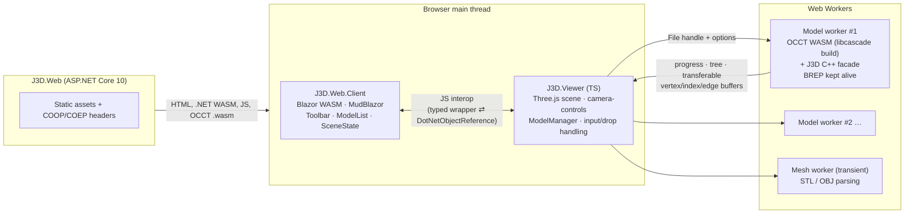

# J3D — Project Plan

> Web-based 3D CAD viewer built on BREP and the Open CASCADE Technology (OCCT) kernel, with a Blazor UI.
>
> **Branches:** one per milestone, squash-merged (M5 `feature/m5-hardening`) · **Status:** M0 (scaffold), M1 (OCCT WASM build), M2 (import pipeline), M3 (viewer) and M4 (Blazor UI) merged; M5 (hardening) in progress · **Last updated:** 2026-10-14

---

## 1. Iteration 1 goal

Let a user, entirely in the browser:

1. **Import** CAD models — STEP, IGES, BREP (exact geometry via OCCT) and STL, OBJ, glTF (meshes) — via a toolbar button or drag and drop, several files at once.
2. **Delete** an imported model.
3. **Rotate, pan and zoom** the view.

The theme is dark throughout. **CAD files never leave the user's machine**: all parsing, tessellation and rendering happen client-side.

### Acceptance criteria

- [ ] An **Import** button opens a multi-select file picker filtered to `.step .stp .iges .igs .brep .stl .obj .gltf .glb`. Dropping files onto the viewport does the same.
- [ ] Each file becomes its own model in the **model list**, showing its name, format, status, progress, and a cancel button while importing.
- [ ] BREP models render **shaded faces in the file's colours** (STEP/IGES via XCAF) with **true BREP edges** drawn over them.
- [ ] Each BREP model shows its **assembly tree** (names, nesting). The tree is read-only.
- [ ] glTF loads as GLB, embedded `.gltf`, multi-file `.gltf` (with its `.bin`/textures selected or dropped together), meshopt, Draco and KTX2. OBJ loads with its `.mtl` and textures when they're supplied alongside it.
- [ ] Semi-transparent colours (STEP/IGES alpha, glTF/MTL opacity) render translucent.
- [ ] **Delete** asks for confirmation ("Delete *name*?"), then removes the whole model from the scene and the list, and frees its memory (worker terminated, GPU buffers disposed).
- [ ] Mouse: **left-drag pans, middle-drag pans, right-drag rotates, the wheel zooms** toward the view centre. The browser context menu is suppressed over the canvas.
- [ ] Touch: one finger rotates, two fingers pinch to zoom and drag to pan. Verified with synthetic touch pointer events, plus a real touch device when one is available (D64).
- [ ] Rotation is **turntable** (Z stays up, the view never rolls) about the scene centre.
- [ ] The view **auto-fits when the scene goes from empty to its first model**. Later imports don't move the camera. **Fit all** is available as a button and the `F` key.
- [ ] A clickable **view cube** (top-right) snaps to 26 standard views (6 faces, 12 edges, 8 corners) with an animated transition, keeping the current zoom. A **Home** button goes to isometric and fits all.
- [ ] The view is **orthographic by default**, with a perspective/orthographic toggle that keeps the framing.
- [ ] Imports scale up to what **wasm32 (4 GB per model worker)** allows. Exceeding it gives a clear "too large" error rather than a crash.
- [ ] Works in current desktop **Chrome/Edge, Firefox and Safari**: verified by CI's Playwright Chromium, Firefox and WebKit, and by hand in Chrome and Edge on Windows. Real Safari and earlier browser versions are known gaps (D42, D64).
- [ ] xUnit/bUnit, Vitest (including real OCCT under Node) and Playwright E2E (×3 browsers) all pass in GitHub Actions.

### Out of scope for iteration 1

Persistence (models are lost on refresh), users and auth, deployment, picking/selection, highlighting from the tree, part visibility, measurement, sectioning, exploded views, export, mobile/tablet layout, zoom-to-cursor, undo.

---

## 2. Decision log

Decided with the project owner on 2026-10-13 (D1–D27 in the first Q&A, D28–D36 in the follow-up round) and 2026-10-14 (D39–D45 at the start of M2, D46–D50 at the start of M3, D51 after M3 merged, D52–D59 at the start of M4, D60 during M4, D61–D72 at the start of M5). Remaining assumptions are listed in §12.

| # | Topic | Decision | Notes |
|---|---|---|---|
| D1 | Language / runtime | **.NET 10 (LTS) / C# 14** | The request said "C# 10"; confirmed this meant the current .NET 10. |
| D2 | Where OCCT runs | **In the browser (WASM)** | No server compute. Most CAD code is C++ (facade) and TypeScript (worker/viewer). |
| D3 | OCCT build | **Replicad's approach**: a trimmed custom build with the `taucad/opencascade.js` toolchain (published as **libcascade 3.1, OCCT 8.0.1**) | Replicad 1.1 links via that toolchain's Docker image. The original `donalffons/opencascade.js` is unmaintained (last push Aug 2023, OCCT 7.6.2). |
| D4 | Build config format | **`@libcascade/toolchain` TypeScript config** (`defineBuild`) | Same approach as Replicad, but using the current typed format rather than legacy YAML+ytt. |
| D5 | Where WASM builds run | **GitHub Actions job builds it; output committed to `dist/` like Replicad** | Local Docker is only needed for local symbol-set changes. |
| D6 | WASM in git | **Git LFS for `*.wasm`** | |
| D7 | Blazor hosting | **Blazor Web App, Interactive WebAssembly** (global) | Switched from Interactive Server once OCCT moved to the browser: no SignalR circuit to drop. |
| D8 | Renderer | **Three.js** (r186) + **camera-controls** (3.x) | camera-controls gives orthographic support, button remapping, `fitToBox` and smooth transitions. |
| D9 | Browser language & build | **TypeScript (7.x) + Vite (8.x)**, npm workspaces | Vite output goes into the client's `wwwroot/viewer`, driven by MSBuild. |
| D10 | Formats | **STEP, IGES, BREP** (OCCT) + **STL, OBJ, glTF/GLB** (Three.js loaders) | Mesh models are labelled "mesh" and won't get BREP features later. |
| D11 | Scene | **Many models + model list** with per-model delete | |
| D12 | Persistence | **Session only** | |
| D13 | Display | Shaded faces, BREP edge overlay, STEP/IGES colours, assembly tree | Needs XCAF symbols in the build. |
| D14 | Tree interaction | **Display only**; delete is always whole-model | |
| D15 | UI library | **MudBlazor** (9.x), dark-only theme, system font stack | |
| D16 | Mouse | **Left = pan, middle = pan, right = rotate, wheel = zoom**; touch supported | Custom mapping: not a Three.js, SolidWorks or Fusion preset. |
| D17 | Rotation | **Turntable**, fixed up axis | |
| D18 | Up axis | **Z-up** | glTF (Y-up by spec) is rotated on import. |
| D19 | Camera extras | Auto-fit on import, Fit all (button + `F`), **ortho default** + toggle | No zoom-to-cursor. |
| D20 | Model size | **As large as wasm32 allows**: progress, cancellation, worker per model, threaded build available | Threaded default: see D28. |
| D21 | Import UX | Button + drag and drop, multi-file | |
| D22 | Browsers | Evergreen Chromium + Firefox + Safari, desktop | |
| D23 | Testing | xUnit v3 + bUnit, Vitest, Playwright E2E | |
| D24 | CI | **Full GitHub Actions CI** (build + all tests on PRs) + the WASM build workflow | |
| D25 | Deployment | **Local dev only** for now | |
| D26 | Naming | **`J3D.*`**, root namespace `J3D` | |
| D27 | Deliverable this session | Plan + solution scaffold (M0) | |
| D28 | OCCT threading | **Single-threaded by default.** Both variants are built; multi-threaded becomes the default only if the M5 benchmark (S4) shows ≥ 1.3× on our fixtures | COOP/COEP stay on regardless. See R3. |
| D29 | Delete | **Confirmation dialog** before deleting a loaded model | Cancelling an in-progress import and dismissing a failed entry are immediate. |
| D30 | Auto-fit | **Only when the scene goes from empty to its first model** | Applies again after every model has been deleted. |
| D31 | Orientation aid | **Clickable view cube**, top-right: 6 faces + 12 edges + 8 corners = 26 views, plus Home | Animated, keeps zoom. Home = isometric + fit all. New scope beyond rotate/pan/zoom. |
| D32 | glTF scope | **Everything**: GLB, embedded and multi-file `.gltf`, meshopt, Draco, KTX2 | Draco/Basis decoders are self-hosted (COEP forbids CDNs). |
| D33 | OBJ materials | **`.mtl` + textures** via the same sidecar mechanism as multi-file glTF | |
| D34 | Transparency | **Honour alpha** from STEP/IGES colours, glTF and MTL | Translucent faces split into their own sub-meshes. See R10. |
| D35 | Repo visibility | **Public** (`JRB-90/j3d`) | The repo itself satisfies LGPL source availability for the OCCT build. |
| D36 | Pushing | Pushed and **draft PR opened** after M0 | |
| D37 | Delivery | **One PR per milestone**, squash-merged into `main` | M0 merged as #1. |
| D38 | Local OCCT builds | **Docker Desktop** (WSL2 backend) for fast facade iteration | CI still builds and commits `dist/`. |
| D39 | M2 scope | **Headless import pipeline plus a dev-only test hook.** M2 delivers the TypeScript pipeline; Playwright drives it through `window.__j3dTest` | Rendering stays in M3, the Blazor UI and .NET interop in M4. The app looks unchanged after M2. |
| D40 | Multi-threaded OCCT in the browser | **Deferred to M5.** M2 wires only the single-threaded variant and the `postMessage` progress path | Both variants are still built and committed (D28). Nested pthread workers and shared-memory progress arrive with S4, only if S4 shows ≥ 1.3×. Amends S3. |
| D41 | Spike checkpoint | Spikes first, findings recorded here, then **continue without pausing** unless a finding contradicts a decision | |
| D42 | Browsers for M2 checks | **Playwright browsers installed locally**; Safari coverage is **Playwright WebKit only** | No Mac available. Real Safari stays a known gap until M5. |
| D43 | Folder drops | **Dropped folders are expanded recursively** into the batch | A multi-file glTF folder groups automatically. Sidecars match by relative path first, then by file name. The picker stays files-only. |
| D44 | Mesh fixtures | **Generated by script** (gltf-transform, draco3dgltf, meshoptimizer, procedural textures, KTX2 encoder) | Licence-free and reproducible, like the OCCT fixtures. |
| D45 | Housekeeping with M2 | LFS object cache in CI; **SDK 10.0.402 / ASP.NET 10.0.13**; merged milestone branches deleted | 10.0.13's SDK is only in the 10.0.4xx feature band. |
| D46 | Mesh materials | **Normalised to `MeshStandardMaterial`**: MTL's Phong materials are converted (colour, textures, opacity and vertex colours kept); STL, and OBJ without an MTL, use the BREP neutral grey; glTF keeps its own PBR or unlit materials | Only Standard/Physical materials respond to the `RoomEnvironment` lighting, so Phong would look flat beside BREP parts. |
| D47 | WebGL in Firefox CI (R13) | **Try the `webgl.force-enabled` prefs first, then headed Firefox under Xvfb; only if both fail, skip Firefox's pixel checks** and record it here | The viewer also degrades gracefully without WebGL: imports still work and nothing is drawn. **Outcome (M3):** the prefs alone weren't enough (headless Firefox still had no WebGL2); headed Firefox under `xvfb-run` gets it from Mesa's software renderer, so Firefox runs the full suite. The prefs stay set. |
| D48 | Toolbar | **Moved from M4 into M3**: the final `Toolbar` (Import, Fit all, Projection) in the app bar, right of the title, with the `ViewerInterop` wrapper it needs | The model list, delete dialog and snackbars stay in M4. After M3 the app is usable apart from delete. |
| D49 | Pixel sampling in E2E | **Focused**: the model draws non-background pixels, the STEP fixture's face colour appears, a translucent part blends with what's behind it, and the view cube is drawn and highlights on hover | Navigation (pan, rotate, zoom, view cube, fit) is asserted through camera state from the test hook, not pixels. |
| D50 | M3 process | **Work straight through** (as D41). Claude runs the manual checklist in the built-in browser with screenshots, then opens a draft PR; the owner checks by hand before saying merge | |
| D51 | Firefox E2E flake (R14) | **Firefox's E2E test classes run one at a time** (`--parallel none`); Chromium and WebKit stay parallel. Landed at the start of the M4 branch, which `main`'s red Firefox run waits for | Measured over 10 dispatched Firefox runs each: 3/10 passed in parallel, 10/10 serially, and the job takes about as long (3–4 min, since software rendering is CPU-bound anyway). **Tried first and dropped:** `preserveDrawingBuffer: true` on the renderer, on the theory that Firefox snapshotted a discarded buffer. The new diagnostics showed the frames were drawn correctly while the screenshots stayed stale, so the renderer keeps three's default. |
| D52 | Model list item | **Compact**: name, format chip and kind, the item's action button, and once loaded one line of memory · triangles · parts, with a warning icon whose tooltip lists any load warnings | "Parts" counts placed instances. A failed item shows its error code and message. |
| D53 | Model tree | **A collapsed expander on every model**, BREP and mesh. Opening it shows the roots; deeper levels load as they're expanded (lazy `MudTreeView`) | Mesh models show the file's object hierarchy (e.g. a glTF's nodes). |
| D54 | Snackbars | **An error snackbar for each failed import and a warning snackbar for each rejected file**; load warnings stay in the item | A failed item stays in the list until dismissed. Rejected files get no item, so the snackbar is their only report. |
| D55 | Import progress | **Phase label plus a bar per phase**: determinate when the phase reports a fraction, indeterminate when it can't (OCCT's Parsing) | No guessed weights across phases. |
| D56 | `SceneState` lifetime | **Scoped**, not a singleton (amends §6.4) | Under WebAssembly that's one per tab, as a singleton would be, and the host's prerender never shares it between requests. Same reasoning as `ViewerSession`. |
| D57 | List order | **Import order**: new models go at the bottom, in the order they were picked or dropped | |
| D58 | M4 process | **As M3 (D50)**: work straight through, Claude runs the manual checklist in the built-in browser, then a draft PR; the owner checks by hand before saying merge | |
| D59 | Test hook after M4 | **Kept alongside the UI** (Development only). The M2/M3 tests keep using it for what the UI doesn't show; M4's E2E tests drive the list, the dialog and the real Import input | |
| D60 | Wide tree levels | **Paged**: each level shows 100 nodes, then a "Show 100 more (*n* left)" row that appends the next page | Found in M4: `MudTreeView` renders every node it's given, and opening a level of about 1,400 blocked the page for 0.6 s (a 10,000-part flat file would take several seconds). A page takes about 0.1 s. |
| D61 | S4 method | **Node first, the browser only if threading wins**: both OCCT builds import the same fixtures under Node, 3 runs each, timed per phase. The threaded build is wired into the browser (nested pthread workers, probably a rebuild with a pool started ahead of time) only if it reaches the bar (D69) on the whole import | Found at the start of M5: the `multi` build had never been run, so S4 first proves it works. Amends S3 and D40 only if threading wins. |
| D62 | S4 and tuning fixtures | **A meshing-heavy generator beside the block copies**: a generated, licence-free STEP of curved, filleted parts (cylinders, tori, B-spline faces) written by OCCT, never committed | The S2 files repeat a 12-triangle block, so they're heavy to parse and almost free to mesh. |
| D63 | Large-model tuning | **Measure, then fix only what crosses a line**: `BatchedMesh` if orbiting the 200 MB file runs below 30 fps; uploads spread across frames if adding a model stalls the page for more than about 200 ms; CPU copies of GPU buffers dropped if memory is the limit; tessellation constants retuned for triangle count against looks. Anything that changes a decision is asked first | Estimated from the code before measuring: the 200 MB file's 10,437 parts are about 21k draw calls (a mesh and an edge line each), 4× the 5k line in §6.3. |
| D64 | Criteria that can't be fully checked | **Amended to what can be verified**: browsers are ticked on CI's Playwright Chromium, Firefox and WebKit plus the owner's manual pass in current Chrome and Edge on Windows, with real Safari and previous browser versions recorded as known gaps (D42). Touch is ticked on the synthetic tests, plus a manual check if a touch device is available | §1 amended to match. |
| D65 | Trimming (R5) | **E2E runs against the published, trimmed app in CI**, chosen by an environment variable and still in Development so the test hook works, and the **trim analyzer** fails the build on trim warnings. Locally, the in-process host stays the default | Found at the start of M5: E2E ran a build, and Blazor WebAssembly only trims at publish, so R5's mitigation never exercised trimmed code. |
| D66 | About and notices | **An info button at the right end of the app bar** opens an About dialog: version, MIT licence, repo link, "CAD files never leave your machine", and each shipped component with its licence (OCCT/libcascade LGPL-2.1 with the exception, linking the build recipe in the repo). **`THIRD-PARTY-NOTICES.md` is hand-curated** with the full licence texts of what ships to the browser, including the runtime libraries linked into the WASM, and a test fails if a runtime dependency is missing from it | Generated notices would need dev-only packages filtered out and would miss what's linked inside the WASM. |
| D67 | Docs | **A user-facing README** (what J3D is, a screenshot, formats, controls, limits, browser support and known gaps, privacy) **and `docs/development.md`** for building, testing, the OCCT rebuild, CI dispatches and fixtures | |
| D68 | CI runner | **Pinned to `ubuntu-24.04`** in both workflows, first thing in M5 | `ubuntu-latest` moves to Ubuntu 26.04 from 2026-10-19. Headed Firefox under Xvfb (D47, D51) is known to work on 24.04; moving on is a later, deliberate change. |
| D69 | S4 bar | **The 4-core CI runner decides** whether threading reaches ≥ 1.3× (D28); the 20-thread development machine's numbers are recorded beside it | Threading has to pay off on ordinary hardware, and its thread cost is paid per model (R3). |
| D70 | If S4 loses | **The threaded build stays, unused**: both variants stay in the config and `dist/`, and the benchmark stays in the repo to re-run when OCCT or libcascade improve threading | It costs a second 6–7 min link and about 15 MB of LFS, only when the OCCT build changes. |
| D71 | List and tree scale | **Virtualised only if measured**: the tree on the 10k-part file and a list of about 50 models are timed, and virtualised only past D63's ~200 ms line | Wide levels are already paged (D60). |
| D72 | M5 process | **As M3/M4 (D50, D58)**: work straight through, Claude runs the manual checklist in the built-in browser, then a draft PR; the owner checks by hand, including the Chrome and Edge pass (D64), before saying merge | |

---

## 3. Architecture



**Key properties**

- **Blazor owns the UI chrome and app state; TypeScript owns everything 3D.** Mesh data never crosses into .NET: the interop only carries small DTOs (ids, progress, tree, stats).
- **One Web Worker per BREP model.** Each gets its own 4 GB wasm32 heap, deleting or cancelling is just `worker.terminate()` (all memory freed instantly), and a crash or out-of-memory error in one model can't affect the others. The compiled `WebAssembly.Module` is compiled once and posted to each worker, so there's no recompilation.
- **The BREP stays alive in its worker after import.** Iteration 1 doesn't need it, but it's the foundation for picking, measurement and sectioning later.
- **Files go straight from `<input>`/drop to the worker** (`File` objects are cloneable), so the main thread never holds the bytes of a BREP, STL or OBJ file. glTF is the exception: three's GLTFLoader needs the DOM for textures, so it reads and parses on the main thread.
- **Cross-origin isolated page** (COOP `same-origin`, COEP `require-corp`). This enables `SharedArrayBuffer` for the threaded OCCT variant and the progress channel. As a result, nothing may be loaded from third-party origins, so there are no CDNs or web fonts.

---

## 4. Repository layout

```
J3D.slnx                       .NET 10 solution (slnx format)
global.json                    SDK 10.0.402 (rollForward latestFeature), Microsoft.Testing.Platform runner
Directory.Build.props          net10.0, C# 14, nullable, warnings-as-errors, analyzers latest-recommended
Directory.Packages.props       Central Package Management
.editorconfig                  C# 14 style rules enforced at build
.gitattributes                 LFS for *.wasm
package.json                   npm workspaces root (src/J3D.Viewer, later src/J3D.Occt)
src/
  J3D.Web/                     ASP.NET Core host: COOP/COEP, MapStaticAssets, prerender shell
  J3D.Web.Client/              Blazor WASM: layout, theme, components, state, interop wrappers
  J3D.Viewer/                  TypeScript: Three.js viewer, model manager, worker host & protocol
  J3D.Occt/                    libcascade config, C++ facade, committed dist/ (M1)
tests/
  J3D.Web.Client.Tests/        xUnit v3 + bUnit
  J3D.Web.Tests/               xUnit v3 + WebApplicationFactory (host behaviour)
  J3D.E2E.Tests/               xUnit v3 + Playwright (.NET) + WebApplicationFactory.UseKestrel
  fixtures/                    CAD/mesh fixtures shared by Vitest and Playwright
docs/plan.md                   this document
.github/workflows/ci.yml       build + unit + E2E (×3 browsers)
.github/workflows/occt-wasm.yml  custom OCCT WASM build (M1)
```

Vitest specs sit next to the TypeScript sources (`src/J3D.Viewer/src/**/*.test.ts`, `src/J3D.Occt/**/*.test.ts`).

---

## 5. Technology stack

| Layer | Choice | Version (2026-10) |
|---|---|---|
| Runtime / language | .NET / C# | 10.0 (SDK 10.0.402, runtime 10.0.13) / 14 |
| UI | Blazor Web App, Interactive WebAssembly + MudBlazor | 10.0.x / 9.11 |
| CAD kernel | OCCT via libcascade toolchain (taucad fork of opencascade.js) | OCCT 8.0.1 / toolchain 3.1 |
| 3D | three + camera-controls | 0.186 / 3.1 |
| Browser code | TypeScript + Vite + Vitest | 7.0 / 8.3 / 5.0 |
| .NET tests | xUnit v3 (MTP v2), bUnit, Playwright for .NET | 4.0 / 2.11 / 1.63 |
| CI | GitHub Actions (ubuntu-latest; Docker for WASM builds) | |

Node ≥ 22 is required (libcascade toolchain, Vite 8).

---

## 6. Detailed design

### 6.1 OCCT WebAssembly build (`src/J3D.Occt`)

**Approach (following Replicad):** use the taucad `opencascade.js` toolchain (`@libcascade/toolchain` 3.1, OCCT 8.0.1, image pinned by digest) to link a **trimmed** OCCT WASM. It contains only a **project-owned C++ facade**, written the way Replicad writes its wrappers: plain C++ classes that the toolchain's bindgen exposes to JS (`scope: 'all'`, so bindings *and* TypeScript declarations are generated). Bulk data is returned as malloc'd arrays whose addresses and lengths JS reads directly out of WASM memory. See [`libcascade.config.ts`](../src/J3D.Occt/libcascade.config.ts) and [`wrappers/j3d_facade.cpp`](../src/J3D.Occt/wrappers/j3d_facade.cpp).

**Why a C++ facade rather than calling the OCCT API from JS:** extracting triangulations face by face through embind costs millions of JS↔WASM calls on large models. The facade does import, meshing and extraction **inside C++** and hands JS contiguous buffers to copy once into transferable `ArrayBuffer`s. Binding only two classes also lets the linker drop unused OCCT code: the trimmed build is **15.4 MB** (single) / **15.0 MB** (multi) raw, against 42.7 MB for the full prebuilt libcascade.

**Facade API** (generated TS: `dist/j3d_occt_<variant>.d.ts`; typed wrapper: [`src/facade.ts`](../src/J3D.Occt/src/facade.ts) → `OcctModel.load(module, source, format, fileName, options)`):

| Member | Purpose |
|---|---|
| `J3DModel.allocateInput(bytes)` / `releaseInput()` | JS streams the `File` into WASM memory in chunks (no extra JS-side copy). Addresses are `unsigned int` because they can exceed 2 GB. |
| `J3DModel.importFile(format, fileName)` | STEP: `STEPCAFControl_Reader::ReadStream` over a zero-copy `std::streambuf` → XCAF document. IGES: `IGESCAFControl_Reader` via an in-memory file (no stream API). BREP: `BRepTools::Read(istream)`, then added to an XCAF document so every format takes the same path. Returns a status code; `getLastError()` explains failures. |
| `J3DModel.mesh(linearDeflectionRatio, angularDeflection)` | Walks the document with `XCAFPrs_DocumentExplorer` (styles inherited through the assembly), collects unique **prototypes** (referred part + effective style) and meshes each unique shape once with `BRepMesh_IncrementalMesh` |
| `J3DModel.getSceneJson()` | `{ nodes: [{ name, parent, prototype }], instances: [{ node, prototype, matrix }] }`; matrices are world transforms, column-major |
| `J3DModel.getPrototypeCount()` / `extractPrototype(i)` → `J3DMeshData` | Positions, normals, opaque-then-translucent indices, per-vertex RGBA (only when a part has several colours, otherwise one uniform colour) and BREP edge segments |
| `Module.j3dProgress(phase, fraction)` | Set by JS; called from C++ (`EM_ASM`) for Parsing/Transferring/Meshing/Extracting. Phase changes are always reported, repeats are throttled to 10 Hz. |

**Extraction rules**

- Faces come from OCCT's own `RWMesh_FaceIterator` (as in its glTF exporter): oriented triangles, transformed nodes, and normals computed from the surface when the triangulation has none.
- Edges are unique per prototype, taken from `BRep_Tool::PolygonOnTriangulation` so they line up exactly with the shaded mesh. **Seam and degenerate edges are skipped**, and free edges are discretised with `GCPnts_TangentialDeflection`.
- Colour precedence: face → part → instance → parent assembly → default `#B4B9C0`, as resolved by the face iterator and document explorer. Colours are passed as **linear RGBA**, because Three.js works in linear space and sRGB values would look washed out. STEP transparency (`SURFACE_STYLE_TRANSPARENT`) arrives as the colour's alpha.
- Faces with alpha < 1 are written to a separate **translucent** index range per prototype, so the viewer can draw opaque and translucent geometry with different materials (D34).
- Default tessellation uses a linear deflection of 0.1 % of the **model's** bounding-box diagonal (absolute, shared by all parts) and an angular deflection of 0.35 rad. Both are constants in one place, tuned in M5, with no UI in iteration 1.
- Memory views into WASM memory become invalid when memory grows, so `facade.ts` copies each one (`.slice()`) before making any further call.

**Toolchain constraints found in M1** (worth knowing before touching the facade):

- The bindgen binds **every top-level and single-namespace class** in a custom file. Helpers must be **private nested classes** (which it skips), and free functions must be `inline`, because the file is compiled into several translation units.
- The bindgen parses the file without Emscripten's headers, so `emscripten.h` is included only under `__has_include`.
- XCAF pulls in OCCT's visualisation toolkit, whose font code references FreeType. As in Replicad's build, `ERROR_ON_UNDEFINED_SYMBOLS` is off; nothing calls it.
- OCCT 8 API differences from 7.x: `Quantity_ColorRGBA::Alpha()`, `Standard_Failure::what()` (no `DynamicType()`), and `Standard_True/False` and the `TopTools_*` collection typedefs are deprecated.
- `libcascade check` (symbol drift guard) isn't used: the TypeScript never references OCCT symbols directly, only the two facade classes.

**Build pipeline**

- **Locally** (Docker Desktop): `npm run build:wasm --workspace @j3d/occt`. A compile error comes back in about 30 seconds; a full link plus `wasm-opt` takes about 6–7 minutes per variant.
- **CI:** `.github/workflows/occt-wasm.yml` runs on `workflow_dispatch` and on pushes touching the config, wrappers or package. It builds both variants and assembles them, runs the Vitest OCCT tests against the new build, commits `dist/` (`*.wasm` via LFS) back to the branch, then dispatches `ci.yml`, because pushes made with `GITHUB_TOKEN` don't trigger workflows.
- **Staleness guard in `ci.yml`:** `npm run check:dist` renders the config and compares it and the C++ sources with the hashes recorded in `dist/*.provenance.json`. `src/J3D.Occt/**` is checked out with LF line endings on every platform so the hashes are stable.
- Fork PRs can't commit back. That's acceptable for a single-maintainer repo.

### 6.2 Import pipeline (worker per model)

```
user picks/drops files (dropped folders expanded recursively, D43)
  → planBatch(): models, sidecars held back for matching, unsupported files → rejected
  → ModelManager.importFiles(batch): id = crypto.randomUUID(), status queued → queued event
  → at most N concurrent imports (default 2); others wait in the queue
  → runner per format: model worker (BREP) · mesh worker + main-thread rebuild (STL/OBJ) · main-thread GLTFLoader (glTF)
  → loaded | failed event; once every model of the batch has finished, its unused sidecars → rejected
```

**As built (M2).** The pipeline lives in `src/J3D.Viewer/src/import/`. Each format has an `ImportRunner` (`request → { result, dispose() }`); `dispose()` both cancels a running import and frees a loaded model, so the `ModelManager` treats cancel and delete the same way. The OCCT runner is in the entry chunk; the mesh runners (and Three.js) are in a chunk loaded on the first mesh import. Until the Blazor UI arrives in M4, the `ModelManager`'s events go to a Development-only test hook (`window.__j3dTest`, enabled by a `<meta name="j3d-test-hook">` that the host renders only in Development), which the Playwright tests drive (D39).

**Model worker lifecycle (BREP)**

1. The main thread compiles the OCCT module once per page (`WebAssembly.compileStreaming`, falling back to `compile` if the MIME type is wrong) and posts the compiled `WebAssembly.Module` with each import. The worker instantiates it through Emscripten's `instantiateWasm` hook, so no worker fetches or compiles the 15 MB binary. Only the `single` variant is wired in (D40).
2. `import { file, format, module }`: `file.stream()` → chunks copied into `AllocateInput` memory (phase **Reading**, fraction = bytes/size) → `Import` (**Parsing**, indeterminate: OCCT's STEP parse has no progress hook; then **Transferring**, determinate) → `ReleaseInput` → `Mesh` (**Meshing**, determinate) → extract (**Extracting**, per prototype).
3. Posts `loaded { scene: { nodes, instances, prototypes }, bounds, stats, memoryBytes }` with **all typed-array buffers transferred** (zero-copy). Bounds and counts are computed in the worker, before the transfer.
4. Stays alive, holding the XCAF document, until the model is deleted.
5. OCCT's own console output (`print`/`printErr`) goes to `console.debug`/`console.warn` with an `[OCCT]` prefix: it explains parse failures but isn't an app error.

**Progress channel** (spike S3)

- `J3DProgress::Show()` is throttled to about 10 Hz.
- Single-threaded variant (the only one wired in, D40): `Show()` runs on the worker thread and calls `Module.j3dProgress` through `EM_ASM`, which `postMessage`s to the page. The page's event loop is free, so messages arrive while the worker is busy in WASM. **Verified in M2** in Chromium and WebKit: every phase arrives, in order.
- `throttleProgress` (in the workers and again per model in the `ModelManager`) always passes a phase change and a phase's end, drops exact repeats, and otherwise limits updates to one per 100 ms, so .NET will see at most 10 Hz per model.
- Threaded variant (M5, only if S4 wins): `Show()` may run on a pthread, so it would write phase and fraction into a static slot in **shared** WASM memory; the worker posts that `SharedArrayBuffer` and its offset to the page once, and the viewer polls it every animation frame.

**Cancellation and deletion:** `worker.terminate()` in both cases. It's instant and frees the entire WASM heap. A cancelled model's list entry is removed.

**Errors** (shown as error codes plus a message in the model list and a snackbar):

| Code | Cause |
|---|---|
| `Unsupported` | Unknown extension, or a feature we don't support (e.g. a glTF extension with no loader) |
| `MissingFile` | A multi-file glTF/OBJ references a required file (e.g. `.bin`) that wasn't selected with it. The message names the missing files. |
| `ParseFailed` | The OCCT reader returned failure, or there was a C++ exception (`getExceptionMessage`) |
| `Empty` | The file parsed but contained no shapes or triangles |
| `OutOfMemory` | WASM `abort` / `RangeError` / memory growth failure: "Model too large for the browser's 4 GB WebAssembly limit". OCCT's readers catch their own allocation failures and report an unreadable file, so a reader failure with the heap above 90 % of its 4 GB ceiling also counts as `OutOfMemory` (found by S2). |
| `Internal` | Anything else (logged to the console with a stack trace) |

**Sidecar grouping (multi-file glTF and OBJ+MTL, D32/D33).** Each picker selection or drop is one *batch*. Before queueing:

1. Files with a primary extension (`.step … .glb`, `.obj`) become models. Sidecar extensions (`.bin`, `.mtl`, `.png`, `.jpg`, `.jpeg`, `.webp`, `.ktx2`) are held back for matching.
2. References are resolved as each model loads: a glTF's `buffers[].uri` up front (from its JSON, or a GLB's JSON chunk); everything else on demand. Sidecars match by decoded, case-insensitive **relative path** first (files from a dropped folder keep their folder-relative path, D43), then by **file name** alone, since picked files carry no folder information.
3. A `LoadingManager.setURLModifier` maps each referenced URI to a `blob:` URL for the matched `File`. The blob URLs are revoked when loading finishes. `data:`, `blob:` and `http(s):` URLs pass through untouched.
4. If a **required** buffer (`.bin`) is missing, the import fails with `MissingFile` before anything loads. A missing texture or `.mtl` is a warning: the texture is replaced by a 1×1 white PNG (so nothing is requested from the server) and the model loads untextured. Individually chosen sidecars that nothing referenced are reported as rejected once every model of the batch has finished; files found inside a dropped folder are skipped silently.
5. `formats.ts` is the source of truth for sidecar extensions too, and adds them to the picker's `accept` list.

**Mesh formats** (no OCCT):

- **STL** is parsed by `STLLoader.parse` in a transient mesh worker, with buffers transferred back and rebuilt on the main thread. A single STL mesh is its own tree root, named after the file.
- **OBJ** geometry is **always** parsed by `OBJLoader` in the mesh worker, which also reports the file's `mtllib` names. The main thread then loads those `.mtl` files and their textures with `MTLLoader` (it needs the DOM for images) and assigns the materials by name. Without a `.mtl`, objects get the neutral grey and honour vertex colours.
- **glTF/GLB** uses `GLTFLoader` on the main thread, since it needs the DOM for textures. It supports GLB, embedded and multi-file `.gltf`, `EXT_meshopt_compression` (`MeshoptDecoder`), `KHR_draco_mesh_compression` (`DRACOLoader`) and `KHR_texture_basisu` (`KTX2Loader`). A file whose `extensionsRequired` lists anything three can't load fails with `Unsupported`. Lights and cameras in the file are dropped.
- **KTX2** transcoding needs to know which compressed formats the GPU accepts. Until M3 passes the real renderer (`GltfImportOptions.getRenderer`), `probeTextureSupport()` reads them from a throwaway WebGL2 context. Without WebGL at all (headless Firefox in CI), nothing is reported and Basis transcodes to uncompressed RGBA, so the import still succeeds.
- The **Draco and Basis decoders** need no copying: three r186's loaders locate them with `new URL(…, import.meta.url)`, so Vite emits them into `viewer/assets/` and they're served same-origin, as COEP requires. They're fetched only when a file uses them (R12).
- **Orientation:** glTF is Y-up by spec and is rotated +90° about X. STL and OBJ are assumed to be Z-up, which is the CAD export convention.
- Mesh models arrive as a ready Three.js object and have **no edge overlay**. Their materials are normalised to `MeshStandardMaterial` (D46): MTL's Phong materials are converted keeping colour, textures, opacity and vertex colours; STL, and OBJ without an MTL, get the BREP neutral grey; glTF keeps its own PBR or unlit materials. STL and OBJ materials are double-sided, since those files often mix up their winding. Their tree is the file's object hierarchy. glTF `alphaMode: BLEND` and MTL `d`/`Tr` opacity are honoured (D34).

### 6.3 Viewer (`src/J3D.Viewer`)

| Concern | Design |
|---|---|
| Renderer | `WebGLRenderer({ antialias: true, alpha: true })` with a transparent clear over the viewport's CSS gradient (`#2A2F37 → #15181C`). Pixel ratio capped at 2. `ResizeObserver` on the host, drawing synchronously on resize. Created only when `webGl2` is reported: without it the import pipeline still runs and nothing is drawn. **As built (M3):** `src/J3D.Viewer/src/view/viewer.ts`. |
| Up axis | `Object3D.DEFAULT_UP = (0,0,1)` before creating any camera. `camera.up = (0,0,1)` before constructing camera-controls. |
| Cameras | One `OrthographicCamera` (default) and one `PerspectiveCamera` (fov 35°). camera-controls' `.camera` is swapped on toggle. Toggling keeps framing by matching the visible height at the target: `h = 2·d·tan(fov/2)` ⇄ ortho frustum/zoom. The orthographic frustum is 1 unit high at zoom 1, so `zoom = 1 / visible height`. The maths is unit-tested (`camera-math.ts`). |
| Controls | camera-controls with `mouseButtons = { left: TRUCK, middle: TRUCK, right: ROTATE, wheel: ZOOM (ortho) / DOLLY (persp) }`, `touches = { one: TOUCH_ROTATE, two: TOUCH_ZOOM_TRUCK (ortho) / TOUCH_DOLLY_TRUCK (persp) }` and `dollyToCursor = false`. Polar angle is unclamped apart from the small epsilon camera-controls needs at the poles. `contextmenu` is prevented on the canvas. camera-controls applies at most one drag step per frame and drops what is left at pointer up, so the E2E drags move one step per frame, as a real mouse does. |
| Fit all | Computes the union of model bounding boxes and frames it **from the current view direction**: the box's corners are projected onto the view plane, the target moves to the centre of their extent, and the visible height covers it with 10 % padding (`fitBox`). camera-controls' own `fitToBox` isn't used: it first snaps the view to the nearest axis, which would turn Home's isometric view into a front view. Both cameras get the distance `h / (2·tan(fov/2)) + depth / 2`, so the toggle finds a fitted view either way. Near and far planes are recomputed from the scene's bounding sphere on every frame; an orthographic near plane may be negative, so nothing is clipped however far the camera is dollied in. Runs automatically **only when the scene goes from empty to its first model** (D30), and via the toolbar button or the `F` key (ignored while focus is in an input). |
| Lighting & materials | `RoomEnvironment` PMREM for image-based light (intensity 0.6), plus a directional "headlight" (2.5) that follows the camera from up and to the left of the viewer, under **Khronos PBR Neutral** tone mapping, which keeps base colours true and rolls off highlights. Tuned in M3 by sampling `box.brep`: the neutral grey reads as itself on faces turned to the viewer, and top faces aren't blown out. `MeshStandardMaterial` (metalness 0.05, roughness 0.55), double-sided, with `polygonOffset` so edges draw cleanly on top. Materials are cached and reference-counted per colour (`materials.ts`). Single-colour parts use material colour; multi-colour parts use `Uint8` normalised RGBA vertex colours. Mesh models: see §6.2 (D46). |
| Transparency | Each prototype's translucent index range becomes a second mesh sharing the same vertex buffer, with `transparent: true`, `depthWrite: false` and per-colour `opacity` (RGBA vertex colours if a part mixes alphas). Three.js sorts translucent objects back-to-front each frame. Edges of translucent faces are still drawn. Intersecting translucent parts can show sorting artefacts (R10). |
| Edges | `LineSegments` with a near-black `LineBasicMaterial` (1 px; WebGL ignores line width). Three has no instanced lines, so an instanced prototype's edges are one `LineSegments` over an `InstancedBufferGeometry` with an `instanceMatrix` attribute, and its material defines `USE_INSTANCING` (three's shader prefix declares `instanceMatrix` under that define). |
| Instancing | Each prototype's `BufferGeometry` is shared by its instances, and prototypes with many instances (≥ 16) use `InstancedMesh`. If draw calls exceed about 5,000, M5 evaluates `BatchedMesh`. |
| Render loop | On demand only: render when camera-controls reports an update or transition, when the scene changes, or on resize. Idle cost is zero. The loop runs only while camera-controls is moving the camera (`controlstart`, `control` and `transitionstart` start it; it stops when `update()` reports no change), timed with three's `Timer`, which is reset after idle so a transition doesn't jump. Spreading large geometry uploads across frames moves to M5's tuning. |
| View cube (D31) | A labelled cube about 110 px across, top-right. It's drawn by the same renderer into a scissored viewport, with its own small orthographic camera that copies the main camera's rotation. Raycasting picks one of **26 regions** (6 faces, 12 edges, 8 corners), highlights it on hover, and on click calls `controls.rotateTo(azimuth, polar, true)`, which animates and keeps distance and zoom. Z-up names: **Top** looks down −Z (+Y up on screen), **Front** looks along +Y, **Right** looks along −X. A **Home** button next to it goes to isometric (front-right-top) and fits all. Top/Bottom use a polar angle of ε / π−ε, because turntable controls can't sit exactly on the pole. **As built (M3):** 26 boxes, one per region, with canvas-texture labels and no tone mapping (`view-cube.ts`); the region → (azimuth, polar) mapping is unit-tested (`view-regions.ts`). Transitions take the short way round. Bottom keeps azimuth 0, so −Y (Front) is up on screen. The host intercepts `pointerdown` on the cube in the capture phase, so a click doesn't also start a camera-controls drag. The Home button sits at the cube's top-left. |
| Drag and drop | `dragenter/over/leave/drop` on the host toggles a `j3d-viewport--drop` overlay class and, from the `drop` handler, synchronously calls the viewer's `importDrop(dataTransfer)` (M2), which expands dropped folders (D43) and queues the batch. **Found in M3:** WebKit hands out file entries it then can't read (`NotFoundError` for files not on disk, such as a test's synthetic drop or a file dragged from another app), so a top-level file entry that fails falls back to the drop's own `File`. |
| Disposal | Delete removes the Object3D, disposes geometries and releases material references, then re-renders. **The camera doesn't move on delete.** |
| Test hook | `window.__j3dTest` is exposed only in Development (the host renders `<meta name="j3d-test-hook">`), for Playwright. Since M2 it drives imports (a hidden file input), records model events, lists models and live workers, and can hold OCCT imports so cancel is testable. Since M3 it also reports the camera (`camera()`: projection, position, target, angles, distance, zoom, visible height, near/far, moving), the frames drawn, where a world point (`project`) or a view cube region (`viewCubePoint`) is on screen, and the hovered region. For failed pixel checks it reports the scene's models, whether the context is lost, and what a fresh frame draws under given points, read from the canvas in the same task as the draw (`canvasPixels`). |

### 6.4 Blazor client (`src/J3D.Web.Client`)

**Render mode:** global `InteractiveWebAssembly` on `<Routes>`. Prerendering stays on so the dark shell paints immediately. The viewer starts in `OnAfterRenderAsync(firstRender)`, so it only ever starts on the interactive (WASM) render.

**Components**

| Component | Responsibility |
|---|---|
| `MainLayout` | `MudThemeProvider` (dark-only `J3DTheme`), app bar, persistent model drawer, main content |
| `Toolbar` | **Import** (a `MudButton HtmlTag="label"` for a visually hidden `<input type=file multiple>`; a native label click needs no JS user-activation trickery), **Fit all** (tooltip "Fit all (F)"), **Projection** toggle (`MudToggleGroup`). In the app bar, right of the title. Disabled until the viewer is running with WebGL2. **Built in M3 (D48).** |
| `ModelList` / `ModelListItem` | Name, format chip, kind (BREP/mesh), status, `MudProgressLinear` (determinate or indeterminate by phase), memory, lazy `MudTreeView` for the assembly. Actions: **Cancel** while importing (immediate), **Delete** when ready (confirmation via `IDialogService.ShowMessageBoxAsync`: "Delete *name*?", with a red Delete button and Cancel; D29), **Dismiss** when failed (immediate). **As built (M4):** the item is compact (D52): name (ellipsised, full name in its tooltip), a format chip, the kind unless the format already says it (a `.brep` file shows just "BREP"), and the action; while importing, "Meshing · 42%" or "Parsing…" over a bar for that phase (D55); once loaded, "64 MB · 1.2M triangles · 3 parts" and a warning icon whose tooltip lists load warnings; a failed item shows "Parse failed: *message*". The tree sits behind a collapsed "Assembly" (BREP) or "Hierarchy" (mesh) toggle (D53) and is display only: its node values are `int?`, since a node equal to the tree view's default selected value (0) is drawn selected. `MessageBoxOptions` can't colour buttons, so the confirmation is one inline `MudMessageBox` in the list whose `YesButton` slot is the red Delete. Removal goes through `ViewerSession.RemoveModelAsync`, and the item disappears when the viewer reports the model removed. |
| `Viewport` | Owns the viewer module's lifetime; receives callbacks through `DotNetObjectReference`. **As built (M4):** relays the model events into `SceneState`, shows an error snackbar for each failed import and a warning snackbar for each rejected file (D54; bottom right, clear of the view cube), and clears `SceneState` on dispose, since the models go with the viewer. |

**Viewer session (M3, D48):** `ViewerSession` (scoped: per tab in WASM, per request while prerendering) holds the running `ViewerInterop`, its capabilities and the projection, and raises `Changed`. The `Viewport` attaches it once both the interop handle and `OnViewerReady` have arrived (in either order) and detaches it on dispose; the `Toolbar` reads it. `AddJ3DClient()` registers it with MudBlazor in both the client and the prerendering host.

**State:** `SceneState` (scoped, D56: one per tab in WASM) holds the models in import order (D57) and raises `Changed`. Components subscribe in `OnInitialized` and unsubscribe in `Dispose`. All transitions (Queued → Importing(phase, fraction) → Ready | Failed → removed) are pure methods, unit-tested without a renderer. **As built (M4):** an `ImmutableList<ModelEntry>`; the transitions are methods on the `ModelEntry` record (`WithProgress`, `AsLoaded`, `AsFailed`), and a progress report after an outcome, or any report for a model no longer listed, changes nothing. Ids are a `ModelId` record struct that crosses interop as a string.

**Large trees:** the tree arrives as a flat array of `{ name, parent, prototype }`, parents first, and `ModelTree` indexes each node's children once. `MudTreeView` loads a node's children when it's first expanded, so deep trees cost nothing until opened. **Wide levels are paged (D60):** `MudTreeView` renders every node it's given, and a level of about 1,400 nodes (the flat 25 MB STEP from S2) blocked the page for 0.6 s, so each level shows 100 nodes and then a "Show 100 more (1,258 left)" row; a page takes about 0.1 s.

**Interop contract** (the only boundary between C# and TS; a typed `ViewerInterop : IAsyncDisposable` wraps the JS side):

| Direction | Member | Payload |
|---|---|---|
| .NET → JS | `createViewer(host, dotnetRef)` | returns the viewer handle |
| .NET → JS | `attachFileInput(input)` | the viewer sets `accept` from `formats.ts` (single source of truth) and listens for `change` |
| .NET → JS | `removeModel(id)` | cancels if still importing |
| .NET → JS | `fitAll()` / `setProjection("orthographic" \| "perspective")` / `dispose()` | |
| JS → .NET | `OnViewerReady(ViewerCapabilities)` | `webGl2`, `crossOriginIsolated` |
| JS → .NET | `OnModelQueued(ModelSummary)` | id, fileName, format, sizeBytes |
| JS → .NET | `OnModelProgress(id, ImportPhase, fraction?)` | ≤ 10 Hz |
| JS → .NET | `OnModelLoaded(id, ModelLoadedInfo)` | tree, stats (nodes, prototypes, instances, triangles, edges, textures), bounds, memoryBytes, warnings |
| JS → .NET | `OnModelFailed(id, ImportError)` / `OnModelRemoved(id)` / `OnImportRejected(fileName, reason)` | |

**As built (M4):** `model-events.ts` subscribes to the `ModelManager` and makes these calls (a .NET failure is logged, not thrown); `index.ts` wires it next to the viewer and the test hook. `createViewer` also logs a console notice (not an error) when the page isn't cross-origin isolated.

**C# 14 / .NET 10 conventions** (some enforced by `.editorconfig` + analyzers at build):

- File-scoped namespaces, nullable enabled, warnings as errors, `AnalysisLevel=latest-recommended`, CPM.
- **Primary constructors** for DI, including Razor components (constructor injection, .NET 9+). Example: `Viewport(IJSRuntime js)`.
- **Extension members** (C# 14 `extension(T)` blocks) for behaviour on enums and framework types. Examples: `ModelFormat.Kind`, `IApplicationBuilder.UseCrossOriginIsolation()`.
- The **`field` keyword** for validated auto-properties, **collection expressions**, records / `readonly record struct` for DTOs and ids, switch expressions and patterns, `required` members.
- Enums cross interop as strings via `JsonStringEnumConverter<T>` + `JsonStringEnumMemberName` (trim-safe generic converter).
- Every JS object reference is `IAsyncDisposable`, and `DotNetObjectReference`s are always disposed.
- No component calls `IJSRuntime` directly except through `ViewerInterop` (`Viewport` creates it).

### 6.5 Host (`src/J3D.Web`)

- `UseCrossOriginIsolation()` sets `Cross-Origin-Opener-Policy: same-origin` and `Cross-Origin-Embedder-Policy: require-corp` on every response. Safari lacks `credentialless`, so it's `require-corp`.
- `MapStaticAssets()` handles fingerprinting, immutable caching, and brotli/gzip pre-compression at publish (`.wasm` compresses roughly 3–4×). `.wasm` is served as `application/wasm` so `compileStreaming` works.
- No server APIs in iteration 1.

### 6.6 Dark theme

- MudBlazor `PaletteDark` only, with no light mode and no toggle. Background `#121417`, surfaces `#1B1E23`, accent `#4F9DFF`, text `#E6E8EB` / `#9AA1AB`, dividers `#2A2F36`.
- **System font stack**, because Google Fonts would be blocked by COEP and adds a network dependency.
- Viewport gradient `#2A2F37 → #15181C`, near-black edges, and neutral grey `#B4B9C0` for uncoloured parts.
- `color-scheme: dark` so native controls (scrollbars, file dialogs where styled) match.

---

## 7. Licensing

OCCT and libcascade are **LGPL-2.1 with the Open CASCADE exception**. Three.js, camera-controls and MudBlazor are MIT, and the Draco decoder is Apache-2.0. The OCCT WASM ships as a separate, replaceable file loaded at runtime (dynamic-linking style), and its full build recipe (config, facade source, toolchain digest, provenance) is in this **public** repo (D35), which covers source availability. M5 adds `THIRD-PARTY-NOTICES.md` and an **About / licences** dialog. *This isn't legal advice. Get a review before any public deployment.*

---

## 8. Testing strategy

| Layer | Tooling | What it covers |
|---|---|---|
| TS unit | **Vitest** (Node) | Format and sidecar detection, batch planning and sidecar matching, folder-drop expansion, the `ModelManager` (queue, concurrency, cancel, delete, events) with fake runners, progress throttling, error mapping, BREP bounds, STL/OBJ parsing and rebuilding, glTF without textures or Draco (GLB, meshopt, `MissingFile`, `Unsupported`); from M3, camera ortho⇄persp maths, fit/near-far maths and colour conversion |
| OCCT integration | **Vitest** + the real `dist/` WASM under Node 22+ | Import each fixture → prototype, instance and triangle counts, names, colours, bounds, error codes, memory release. On demand: generated large STEP files (`J3D_LARGE_FIXTURES`, see below) |
| C# unit / component | **xUnit v3 + bUnit 2** | `SceneState` transitions, `ModelFormat` behaviour, `ModelList` / `Toolbar` / `Viewport` rendering and interop calls (bUnit JS interop in strict mode) |
| Host | **xUnit v3 + WebApplicationFactory** | COOP/COEP on pages and assets, the OCCT `.wasm` served as `application/wasm`, the test-hook `<meta>` only in Development |
| E2E | **Playwright for .NET** + `WebApplicationFactory.UseKestrel()` (.NET 10), Chromium/Firefox/WebKit | **Since M2** (through the test hook): every fixture imports with the expected structure, counts and Z-up bounds; progress phases in order; `ParseFailed` through a C++ exception; multi-file glTF and OBJ+MTL batches, including `MissingFile` and a missing texture; unsupported files rejected; two imports at a time; cancelling a running import and deleting a loaded model terminate their workers; no console errors. **Since M3:** pixel sampling (D49) of a STEP part's file colours over the background, a translucent cover showing the core inside it, the canvas clearing on delete with the camera unmoved, and the view cube drawn and highlighted on hover; zero frames while idle; first-model auto-fit only (again after the scene empties); right-drag turntable rotation, left/middle-drag pan, wheel zoom (ortho) and dolly (perspective) about the view centre; the context menu suppressed; one-finger rotate and two-finger pinch (synthetic touch pointer events, since Playwright has no multi-touch); view cube face/edge/corner clicks keeping the zoom; Home; `F` and the Fit all button (and `F` ignored in an input); the projection toggle keeping the framing; the toolbar's Import; drag-and-drop overlay and drop. **Since M4** (`ModelListTests`, through the toolbar's real input, the list and the dialog; D59): models listed in import order with their format, kind and stats; cancelling a held import (its worker ends); delete asking first, with the dialog's Cancel keeping the model; a failed import reported in the item and a snackbar, then dismissed; a rejected file reported in a snackbar only; the assembly tree opening a level at a time. `crossOriginIsolated` has been checked by `ShellTests` since M0. Runs against the **Release** build, which isn't trimmed (Blazor trims only at publish); M5 moves CI onto the published, trimmed app (D65). |

Notes:

- Playwright for .NET has no `toHaveScreenshot` (visual comparison is Node-only), so canvas checks use **pixel sampling** (`page.screenshot` + decode) instead of baseline images.
- **Large-model tests** run on demand, never on every PR: `npm run fixtures:large -- 200 700` generates STEP files into the git-ignored `tests/fixtures/large/`, and setting `J3D_LARGE_FIXTURES=200,700` enables both the Node test (`src/J3D.Occt/src/large.test.ts`) and the E2E test (`LargeModelTests`). In CI, dispatch `ci.yml` with the `large_fixtures` input.
- **Firefox locally:** Playwright's Firefox 155 build doesn't start on the development machine (Windows build 26300: "side-by-side configuration is incorrect", a missing `mozglue` assembly, even after a clean reinstall), so Firefox E2E runs only in CI (Linux). Chromium and WebKit run locally.

---

## 9. CI/CD

- **`ci.yml`** (in M0): on PRs and pushes to `main`. Steps: `npm ci` → typecheck → Vitest → `dotnet build -c Release` → client and host tests. Then an E2E matrix `[chromium, firefox, webkit]` with `playwright.ps1 install --with-deps`; since M3, Firefox runs headed under `xvfb-run` so it has WebGL (D47), with its test classes one at a time (D51). Since M1 it also runs the OCCT staleness guard and the OCCT integration tests. Since M2, Git LFS objects are cached by content (`actions/cache` keyed on `git lfs ls-files`) instead of fetched on every checkout (R8), and a manual `workflow_dispatch` with `large_fixtures` (e.g. `200,700`) also generates and imports large STEP files in every job. A dispatch can also limit E2E to one `browser`, and dispatched runs don't cancel each other, so a flaky browser's job can be repeated side by side (`gh workflow run ci.yml --ref <branch> -f browser=firefox`, R14). If E2E fails, the screenshots the pixel checks sampled are uploaded as `e2e-screenshots-<browser>`.
- **`occt-wasm.yml`** (M1): see §6.1.
- No deployment pipeline (D25).

---

## 10. Work breakdown

### M0 — Scaffold ✅ (this branch)

Solution and props, CPM, `.editorconfig`, LFS attributes, Blazor Web App (Interactive WASM) with the MudBlazor dark shell, COOP/COEP middleware, Vite/TS viewer workspace built by MSBuild into `wwwroot/viewer`, `Viewport` ⇄ module interop wiring with a capability report, `ModelFormat` (C#) and `formats.ts` (TS), test projects (xUnit v3 / bUnit / WAF / Playwright), and CI.
**Verified locally:** build has 0 warnings; 21 .NET tests and 17 Vitest tests pass; the app runs cross-origin isolated with the viewer module loaded. E2E is compiled but not run locally (Playwright browsers not installed).

### M1 — OCCT WASM build ✅ ([JRB-90/j3d#2](https://github.com/JRB-90/j3d/pull/2))

- `src/J3D.Occt` workspace: `libcascade.config.ts` (`single` default + `multi`), C++ facade (`J3DModel`, `J3DMeshData`), typed TS wrapper (`OcctModel`), committed `dist/` (LFS), `check:dist` staleness guard, fixture generator.
- `occt-wasm.yml` (build → test → commit → dispatch CI) and the staleness check in `ci.yml`.
- Fixtures for BREP/STEP/IGES ([tests/fixtures](../tests/fixtures/README.md)) and 8 Vitest integration tests running the real WASM under Node: box geometry and edges, per-face colours, assembly tree with a shared prototype and instance transforms, translucency, every progress phase, `ParseFailed`, Blob streaming, IGES colours.
- Spike **S1** outcome: toolchain, XCAF, facade and size verified (§6.1). The trimmed build is about a third of the full libcascade size. The Safari check of WASM exceptions moves to M2, where a browser harness exists.
- **Exit met:** the WASM builds locally and in CI, and the Node tests import every OCCT fixture with the expected tree, colours and triangle counts.

### M2 — Import pipeline ✅ ([JRB-90/j3d#3](https://github.com/JRB-90/j3d/pull/3), squash-merged as `a76467d`)

Scope as decided at the start of M2: a **headless** pipeline driven by a Development-only test hook (D39), single-threaded OCCT only (D40).

- **Pipeline** (§6.2 "As built"): `ModelManager` with batch planning, sidecar matching and folder-drop expansion; import queue (concurrency 2); OCCT model worker per BREP model with the module compiled once and shared; transient mesh worker for STL/OBJ; main-thread glTF (meshopt, Draco, KTX2) and MTL materials; typed worker protocol; chunked file streaming; transferable results; throttled progress; cancel and delete by worker termination; error codes including `OutOfMemory`.
- **Fixtures:** licence-free mesh fixtures from `src/J3D.Viewer/scripts/generate-mesh-fixtures.mjs` (D44) and `npm run fixtures:large` for large STEP files.
- **Tests:** 82 Vitest unit tests in the viewer; 12 E2E tests (plus the on-demand large-model test) passing in all three browsers in CI, and in Chromium and WebKit locally (Firefox can't run locally, §8); host tests for the test hook and the `.wasm` MIME type.
- **Housekeeping (D45):** SDK 10.0.402 / ASP.NET 10.0.13 (10.0.9 now fails NuGet's audit with two high-severity advisories), LFS cache in CI, merged milestone branches deleted.

**Spike outcomes**

- **S5 (Vite worker + WASM under Blazor static assets):** Vite's library mode inlines every asset, so it would have embedded the 15 MB WASM as base64. The viewer is now an **app build** with a single JS entry (`j3d-viewer.js`, exports preserved), hashed chunks, workers and assets under `wwwroot/viewer/`, and relative asset URLs (`base: './'`). The worker imports the Emscripten glue (`@j3d/occt/single`), whose `new URL('…wasm', import.meta.url)` and the main thread's `?url` import resolve to **one** emitted WASM file. Blazor's `MapStaticAssets` serves it as `application/wasm`, so `compileStreaming` works; the compiled `WebAssembly.Module` posts to workers in Chromium and WebKit. The glue's Node-only `import('node:module')` gets a stub in the worker build.
- **S3 (progress channel):** the single-threaded `postMessage` path works as designed (§6.2); the shared-memory path for the threaded variant is deferred with it (D40).
- **S2 (memory ceiling):** with the worst-case generator (thousands of unique parts, no instancing), the peak WASM heap is **about 7× the STEP file size** and linear: 25 MB → 191 MB, 50 → 359, 100 → 679, **200 MB → 1,457 MB**. So the practical ceiling for such files is roughly **550–600 MB of STEP**. 700 MB fails cleanly with `OutOfMemory` everywhere, **after a fix**: OCCT's STEP reader caught its own allocation failure and reported "not a readable STEP file", so a reader failure with the heap above 90 % of 4 GB is now reported as `OutOfMemory` (`facade.ts`). The heap is identical in every browser; time is mostly OCCT's transfer phase:

  | 200 MB STEP (10,437 parts) | Firefox | Chromium | WebKit | Node |
  |---|---|---|---|---|
  | Dev machine (Windows) | — | 28 s | 37 s | 30 s |
  | CI runner (`ubuntu-latest`) | 37 s | 56 s | 54 s | 49 s |
  | 700 MB → `OutOfMemory` after (CI) | 12 s | 21 s | 20 s | 21 s |
- **WebKit WASM exceptions (from S1):** `invalid.step` fails with `ParseFailed` through a C++ exception in Playwright WebKit, so `exceptions: 'wasm'` works there. Real Safari remains unverified (D42).

**Exit met:** every fixture imports in all three browsers (CI) with progress and a working cancel, and a generated 200 MB STEP loads in all three (a 700 MB one fails cleanly with `OutOfMemory`).

### M3 — Viewer ✅ ([JRB-90/j3d#4](https://github.com/JRB-90/j3d/pull/4), squash-merged as `08a7bcd`)

Scope as decided at the start of M3 (D46–D50):

- Renderer, Z-up, both cameras with a framing-preserving toggle, camera-controls mapping (D16/D17), fit-all (first model, button, `F`), lighting and materials (mesh materials normalised, D46), colour handling, transparency, BREP edges, instancing, view cube + Home, on-demand rendering, resize, drag-and-drop overlay, disposal, test hook (camera state, frame counter).
- **Toolbar** (Import, Fit all, Projection) in the app bar with the `ViewerInterop` wrapper, moved forward from M4 (D48).
- WebGL for Firefox in CI (D47), and focused pixel sampling in E2E (D49).
- **Exit:** manual checklist of the rendering and navigation acceptance criteria passes (run in the built-in browser, D50). Vitest covers camera maths and view cube region → (azimuth, polar) mapping.

**As built**

- **Viewer** (`src/J3D.Viewer/src/view/`, §6.3): `viewer.ts` (renderer, cameras, controls, lighting, loop, fit, view cube input, Home), `brep-object.ts` (BREP buffers → shared geometry, `InstancedMesh` and instanced edge lines from 16 copies), `materials.ts` (cache per colour), `camera-math.ts` and `view-regions.ts` (pure maths), `view-cube.ts`, `drop-target.ts`. Mesh materials normalised (D46) in `obj-materials.ts` and `mesh-import.ts`. three's core is a shared `three` chunk; the lazily loaded mesh chunk now holds only the loaders. camera-controls 3.1.2.
- **Blazor:** `Toolbar`, `ViewerInterop`, `ViewerSession` and `AddJ3DClient()` (§6.4).
- **Tests:** 117 Vitest tests in the viewer (camera maths, the 26 view cube regions, the BREP builder, MTL normalisation, the drop fallback); 26 bUnit tests (`Toolbar`, `Viewport`, `ViewerSession`); E2E `RenderingTests`, `NavigationTests` and `ImportUiTests` (§8), passing locally in Chromium and WebKit.
- **Manual checklist** (D50, in the built-in browser): import input (`accept`, `multiple`, label); drop overlay and a multi-file glTF drop; STEP colours with BREP edges; translucency (STEP, glTF and MTL); every mesh variant (STL, OBJ+MTL with texture, GLB, multi-file glTF, Draco, meshopt, KTX2) with no warnings; pan, zoom, view cube faces with hover highlight, Home, `F`, Fit all, the projection toggle keeping the visible height exactly; zero frames while idle. Touch was checked only with synthetic pointer events (no touch device).

### M4 — Blazor UI ✅ ([JRB-90/j3d#5](https://github.com/JRB-90/j3d/pull/5), squash-merged as `55092bb`)

Scope as decided at the start of M4 (D52–D59): the model list as described in §6.4, with a compact item (D52), a collapsed tree on every model (D53), snackbars for failures and rejections (D54), progress per phase (D55), and models in import order (D57). M2/M3's E2E tests keep the test hook (D59).

- `SceneState`, `ModelList`/`ModelListItem` with lazy tree, delete confirmation dialog, snackbar errors, unsupported-browser notices (no WebGL2; not cross-origin isolated → single-threaded notice in the console only). The `Toolbar` and `ViewerInterop` arrive in M3 (D48); M4 extends the interop with the model callbacks.
- **Exit:** bUnit coverage of all components and state transitions. The full user flow works by hand.

**As built**

- **First, the Firefox flake that turned `main` red after M3 merged** (R14, D51): Firefox's E2E classes run one at a time; `ci.yml` can be dispatched for one browser, with runs side by side.
- **Viewer → .NET:** `model-events.ts` relays the `ModelManager`'s events as the interop contract's callbacks (§6.4).
- **Blazor:** `SceneState`, `ModelEntry` and `ModelTree` (`State/`); the interop DTOs (`ModelSummary`, `ModelLoadedInfo`, `ImportError`) with `ModelId` and `ImportPhase`; `ModelList` and `ModelListItem` in the drawer, with the delete confirmation and paged tree levels (D60); the `Viewport`'s callbacks and snackbars; `ViewerSession.RemoveModelAsync`.
- **Tests:** 121 Vitest tests in the viewer; 94 client tests (`SceneState`, `ModelTree`, display formatting, the interop JSON, `ModelList`, `ModelListItem`, the `Viewport`'s callbacks); E2E `ModelListTests` (§8), with all 42 E2E tests passing locally in Chromium and WebKit.
- **Manual checklist** (D58, in the built-in browser): a mixed batch listed in order; each phase of a 25 MB STEP's import (Reading, an indeterminate Parsing, then Transferring, Meshing and Extracting) ending at "191 MB · 16.3k triangles · 1.4k parts"; a long name ellipsised; load warnings in the tooltip; the failure and rejection snackbars; the delete dialog's Cancel and Delete (scene and worker cleared); cancelling a held import; the tree opening a level at a time, with paging on the 1,358-part model; the drawer scrolling a long list.

### M5 — Hardening (in progress, `feature/m5-hardening`)

Scope as decided at the start of M5 (D61–D72):

- **CI runner pinned** to `ubuntu-24.04` first (D68).
- Spike **S4**: both OCCT builds under Node, on the S2 files and a new meshing-heavy generator (D62). Threading becomes the default, and is wired into the browser, only if it reaches ≥ 1.3× on the 4-core CI runner (D61, D69); otherwise it stays built but unused (D70).
- **Large-model measurements**, then only the tuning they call for (D63): `BatchedMesh`, uploads spread across frames, dropping CPU copies of GPU buffers, tessellation constants. The model list and tree likewise (D71).
- **Trimmed code tested**: E2E against the published app in CI, plus the trim analyzer (D65).
- **About dialog and `THIRD-PARTY-NOTICES.md`** (D66), **README and `docs/development.md`** (D67), and Safari-specific fixes as WebKit finds them.
- **Exit:** every acceptance criterion in §1 is ticked, as amended by D64.

---

## 11. Risks and spikes

| # | Risk | Mitigation |
|---|---|---|
| R1 | The libcascade toolchain is young (v3.x) | Replicad depends on it too. Pin the image digest. Keep the facade small and toolchain-agnostic so a plain Emscripten OCCT build is a fallback. |
| R2 | The 4 GB wasm32 ceiling. OCCT's STEP parse can peak at many times the file size. **Measured in S2:** about 7× for many small unique parts, so roughly 550–600 MB of STEP. | Stream input into WASM, free it before meshing, one heap per model, explicit `OutOfMemory` error, including when OCCT's reader hides an allocation failure (§10 M2). |
| R3 | The **threaded build barely helps our workload**: libcascade reports 1.33× for STEP import + mesh and **1.06× for meshing alone**. Each worker's pthread pool also costs `PTHREAD_POOL_SIZE × 8 MB` of stack, multiplied by one worker per model. | **Decided (D28):** ship both variants, keep COOP/COEP, default to single-threaded unless S4 shows ≥ 1.3× on our fixtures. |
| R4 | Safari quirks (WASM exception handling flavour, SAB, WebGL) | WebKit is in the E2E matrix from M0. Since M2, `exceptions: 'wasm'`, posting a compiled module to workers and every fixture are verified in Playwright WebKit. Real Safari is untested until there's a Mac (D42). |
| R5 | Blazor WASM trimming breaks interop DTO deserialisation in Release | DTOs are simple records with string enums. **Gap found at the start of M5:** E2E ran a Release *build*, and Blazor WebAssembly only trims at publish, so trimmed code was never tested. M5 runs E2E against the published app and turns on the trim analyzer (D65). |
| R6 | Main-thread jank when uploading huge geometry | Spread uploads across frames, render on demand, instancing. |
| R7 | IGES has no stream reader, so it needs a MEMFS copy (2× input memory) | Acceptable, since IGES files are typically smaller. Documented. |
| R8 | Git LFS quota and bandwidth | LFS objects are cached in CI since M2; WASM changes are infrequent. |
| R9 | Changing the symbol set locally needs Docker | Docker Desktop (WSL2 backend) is installed for local builds (D38); CI still builds and commits `dist/`. |
| R10 | Translucent rendering: per-object sorting can't resolve intersecting or interleaved translucent parts, and many translucent parts add sorting cost | Accept artefacts for iteration 1 (the usual CAD-viewer trade-off). Order-independent transparency is a later option. Fixture with nested translucent parts for E2E. |
| R11 | View cube vs turntable at the poles: exactly-Top/Bottom views are degenerate for azimuth/polar controls | Use polar ε / π−ε with a fixed azimuth so +Y is up on screen. Unit-test the 26 region mappings. |
| R12 | Draco/Basis decoders add ~1–2 MB of assets and their own worker/WASM loading paths | Vite emits them same-origin automatically (three locates them via `import.meta.url`), and they're fetched only when a file uses them. The Draco and KTX2 fixtures load in all three browsers. |
| R13 | **Headless Firefox in CI has no WebGL** (found in M2: creating a `WebGLRenderer` failed), which M3's rendering and pixel-sampling tests need | M2's import path no longer needs WebGL. **Resolved in M3 (D47):** Firefox's E2E job runs headed under `xvfb-run` (with the `webgl.force-enabled` prefs), where Mesa's software renderer provides WebGL2. Software rendering is slow, so camera waits allow 30 s. |
| R14 | **Firefox CI screenshots sometimes missed the WebGL canvas** (found in M3): a pixel check saw a blank canvas (not even the view cube) or a stale one (the STL of an import but not its STEP), while the scene held the models, the camera was at rest and the context wasn't lost. A view cube hover also sometimes came undone. Never seen in Chromium, WebKit or by hand. Firefox's "WebGL context was lost." warning was a red herring: Firefox logs it for any loss, including the capability probe's own `loseContext()`. **Cause:** headed Firefox under Xvfb has no window manager, so parallel tests' windows open stacked at the same spot. GTK reports the covered windows as fully obscured, which Firefox treats as occluded (`nsWindow::OnVisibilityNotifyEvent`) and doesn't paint, and windows opening and closing under the X pointer send it pointer crossings. | **Resolved (D51):** Firefox's test classes run one at a time; 10/10 dispatched runs passed (3/10 in parallel). A failed pixel check now reports what a fresh frame draws at the samples, read from the canvas, beside its screenshot, which separates "not drawn" from "not painted". `ci.yml` can be dispatched for one browser, with runs side by side, to repeat a flaky job (§9). |

---

## 12. Remaining assumptions

All eight open questions from the first draft are answered (D28–D36). These smaller defaults follow from those answers (5–7 from M2) and are open to change:

1. **Cancel and dismiss don't confirm.** Only deleting a *loaded* model shows the confirmation dialog (D29). Cancelling an in-progress import and dismissing a failed entry are immediate, since there's nothing loaded to lose.
2. **Home = isometric + fit all.** Clicking a view cube region keeps the current zoom (D31); the Home button also re-frames everything.
3. **Isometric is front-right-top**, i.e. the camera looks from (+X, −Y, +Z) toward the target.
4. **Missing textures don't fail an import.** A multi-file glTF/OBJ with missing textures loads untextured with a warning; only a missing `.bin` fails (`MissingFile`). A missing `.mtl` is likewise a warning, and the OBJ gets default materials.
5. **Files inside a dropped folder are reported only if they matter.** Unsupported or unused files found inside a dropped folder (READMEs, thumbnails) are skipped silently; files picked or dropped individually are reported as rejected.
6. **glTF lights and cameras are dropped** on import: J3D lights the scene itself (M3).
7. **A reader failure close to the 4 GB ceiling is `OutOfMemory`.** OCCT doesn't distinguish the two, and above 90 % of the heap the file is almost certainly too large rather than malformed.
